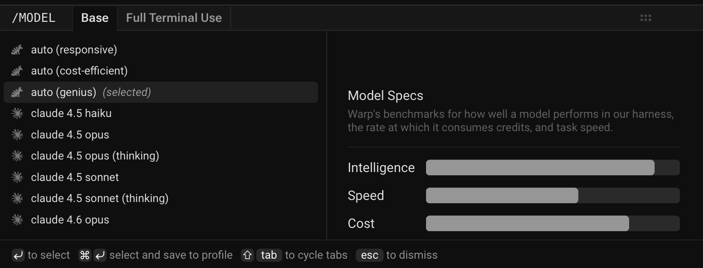

import { VARS } from '@data/vars';

Choose a model for your agents, use Auto for dynamic selection, or define a [custom router](/agents/inference/custom-routers/). Models support reasoning levels and per-profile defaults.

## Available models

The `model_id` values shown below can be used when configuring models via the [{VARS.WARP_AUTOMATION_PLATFORM}](/platform/overview/) or [CLI](/agents/cli/oz-cli/).

### Auto models

| Model | `model_id` | Description |
| --- | --- | --- |
| Auto (Responsive) | `auto` | Selects the highest-quality, fastest available model. Can cost more than cost-efficient options. |
| Auto (Cost-efficient) | `auto-efficient` | Optimizes for lower inference cost while maintaining output quality. |
| Auto (Genius) | `auto-genius` | Adapts to task complexity and selects Warp's most capable model when it's worth it. Best for deep debugging, architecture decisions, and `/plan` sessions. |
| Auto (Open-weights) | `auto-open` | Routes between the best open-source models available in Warp. Optimizes for low cost and fast speed using open-weights models. |

#### OpenAI

The `low`, `medium`, `high`, `xhigh`, and `max` suffixes select increasing reasoning levels.

| Model | Supported `model_id` values |
| --- | --- |
| GPT-6 Astra | `gpt-6-astra-low`, `gpt-6-astra-medium`, `gpt-6-astra-high`, `gpt-6-astra-xhigh`, `gpt-6-astra-max` |
| GPT-6.1 Sol | `gpt-6-1-sol-low`, `gpt-6-1-sol-medium`, `gpt-6-1-sol-high`, `gpt-6-1-sol-xhigh`, `gpt-6-1-sol-max` |
| GPT-6.1 Terra | `gpt-6-1-terra-low`, `gpt-6-1-terra-medium`, `gpt-6-1-terra-high`, `gpt-6-1-terra-xhigh` |
| GPT-6 Sol | `gpt-6-sol-low`, `gpt-6-sol-medium`, `gpt-6-sol-high`, `gpt-6-sol-xhigh`, `gpt-6-sol-max` |
| GPT-6 Luna | `gpt-6-luna-low`, `gpt-6-luna-medium`, `gpt-6-luna-high`, `gpt-6-luna-xhigh`, `gpt-6-luna-max` |
| GPT-5.6 Sol | `gpt-5-6-sol-low`, `gpt-5-6-sol-medium`, `gpt-5-6-sol-high`, `gpt-5-6-sol-xhigh` |
| GPT-5.6 Terra | `gpt-5-6-terra-low`, `gpt-5-6-terra-medium`, `gpt-5-6-terra-high`, `gpt-5-6-terra-xhigh` |
| GPT-5.6 Luna | `gpt-5-6-luna-low`, `gpt-5-6-luna-medium`, `gpt-5-6-luna-high`, `gpt-5-6-luna-xhigh` |
| GPT-5.5 | `gpt-5-5-low`, `gpt-5-5-medium`, `gpt-5-5-high`, `gpt-5-5-xhigh` |
| GPT-5.4 | `gpt-5-4-low`, `gpt-5-4-medium`, `gpt-5-4-high`, `gpt-5-4-xhigh` |

To use eligible OpenAI models through your ChatGPT plan, [connect a ChatGPT subscription](/agents/inference/chatgpt-subscription/) and select a specific OpenAI model.

#### Anthropic

Suffixes select effort level. `xhigh-fast` enables fast mode, and `thinking` enables thinking. The default ID for each family is listed separately where one exists.

| Model | Supported `model_id` values | Default `model_id` |
| --- | --- | --- |
| Claude Opus 5.5 | `claude-5-5-opus-low`, `claude-5-5-opus-medium`, `claude-5-5-opus-high`, `claude-5-5-opus-xhigh`, `claude-5-5-opus-xhigh-fast`, `claude-5-5-opus-max` | `claude-5-5-opus-high` |
| Claude Opus 5 | `claude-5-opus-low`, `claude-5-opus-medium`, `claude-5-opus-high`, `claude-5-opus-xhigh`, `claude-5-opus-xhigh-fast`, `claude-5-opus-max` | `claude-5-opus-high` |
| Claude Fable 5.2 | `claude-5-2-fable-low`, `claude-5-2-fable-medium`, `claude-5-2-fable-high`, `claude-5-2-fable-xhigh`, `claude-5-2-fable-max` | Choose an effort-specific ID |
| Claude Fable 5.1 | `claude-5-1-fable-low`, `claude-5-1-fable-medium`, `claude-5-1-fable-high`, `claude-5-1-fable-xhigh`, `claude-5-1-fable-max` | `claude-5-1-fable-high` |
| Claude Fable 5 | `claude-5-fable-low`, `claude-5-fable-medium`, `claude-5-fable-high`, `claude-5-fable-xhigh`, `claude-5-fable-max` | `claude-5-fable-high` |
| Claude Sonnet 5.5 | `claude-5-5-sonnet-low`, `claude-5-5-sonnet-medium`, `claude-5-5-sonnet-high`, `claude-5-5-sonnet-xhigh`, `claude-5-5-sonnet-max` | `claude-5-5-sonnet-xhigh` |
| Claude Sonnet 5 | `claude-5-sonnet-low`, `claude-5-sonnet-medium`, `claude-5-sonnet-high`, `claude-5-sonnet-xhigh`, `claude-5-sonnet-max` | `claude-5-sonnet-xhigh` |
| Claude Opus 4.8 | `claude-4-8-opus-low`, `claude-4-8-opus-medium`, `claude-4-8-opus-high`, `claude-4-8-opus-xhigh`, `claude-4-8-opus-xhigh-fast`, `claude-4-8-opus-max` | `claude-4-8-opus-xhigh` |
| Claude Opus 4.7 | `claude-4-7-opus-high`, `claude-4-7-opus-xhigh`, `claude-4-7-opus-max` | `claude-4-7-opus-xhigh` |
| Claude Opus 4.6 | `claude-4-6-opus-high`, `claude-4-6-opus-max` | `claude-4-6-opus-high` |
| Claude Sonnet 4.6 | `claude-4-6-sonnet-high`, `claude-4-6-sonnet-max` | `claude-4-6-sonnet-high` |
| Claude Opus 4.5 | `claude-4-5-opus`, `claude-4-5-opus-thinking` | `claude-4-5-opus` |
| Claude Sonnet 4.5 | `claude-4-5-sonnet`, `claude-4-5-sonnet-thinking` | `claude-4-5-sonnet` |
| Claude Haiku 5.5 | `claude-5-5-haiku-low`, `claude-5-5-haiku-medium`, `claude-5-5-haiku-high`, `claude-5-5-haiku-xhigh`, `claude-5-5-haiku-max` | — |
| Claude Haiku 4.5 | `claude-4-5-haiku` | `claude-4-5-haiku` |

Claude Haiku 5.5 has no fixed default `model_id`; choose one of its effort-specific IDs.

:::caution
Some Anthropic models require provider retention even when analytics is off. Check [models requiring provider retention](#models-requiring-provider-retention) before selecting a model.
:::

#### Google

| Model | `model_id` |
| --- | --- |
| Gemini 4 Argon | `gemini-4-argon` |
| Gemini 3.1 Pro | `gemini-3.1-pro` |
| Gemini 3.8 Flash | `gemini-3.8-flash` |
| Gemini 3.7 Flash | `gemini-3.7-flash` |
| Gemini 3.6 Flash | `gemini-3.6-flash` |
| Gemini 3.5 Flash | `gemini-3.5-flash` |

#### xAI

| Model | `model_id` | Reasoning Level |
| --- | --- | --- |
| Grok 4.7 | `grok-4-7-low` | Low |
| Grok 4.7 | `grok-4-7-medium` | Medium |
| Grok 4.7 | `grok-4-7-high` | High |
| Grok 4.7 | `grok-4-7-xhigh` | Extra High |
| Grok 4.6 | `grok-4-6-low` | Low |
| Grok 4.6 | `grok-4-6-medium` | Medium |
| Grok 4.6 | `grok-4-6-high` | High |
| Grok 4.6 | `grok-4-6-xhigh` | Extra High |
| Grok 4.5 | `grok-4-5-low` | Low |
| Grok 4.5 | `grok-4-5-medium` | Medium |
| Grok 4.5 | `grok-4-5-high` | High |
| Grok 4.3 | `grok-4-3-low` | Low |
| Grok 4.3 | `grok-4-3-medium` | Medium |
| Grok 4.3 | `grok-4-3-high` | High |
| Grok Build 0.1 | `grok-build-0.1` | — |

To use eligible Grok models without Warp-provided inference charges, connect your xAI account. See [SuperGrok subscription](/agents/inference/grok-subscription/) for setup and other applicable charges.

#### Hosted models (via [Fireworks AI](https://fireworks.ai))

| Model | `model_id` |
| --- | --- |
| GLM 5.3 | `glm-5.3-fireworks` |
| GLM 5.3 Flash | `glm-5.3-flash-fireworks` |
| Kimi K3 | `kimi-k3-fireworks` |
| Minimax 3 | `minimax-3-fireworks` |
| Qwen 3.8 Max | `qwen-3.8-max-fireworks` |
| DeepSeek V4.1 Flash | `deepseek-v4.1-flash-fireworks` |

### How to change models

In the Warp app's prompt input, click the displayed model name and choose a model. The selection persists for future prompts.

<figure>

<figcaption>Model selector in Warp's input.</figcaption>
</figure>

### Custom routers

Beyond the built-in Auto models, you can define your own custom routers that automatically route each task to a concrete model based on task complexity or rules you write. Custom routers appear in the model picker alongside Auto and individual models.

Add and manage custom routers in **Settings** > **Agents** > **Warp Agent** > **Custom Routers**. See [Custom routers](/agents/inference/custom-routers/) for details on creating one.

### Model fallback

If your selected model is unavailable, Warp uses a fallback from a predefined chain with comparable quality and capabilities. Warp switches back when the selected model becomes available.

### Configuring models per Agent Profile

You can configure the base model for each [Agent Profile](/agents/capabilities/agent-profiles-permissions/), alongside the Agent's autonomy, tool access, and other permissions. The base model is also used for [Planning](/agents/capabilities/planning/).

Edit your default profile or any other profile directly in **Settings** > **Agents** > **Profiles**.

### Reviewing inference and privacy in Terminal

To use inference covered by provider ZDR, review the model and its inference source before sending sensitive content:

1. In the Warp app's prompt input, click the current model name. Choose a Warp-managed model that isn't in the [provider-retention exception list](#models-requiring-provider-retention). If you use Auto, review [automatic selection and fallback](#zero-data-retention-policies); Auto isn't a pinned model.
2. In the Warp app, open **Settings** > **Agents** > **Profiles** and review the active profile's base model. If you use a [custom router](/agents/inference/custom-routers/), review every target and its default model, not only the router's name.
3. In **Settings** > **Agents** > **Warp Agent**, review personal keys, endpoints, and connected subscriptions, and check any [team-managed configuration](/enterprise/enterprise-features/team-managed-keys-and-endpoints/). Search Settings for `API keys` to find personal inference controls. For customer-managed inference, verify provider ZDR for the specific account, model, and configuration. Review [BYOK fallback](/agents/inference/bring-your-own-api-key/#failover-and-fallback-behavior) if enabled.
4. In **Settings** > **Privacy**, toggle off **Help improve Warp** if you don't want analytics and improvement collection. Review **Send crash reports** and **Store AI conversations in the cloud** separately. The storage toggle controls [personal Terminal conversation sync](/agents/local-agents/cloud-conversations/), not factory run storage.

Before sending the next prompt, confirm the intended model is displayed in the input. Recheck these choices when switching profiles, models, or inference providers. For cloud factory runs, use the [factory review procedure](/factories/factory-agents/configuration/#reviewing-inference-for-provider-zdr) instead.

### Zero data retention policies

Warp's provider Zero Data Retention (ZDR) agreements cover Warp-managed inference on all plans, in both Terminal and factory runs, except for the models listed below. Provider ZDR concerns prompts and responses at the inference provider; it doesn't disable [Warp analytics or product storage](/enterprise/security-and-compliance/security-overview/#what-telemetry-does-warp-collect-and-why).

Auto selects models dynamically, and [fallback](#model-fallback) can change the model serving a request. A primary model selection isn't a complete inventory of auxiliary inference, such as Computer Use or Scorers. Review the applicable [factory configuration](/factories/factory-agents/configuration/#reviewing-inference-for-provider-zdr) as well.

#### Models requiring provider retention

Anthropic requires retention for these models, including their effort variants, for safety, abuse monitoring, and compliance:

* Claude Fable 5
* Claude Fable 5.1
* Claude Fable 5.2

These models aren't covered by provider ZDR even when **Help improve Warp** is off. For Enterprise teams, they are disabled by default and a workspace admin must enable them in the [Admin Panel](/enterprise/team-management/admin-panel/#models-settings). Don't rely on Enterprise defaults as a self-serve model restriction.

For your own keys, endpoints, subscriptions, or direct Claude Code and Codex calls, verify ZDR with the provider for your specific account, model, and configuration rather than applying Warp's agreements to that traffic.
