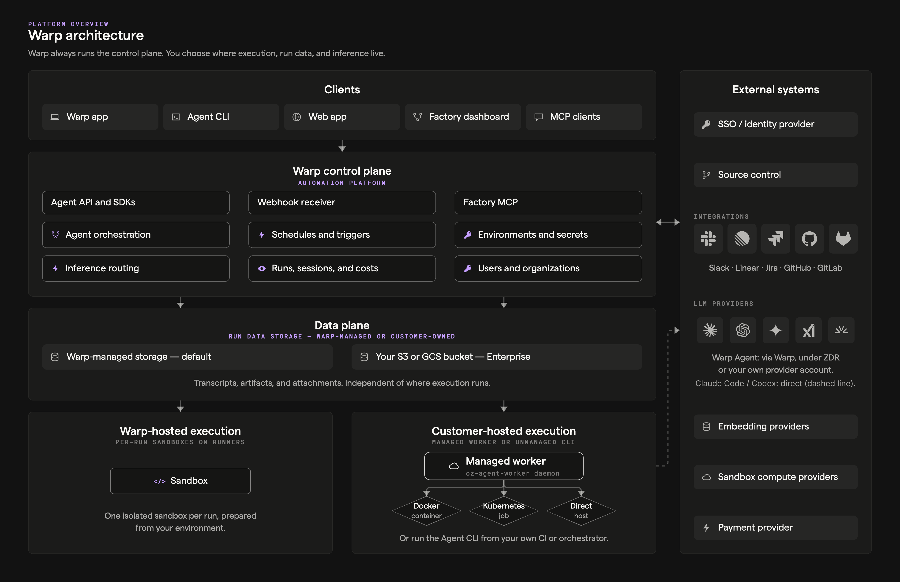
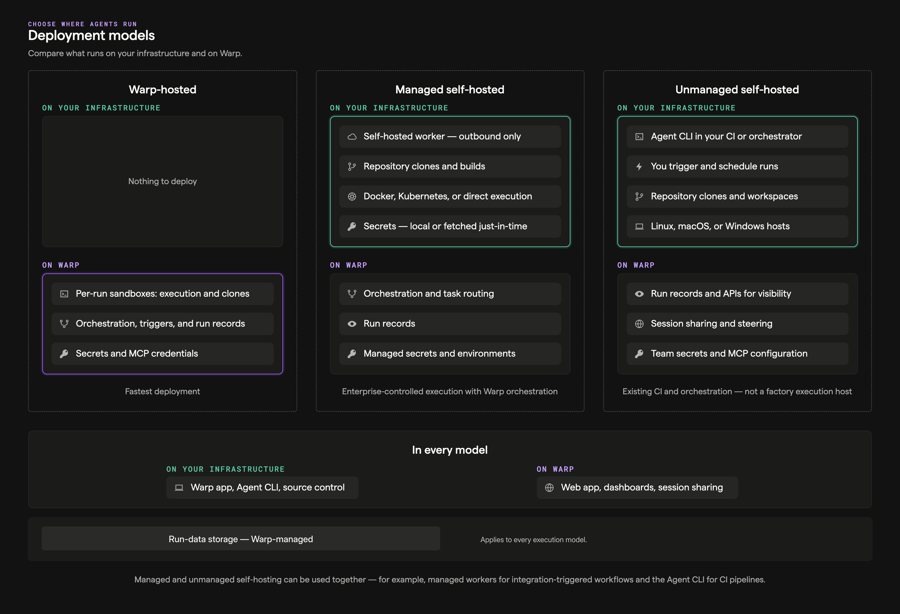

import { VARS } from '@data/vars';

Warp's architecture separates the **control plane** (orchestration, observability, and LLM inference) from the **execution plane** (where agents run, code is accessed, and commands execute). This separation gives enterprise teams flexibility to choose where sensitive workloads run while maintaining centralized management and visibility.

Use this information to evaluate which deployment model fits your organization's security, compliance, and operational requirements.

## System architecture overview

Warp's cloud agent infrastructure has four key components:

1. **Trigger** - What starts an agent run (CI step, webhook, cron schedule, Slack mention, CLI command, or API/SDK call).
2. **Orchestration** - What decides what to run and tracks it ({VARS.WARP_AUTOMATION_PLATFORM} orchestrator or your own system).
3. **Execution** - Where the agent actually runs (Warp-hosted environment, your infrastructure, or your existing CI/orchestrator).
4. **Visibility** - How the team monitors and intervenes ({VARS.DASHBOARD}, session sharing, APIs/SDKs).

The [stack overview](/platform/architecture/#stack-overview) reference describes each component in this diagram.

### High-level data flow

* **Warp terminal (client)** ↔ **Warp backend (control plane)** ↔ **LLM providers**
* The Warp backend handles task orchestration, observability, and LLM inference routing.
* What your AI provider retains depends on the [model and provider account you use](/support-and-community/privacy-and-security/privacy/#zero-data-retention-zdr), not where the agent runs.
* The **execution plane** is where source code is accessed, commands run, and build artifacts are produced. This can run on Warp's infrastructure or yours.

## Warp-hosted (SaaS)

Warp-hosted is the default deployment model. Agents run on Warp-managed infrastructure with no setup required from your team.

### How it works

* Agents execute in **isolated Docker containers** on Warp-hosted infrastructure (GCP).
* The {VARS.WARP_AUTOMATION_PLATFORM} orchestrator manages agent lifecycle - provisioning, execution, monitoring, and cleanup.
* Environments are ephemeral and destroyed after each run.

### Triggers

Warp-hosted agents can be triggered by:

* **First-party integrations** - Slack, Linear, and other connected tools
* **Scheduled agents** - Cron-like automation for recurring work
* **CLI** - `oz agent run-cloud` for on-demand cloud execution
* **API/SDK** - Programmatic triggers from your own systems

### When to use

* You want the simplest path to scalable cloud agent execution.
* You need to run many tasks in parallel without building sandboxing infrastructure.
* Your security requirements permit Warp-hosted compute after a separate review of [inference and storage](/factories/zero-data-retention/).

## Self-hosted execution

For organizations that need repository checkouts and command execution on their own infrastructure, Warp supports self-hosted execution. Prompts and run records can still include code from your repository and pass through Warp's servers.

:::note
Self-hosted execution is available exclusively on Warp's **Enterprise** plan.
:::

### Split architecture

Self-hosted deployments use a split architecture:

* **Execution plane (customer-hosted)** - Repository checkouts, commands, and workspaces stay on your infrastructure. Code context, tool output, and uploaded files can still become prompts or stored run data (see [What transits Warp's servers](#what-transits-warps-servers)).
* **Control plane (Warp-hosted)** - Warp coordinates runs and sends the Warp Agent's model requests to the configured provider. See [What transits Warp's servers](#what-transits-warps-servers) for the data it receives.

### Deployment modes

**Unmanaged** - Use `oz agent run` to run agents in your existing orchestrator or CI environment. Supports Linux, macOS, and Windows with no Docker dependency.

* Best for teams that already have CI/CD infrastructure or internal orchestrators.
* You control scheduling, scaling, and environment setup.
* Warp provides cloud connectivity, shared context, visibility, and session sharing.

**Managed** - Run the `oz-agent-worker` daemon to let Warp orchestrate agents in isolated Docker containers on your infrastructure.

* The worker process connects to the {VARS.WARP_AUTOMATION_PLATFORM} via WebSocket and receives tasks automatically.
* Agents run in isolated Docker containers managed by the worker.
* You get the same orchestration capabilities as Warp-hosted, but execution stays on your infrastructure.

### Network requirements

Self-hosted agents require **outbound-only** network access. No inbound network access is required.

**Egress requirements:**

* Outbound access to Warp's backend services (for orchestration and observability)
* For managed mode: access to Docker Hub and GitHub (for container images and repository access)

### When to use

* Compliance or security requirements prevent using Warp-hosted compute.
* You need to keep repository checkouts on your infrastructure while allowing prompts and run records that include code to pass through Warp's servers.

## Hybrid deployments

Organizations can combine Warp-hosted and self-hosted execution to balance convenience with security requirements.

### How it works

* Route sensitive workloads (e.g., production code, regulated data) to self-hosted agents.
* Route less sensitive workloads (e.g., open-source tooling, internal utilities) to Warp-hosted agents.
* Both execution modes share the same {VARS.DASHBOARD}, session sharing, and API/SDK visibility.

### Example configurations

* **By sensitivity** - Production repositories run on self-hosted agents; staging and development run on Warp-hosted.
* **By team** - Security-sensitive teams (e.g., infrastructure, payments) use self-hosted; other teams use Warp-hosted.
* **By task type** - Scheduled maintenance tasks run on Warp-hosted; ad-hoc debugging runs self-hosted in dev environments.

## Data flow and boundaries

Understanding what data stays where is critical for security and compliance decisions.

### What stays on customer infrastructure (self-hosted)

* **Source code** - Repository checkouts and version history remain on your infrastructure. Code excerpts can still appear in prompts and transcripts.
* **Build artifacts** - Compiled outputs and generated files unless uploaded as run artifacts
* **Shell commands** - Commands run on your infrastructure. Their output can appear in stored transcripts.
* **Runtime secrets** - Environment variables and credentials
* **Execution logs** - Runtime logs remain on your infrastructure unless uploaded as diagnostics or included in run records.

### What transits Warp's servers

* **Task orchestration** - Scheduling, routing, and lifecycle management
* **Observability data** - Run status, duration, and metadata
* **LLM inference** - The Warp Agent routes prompts and responses through Warp to the configured provider. Claude Code and Codex call their providers directly.
* **Run data** - Transcripts, prompt attachments, and uploaded artifacts remain stored after the execution workspace is removed. Enterprise admins can configure where this data is stored through [self-hosted agent data storage](/factories/self-hosting/data-storage/).
* **Session sharing data** - Live session sharing has its own [retention and access rules](/agents/local-agents/session-sharing/#data-retention-and-access)

## Choosing a deployment model

Consider the following when selecting a deployment model:

**Warp-hosted** is right if:
* You want zero infrastructure management for agent execution.
* Your security requirements permit Warp-hosted compute.
* You need maximum parallelization and scalability.

**Self-hosted** is right if:
* Compliance requirements mandate repository checkouts and command execution on your infrastructure while allowing prompts and stored run records to include code.
* You need to integrate with existing CI/CD or infrastructure tooling.
* You want full control over the execution environment.

**Hybrid** is right if:
* Different teams or repositories have different security requirements.
* You want the convenience of Warp-hosted for most work but need self-hosted for sensitive workloads.

## Related pages

* [Architecture reference](/platform/architecture/) - Diagrams of the stack, the run lifecycle, self-hosted execution, and data boundaries
* [Deployment Patterns](/factories/deployment-patterns/) - Detailed patterns for CLI-only, {VARS.WARP_AUTOMATION_PLATFORM}-hosted, and self-hosted setups
* [Private networking](/enterprise/enterprise-features/private-networking/) - Connect private LLM gateways and MCP servers to Warp-hosted services
* [Security overview](/enterprise/security-and-compliance/security-overview/) - Data handling, encryption, and compliance details
* [Bring Your Own LLM](/enterprise/enterprise-features/bring-your-own-llm/) - Route inference through your own cloud infrastructure
* [Admin Panel](/enterprise/team-management/admin-panel/) - Configure agent policies and security settings
* [Contact sales](https://www.warp.dev/contact-sales) - Discuss deployment options for your organization
