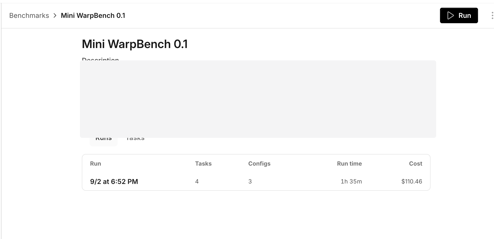
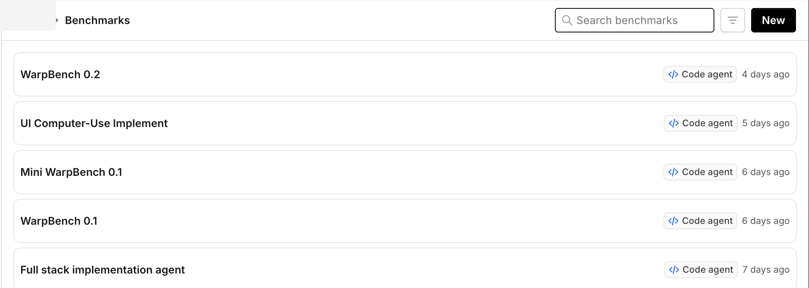
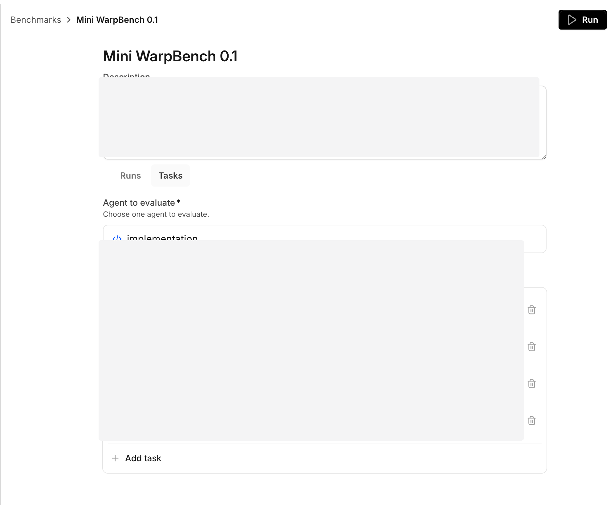
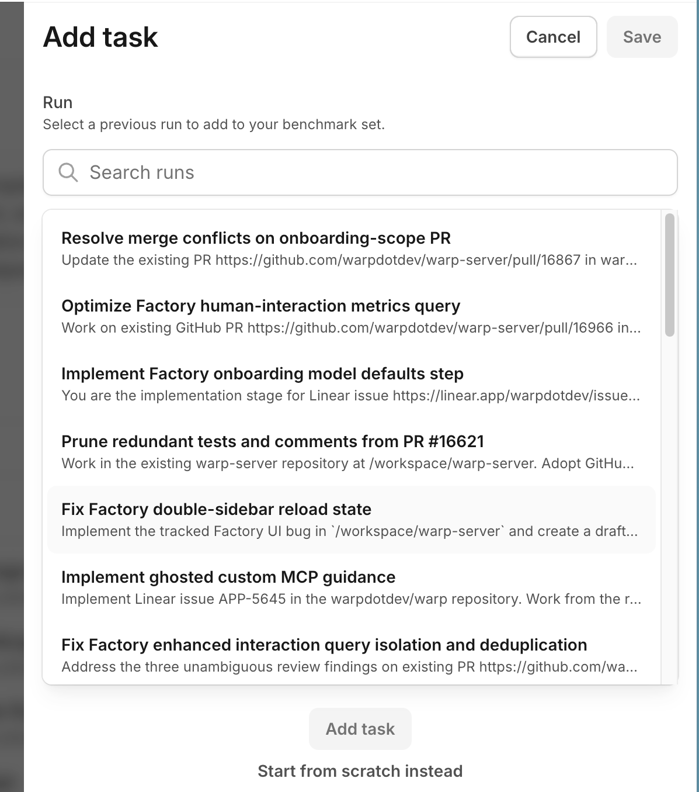
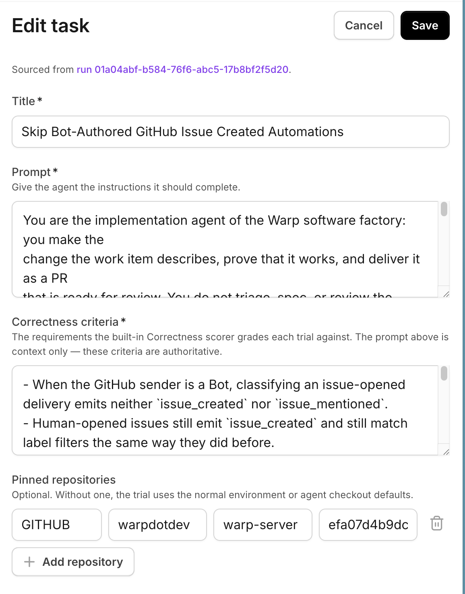
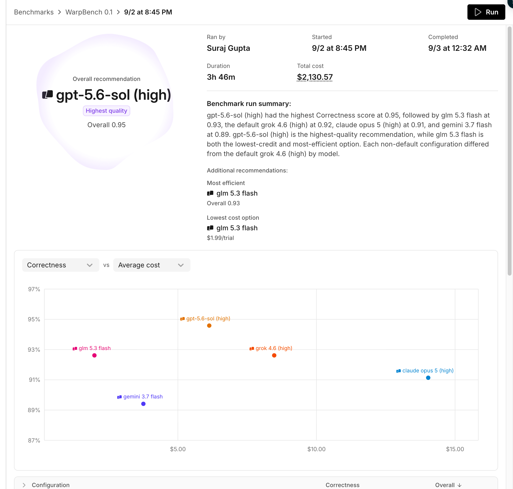
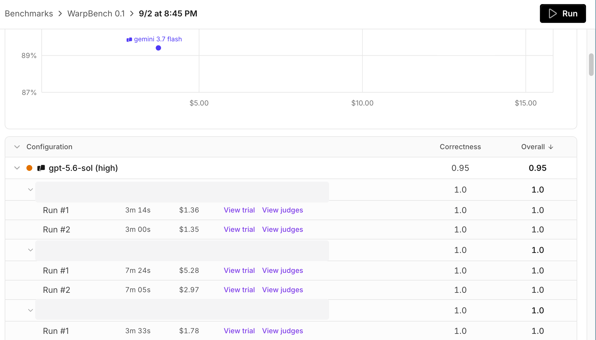

import { VARS } from '@data/vars';
import VideoEmbed from '@components/VideoEmbed.astro';

Warp Factories benchmarks compare configurations for an agent or Blueprint stage on the same fixed tasks. Test a model, harness, runner, or definition-branch change before you apply it to your factory.

This video shows how to compare benchmark results for quality and cost before changing a coding agent's configuration.

<VideoEmbed url="https://www.youtube.com/watch?v=LKx5MeUsptQ" title="Comparing factory benchmark results to reduce coding agent costs" />

## How benchmarks work

A benchmark suite is a reusable collection of tasks with one evaluation target:

* **Agent** - Run each task as the selected factory agent.
* **Stage** - For a factory with a [Blueprint](/factories/blueprints/), enter the selected stage directly and stop when it completes, rather than continuing through the rest of the workflow.

Each task has a prompt and "Correctness criteria," which tell the built-in Correctness Scorer what a successful trial must do. A trial executes one task under one configuration. Repetitions create additional trials.

When you launch a suite, choose the configurations, Scorers, and repetitions to compare. Warp runs the trials, then scores trials that reach a terminal state. A blocked trial remains **Blocked**, but Warp can score the evidence it produced; each Scorer decides whether that evidence satisfies its criteria. The run keeps those inputs, so later changes to the suite do not change its past results.

<figure style={{ maxWidth: "563px" }}>

<figcaption>The Runs tab for a benchmark suite.</figcaption>
</figure>

Use separate suites for focused questions:

* **Factory default** - Compare models and runners to choose the default configuration for a coding agent.
* **Frontend changes** - Compare configurations on representative frontend tasks before applying one to that workflow.

## Create and run a benchmark

To use Benchmarks, you need access to a factory and permission to edit its benchmarks and launch runs. Write representative tasks yourself, or use [completed runs](#create-tasks-from-completed-runs) to capture real work.

This video shows how to turn your team's coding tasks into a reusable benchmark suite.

<VideoEmbed url="https://www.youtube.com/watch?v=mojpQjwBXN0" title="Creating a model benchmark from your team's coding tasks" />

1. In the <a href={VARS.FACTORY_WEB_APP_URL}>{VARS.FACTORY_WEB_APP}</a>, open your factory, click **Benchmarks**, then click **New**.

   <figure style={{ maxWidth: "563px" }}>
   
   <figcaption>The Benchmarks page for a factory.</figcaption>
   </figure>

2. Enter a name and optional description. Choose the agent to evaluate, or choose **Stage** and select a Blueprint stage.

   <figure style={{ maxWidth: "563px" }}>
   
   <figcaption>The benchmark editor with a selected agent.</figcaption>
   </figure>

3. Click **Add task**. Warp saves the benchmark, then opens task setup.
4. Click **Start from scratch instead** to write a task.

   <figure style={{ maxWidth: "375px" }}>
   
   <figcaption>The task source picker.</figcaption>
   </figure>

5. Enter a unique task title, prompt, and "Correctness criteria." Optionally pin the task's repositories to [exact commits](/factories/factory-as-code/#startingreporefs). Click **Save**.

   <figure style={{ maxWidth: "375px" }}>
   
   <figcaption>The task editor for a benchmark suite.</figcaption>
   </figure>

6. Click **Run**. Under "Setups," configure each comparison independently:
   - Leave "Factory branch" blank to use production with the harness, model or authorized custom router, and runner you choose.
   - Enter a definition branch to use that branch's full definition, including its harness, model, runner, and workers. Manual execution overrides do not combine with a branch selection.
   - Click **Add setup** to add another configuration. For example, compare production with a branch that changes the review agent's instructions.
7. Select additional Scorers and set "Repetitions." Correctness is always included. The dialog shows the number of trials created. More trials and Scorers increase the run's cost.
8. For manual Warp-hosted setups, choose a compatible team-owned secret under "Harness credentials" if your harness requires credentials. Setups using the same harness share one selected credential. Self-hosted configurations use credentials from their worker environment.
9. Click **Run benchmark**. The benchmark page shows its status and scored trials. You can cancel a running or scoring benchmark.

Repeat launches can reuse a previous run's recorded settings. Review the selections before launching: a model, runner, or credential may no longer be available, and Scorer eligibility is checked against the current factory.

### Configure the Correctness judge

In the suite's configuration, use "Correctness scorer" to override "Judge model" or "Runner." These settings control the judge that evaluates task results, not the agent under test. Click **Reset to default** beside an override to use the inherited setting again. Definitions as code use [`correctnessScorer`](/factories/factory-as-code/#correctnessscorer).

### Create tasks from completed runs

For a repository-backed factory definition, open a completed factory run's menu and click **Add to benchmark**. Choose an existing suite, then click **Add task**. The foreman authors a benchmark task for review in the definition repository, rather than inserting it immediately. Review its prompt, correctness criteria, and starting commits before merging.

Alternatively, in a suite's **Add task** picker, select completed runs and click **Add task** to start the same authoring workflow.

## Review benchmark results

After the run completes, review the result as a comparison, not as a universal model ranking.

<figure style={{ maxWidth: "736px" }}>

<figcaption>A completed benchmark result and comparison chart.</figcaption>
</figure>

* **Overall recommendation** - Identifies the highest-quality configuration when at least two configurations have comparable results.
* **Additional recommendations** - Highlight the most efficient and lowest-cost configurations when the result supports those comparisons.
* **Comparison chart** - Compare the selected result dimensions across configurations.
* **Overall table** - Compare each Scorer's average and the combined Overall value. Expand a configuration, task, and repetition to inspect its individual trials.
* **Scorer grids** - Show each task's results across configurations for a selected Scorer.

<figure style={{ maxWidth: "736px" }}>

<figcaption>Expanded trial results for a configuration.</figcaption>
</figure>

The run's "Total cost" includes trials and Scorer usage. Reported costs combine billed Warp inference, compute, and platform usage with available estimates for externally billed inference. Use them to compare configurations, not reconcile invoices; historical estimates and missing external costs can affect the comparison. See [charges and estimates](/support-and-community/plans-and-billing/credits/#charges-and-estimates).

Read averages and totals as different measurements:

* **Configuration averages** - Average cost and duration use the final attempts of trials whose execution succeeded, including trials that failed Correctness or have no score yet.
* **Totals** - Trial and configuration cost totals include retries and failed work. A trial's total duration also includes its retry attempts. "Run time" is not billable active agent time.
* **Benchmark elapsed time** - Includes scoring, unlike trial execution time.
* **Missing measurements** - Unavailable usage or scores are not zero.

A failed or cancelled benchmark shows only results that finished scoring before the run stopped.

### Recover missing scores

An execution failure means the trial did not finish its work. A scoring error means a judge could not return a result; it is not a failing quality verdict. Check coverage warnings before comparing configurations, because plotted scores can be based on incomplete results.

For a completed benchmark with finished work that remains unscored, open the run's three-dot menu next to **Run** and click **Rescore missing scores**. Click **Confirm rescore** to retry scoring without rerunning completed trials.

## Apply a benchmark result

Change one configuration at a time. If the evidence supports a candidate, update the agent's model or runner in the factory dashboard, or submit the change through your [factory definition](/factories/factory-as-code/). Keep the relevant Scorers active, then compare later production runs with the baseline you recorded before the change.

For version-controlled factories, define reusable suites in `benchmarks/<suite-slug>/suite.yaml` and their tasks in `benchmarks/<suite-slug>/tasks/<task-slug>.yaml`. See [benchmark suite files](/factories/factory-as-code/#benchmarkssuite-slugsuiteyaml).

To manage suites, tasks, runs, trials, and results programmatically, use the [benchmark API reference](/api#tag/factory-benchmarks).

## Related pages

* [Measure and improve a factory](/factories/measure-and-improve/) - Configure Scorers and use benchmark evidence in an improvement loop
* [Factory dashboard](/factories/factory-dashboard/) - Track factory work, runs, and benchmark suites
* [Factory definition syntax](/factories/factory-as-code/) - Define factories and benchmark suites as code
