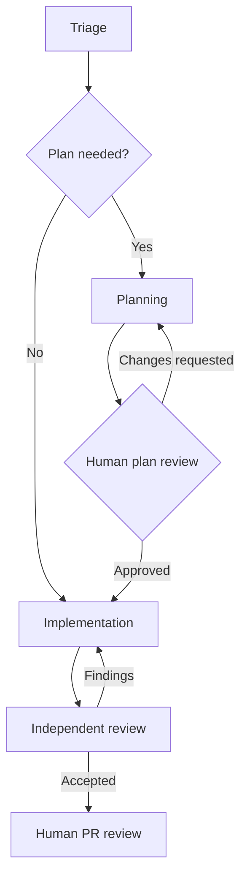

A Blueprint defines how a factory handles work. In Warp Factories, you use it to choose the stages a request goes through, the agent that runs each stage, and the decisions that need a person.

{/* VERIFY: Confirm public Blueprint availability and access requirements before publishing this page and its linked workflow. */}

For example, your issue-to-PR workflow can send a well-defined bug directly to implementation, require an approved plan for an API change, and return review findings to the same implementation conversation. You configure those paths rather than rely on a single foreman prompt to describe the whole process.

## Stages, workers, and routes

* **Stage** - A unit of work with its own instructions, inputs, and outputs. A review stage can require findings against a particular PR head. See [Defining Blueprint stages](/factories/blueprints/stages/).
* **Worker** - The configured agent that runs a stage. The same implementation agent can handle the first change and later revisions. See [About factory agents](/factories/factory-agents/).
* **Route** - A condition that selects what happens next. Review findings can return to implementation; accepted work can move to handoff. See [Routing work between Blueprint stages](/factories/blueprints/routes/).
* **Gate** - A question that pauses a stage for a person. A plan-review gate can accept approval or requested changes, with different routes for each answer. See [Adding human gates to a Blueprint](/factories/blueprints/gates/).

The Blueprint lives in `factory.yaml`. Each stage names a worker from the factory's agent definitions. A stage named `planning` might use the `spec` agent; another stage might use that same agent for a different procedure.

## What changes for your agents

The Blueprint supplies the stage procedures, handoffs, route conditions, and gates. Its workflow takes precedence over stage lists or delegation orders in other prompts. When you change the review loop, edit the Blueprint rather than maintain a second routing procedure in the foreman's instructions.

Agent instructions still define behavior that applies across the agent's work. Skills still supply reusable procedures, such as the repository's test commands. Models, harnesses, runners, tools, and access remain in the [agent configuration](/factories/factory-agents/configuration/).

The foreman drives the top-level workflow and communicates with you. It gathers a stage's inputs from the request and earlier results, runs its own stages in its conversation, and dispatches other stages to their workers. A dispatched worker follows the named stage, reports its outputs, and stops. The foreman uses that result to choose the next route.

A stage can also contain a group of stages, driven by its assigned worker. That worker handles the group's internal handoffs and returns the group's result to the foreman. You can start with a flat workflow and group related work when it needs a separate coordinator.

## How a request moves through a Blueprint

The worker driving a workflow evaluates its entry conditions in order and takes the first match. After a stage finishes, it evaluates that stage's outgoing conditions. Write conditions in prose that refers to the request, the stage's outputs, or a gate's answer.

An issue-to-PR workflow might use these routes:

The route order matters; the order you declare stages does not. If no condition fits, the worker asks for the missing decision instead of silently finishing. A follow-up resumes the stage it concerns rather than repeating intake.

## Gates ask for answers, not automatic approval

You choose what question a gate asks, which answers satisfy it, and when it opens. For a plan review, “changes requested” answers the question but sends the plan back for revision; it does not approve implementation.

Gates and prompts guide the workflow. They do not enforce repository permissions. Use repository rules and branch protection to control who can approve and merge a PR. Agent review is advisory, and a passing run does not replace your review of the diff and verification results.

## Definition changes and work already running

A new run uses the applied Blueprint selected when that run starts. Editing the current definition does not reroute an existing run, and follow-ups to that run retain its Blueprint. Start separate work after applying a definition change to test the new workflow.

## When to use a Blueprint

Use a Blueprint when you need to change and review a standing workflow: which requests need a plan, what independent review checks, or when an owner must answer. Keep the procedures and routing under version control, then test a changed definition on new work before using it more broadly.

For a single ad-hoc coding request, a standalone agent can be enough. You do not need to create a factory or put every request through a full software-development lifecycle.

## Related pages

* [Running an issue-to-PR Blueprint](https://docs.warp.dev/guides/agent-workflows/running-an-issue-to-pr-blueprint/) - Configure a workflow and review its result
* [Factory definition syntax](/factories/factory-as-code/#blueprint) - Look up the configuration fields
* [Configuring factory agents](/factories/factory-agents/configuration/) - Choose worker resources and shared instructions
