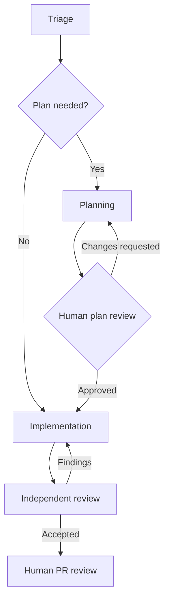

A Blueprint defines a factory's workflow: the stages of work, the agent that runs each stage, the routes between stages, and the questions that need your answer. In Warp Factories, you configure that workflow separately from the workers' models, tools, and repository access.

{/* VERIFY: Confirm public Blueprint availability and access requirements before publishing this page and its linked workflow. */}

:::caution
Draft: Blueprint availability and the worked example still need verification before publication.
:::

For example, an issue-to-PR Blueprint can require a plan for an ambiguous request, wait for your approval, then send the implementation through independent review. A small, well-defined change can take a shorter route through the same workflow.

## Stages, workers, and routes

* **Stage** - A named part of the workflow, such as planning or implementation. Its instructions describe the work to do, the inputs to use, and the outputs to return.
* **Worker** - The agent assigned to a stage. Agent definitions still select execution settings and tools; a Blueprint does not replace them or grant permissions.
* **Route** - A possible next stage, selected from conditions you write in prose. A route can return to an earlier stage for a revision.
* **Gate** - A named decision point that pauses a stage until you supply the requested answer.

Stage names and agent names are separate. A stage named `planning` can use the `spec` agent, while another stage uses the foreman itself.

The [definition syntax](./factory-as-code/#blueprint) shows how these parts fit together in `factory.yaml`. Inputs and outputs are instructions for agents, not typed schemas that Warp checks for completeness.

## Who does what

You choose the stages, workers, instructions, route conditions, and gates. You also configure repository access and credentials separately, answer questions, and decide whether to accept the result.

The foreman drives the workflow and communicates with you. It gathers a stage's inputs from your request and earlier results, runs stages assigned to itself in its own conversation, and delegates stages assigned to other workers. It collects their outputs before selecting the next route.

A delegated stage worker performs the assigned work and reports its outputs to the foreman. It does not choose the next stage. If it needs your input, it sends the question through the foreman.

## How a request moves through a Blueprint

The foreman evaluates entry conditions in their listed order and takes the first match. After a stage finishes, it does the same with that stage's outgoing conditions. These are agent judgments about prose, not Boolean expressions evaluated by a rules engine. If no condition fits, the foreman asks for the missing decision instead of silently finishing.

An issue-to-PR workflow might use these routes:

The routes, not the order of stage declarations, decide what runs. Feedback on a draft PR returns to implementation and review rather than repeating intake.

## Gates ask for answers, not automatic approval

A conditional gate opens when its `when` condition holds during the work. A gate without `when` opens after the stage's work is done. The stage stays open until the question is answered.

For a plan-review gate, both “approved” and “changes requested” can be valid answers. The answer closes that question; the outgoing route decides whether to implement or revise the plan. An unrelated reply does not satisfy the gate.

Gates and prompts guide the workflow. They do not enforce repository permissions. Use repository rules and branch protection to control who can approve and merge a PR. Agent review is advisory, and a passing run does not replace your review of the diff and verification results.

## Definition changes and work already running

A new run uses the applied Blueprint selected when that run starts. Editing the current definition does not reroute an existing run, and follow-ups to that run retain its Blueprint. Start separate work after applying a definition change to test the new workflow.

## When to use a Blueprint

Use a Blueprint for a standing workflow with decisions you want to configure explicitly: when to request a plan, which worker handles a stage, how review findings return for revision, and where a person must answer.

For a single ad-hoc coding request, a standalone agent can be enough. You do not need to create a factory or put every request through a full software-development lifecycle.

## Related pages

* [Running an issue-to-PR Blueprint](https://docs.warp.dev/guides/agent-workflows/running-an-issue-to-pr-blueprint/) - Configure a workflow and review its result
* [Factory definition syntax](./factory-as-code/#blueprint) - Look up stage, route, and gate fields
* [About factory agents](./factory-agents/) - Configure the workers a Blueprint uses
* [Multi-agent orchestration](https://docs.warp.dev/platform/orchestration/) - Divide an ad-hoc request between agents
