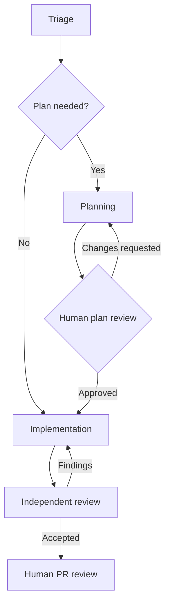

A Blueprint defines how work moves through your factory in Warp Factories. Each stage has its own instructions and assigned worker. Transitions connect the stages and define the conditions for moving between them.

{/* VERIFY: Confirm public Blueprint availability and access requirements before publishing this page and its linked workflow. */}

For example, your issue-to-PR workflow can send a well-defined bug directly to implementation, require an approved plan for an API change, and return review findings to the same implementation conversation. You configure those paths rather than rely on a single foreman prompt to describe the whole process.

## Stages, workers, and transitions

* **Stage** - A unit of work with its own instructions, inputs, and outputs. A review stage can require findings against a particular PR head. See [Defining Blueprint stages](/factories/blueprints/stages/).
* **Worker** - An agent configured for the factory, with its own instructions, model, harness, and tools. It runs assigned stages and keeps its conversation for later stages or revisions on the same work item. See [factory workers](/factories/factory-agents/).
* **Transition** - Connects stages and selects what happens next. Review findings can return to implementation; accepted work can move to handoff. See [Configuring Blueprint transitions](/factories/blueprints/routes/).
* **Gate** - Pauses a stage for a person's answer. A plan-review gate can require approval before implementation, with different transitions for approval and requested changes. See [Adding gates to a Blueprint](/factories/blueprints/gates/).

The Blueprint lives in `factory.yaml`. Each stage names a worker from the factory's worker definitions. A stage named `planning` might use the `spec` worker; another stage might use that same worker for a different procedure.

## Blueprints and worker definitions

Put stage-specific instructions, handoffs, transition conditions, and gates in the Blueprint. For example, change the review loop there to return findings to implementation. The Blueprint's workflow takes precedence over competing stage lists or delegation orders in other prompts.

Put general instructions that apply across all stages in the worker definition, such as reporting failed checks honestly. Use skills for reusable procedures, such as the repository's test commands. Choose models, harnesses, runners, tools, and access in the [worker configuration](/factories/factory-agents/configuration/).

The foreman is the agent that drives the top-level workflow and communicates with you. It gathers a stage's inputs from the request and earlier results, runs its own stages in its conversation, and dispatches other stages to their workers. A dispatched worker follows the named stage, reports its outputs, and stops. The foreman uses that result to choose the next transition and relays human questions and answers to the worker.

A stage can also contain a group of stages, driven by its assigned worker. That worker handles the group's internal handoffs and returns the group's result to the foreman. You can start with a flat workflow and group related work when it needs a separate coordinator.

## How a request moves through a Blueprint

The worker driving a workflow evaluates its entry conditions in order and takes the first match. After a stage finishes, it evaluates that stage's outgoing conditions. Write conditions in prose that refers to the request, the stage's outputs, or a gate's answer.

An issue-to-PR workflow might use these transitions:

The transition order matters; the order you declare stages does not. If no condition fits, the worker asks for the missing decision instead of silently finishing. A follow-up resumes the stage it concerns rather than repeating intake.

## Human decisions at gates

You choose what question a gate asks, which answers satisfy it, and when it opens. For a plan review, “changes requested” answers the question but sends the plan back for revision; it does not approve implementation.

Answer a gate in the original conversation with the foreman. An unanswered question keeps the stage open.

Gates and prompts guide the workflow. They do not enforce repository permissions. Use repository rules and branch protection to control who can approve and merge a PR. Worker review is advisory, and a passing run does not replace your review of the diff and verification results.

## Definition changes and work already running

A new run uses the applied Blueprint selected when that run starts. Editing the current definition does not reroute an existing run, and follow-ups to that run retain its Blueprint. Start separate work after applying a definition change to test the new workflow.

## When to use a Blueprint

Use a Blueprint when you need to change and review a standing workflow: which requests need a plan, what independent review checks, or when an owner must answer. Keep the procedures and routing under version control, then test a changed definition on new work before using it more broadly.

For a single ad-hoc coding request, a standalone agent can be enough. You do not need to create a factory or put every request through a full software-development lifecycle.

## Related pages

* [Running an issue-to-PR Blueprint](https://docs.warp.dev/guides/agent-workflows/running-an-issue-to-pr-blueprint/) - Configure a workflow and review its result
* [Factory definition as code](/factories/factory-as-code/#blueprint) - Look up the configuration fields
* [Worker configuration](/factories/factory-agents/configuration/) - Choose worker resources and shared instructions
