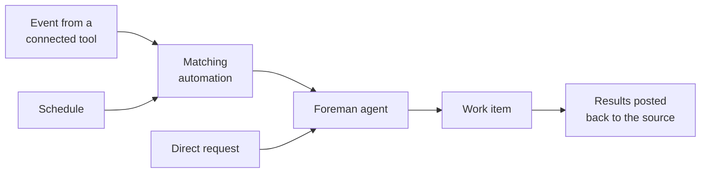

import { VARS } from '@data/vars';

Connect your factory to the tools where your team discusses, tracks, and reviews work. The factory keeps the source thread, issue, or pull request as context and posts results there.

Each source feeds into this factory's repositories. If the work belongs to a different product surface, [start a new factory](/factories/#sizing-a-factory) for it instead.

GitHub, GitLab.com, and Azure DevOps Services connect both repositories and provider-specific work sources. To use another code forge for repository access, [connect another code forge to your factory](/factories/code-forges/other-code-forges/). That fallback does not receive provider-specific events or automations.

## Choose a source

Pick the sources that match where work starts for your team. You can connect multiple sources, but not both Linear and Jira at the same time. Choose either issue tracker during setup, or connect one later from the factory's settings or [definition](/factories/factory-as-code/).

| Source | Best for | Start work by | Continues in |
| --- | --- | --- | --- |
| [Slack](/factories/integrations/slack/) | Chat and support requests | [Mentioning the app in a channel, thread, or DM](/factories/integrations/slack/#start-and-continue-work-from-slack) | The Slack thread or DM |
| [Microsoft Teams](/factories/integrations/teams/) | Chat in standard and shared channels | [Mentioning the Warp app in a configured channel](/factories/integrations/teams/#start-and-continue-work) | The Teams thread |
| [GitHub](/factories/integrations/github/) | Issues, pull requests, reviews, and CI | [Adding the factory's label and mentioning **@warp**](/factories/integrations/github/#mention-the-factory) | The issue, pull request, or review thread |
| [GitLab](/factories/integrations/gitlab/) | Merge request activity and bot mentions | [Mentioning the factory's bot in a merge request comment](/factories/integrations/gitlab/#mention-the-factory) | The merge request thread |
| [Azure DevOps](/factories/integrations/azure-devops/) | Work items and pull requests | [Mentioning the factory identity in a work item or pull request, or assigning it a work item](/factories/integrations/azure-devops/#configure-azure-devops-automations) | The factory work item |
| [Linear](/factories/integrations/linear/) | Planned issues | [Assigning the issue to the factory, or mentioning the Warp app in a comment](/factories/integrations/linear/#route-agent-sessions) | The Linear issue and its agent session |
| [Jira](/factories/integrations/jira/) | Work items assigned to Warp | [Assigning or mentioning **Warp** on a work item](/factories/integrations/jira/#connect-jira-and-add-an-automation) | The Jira agent session |
| [Custom webhooks](/factories/webhooks/) | Any system that can POST JSON: CI, monitoring, alerting, and internal tools | [Posting JSON to the webhook's URL from the external system](/factories/webhooks/#configure-the-sender) | The factory work item |
| [Factory endpoints](/factories/factory-api/) | Custom integrations and scripts that dispatch by factory UID | [Calling `POST /factory/{uid}/runs` with a prompt](/factories/factory-api/#dispatch-a-run-to-a-factory) | The factory work item |
| [Factory MCP](/factories/factory-mcp/) | Exchanging work with a local coding agent, in both directions | [Calling `send_task` from a connected coding agent](/factories/factory-mcp/#send-new-work-to-a-factory) | The factory work item |
| Direct runs and schedules | One-off or recurring work | [Clicking **New** on the factory's Runs page, or adding a schedule trigger](#direct-runs-and-schedules) | The factory work item |

## Connect a source

Grant only the access your factory needs. Most connections add default [automations](/factories/automations/) that you can adjust.

If you don't administer the external service, send a setup request to someone who does. They approve the workspace connection; you finish choosing the repositories, projects, teams, or channels for your factory.

### Request setup from an administrator

You need permission to connect workspace integrations in Warp, separate from administrator access in the external service. A factory Editor role alone doesn't grant that permission. Azure DevOps Manager setup also permits active workspace members.

1. In the <a href={VARS.FACTORY_WEB_APP_URL}>{VARS.FACTORY_WEB_APP}</a>, open the provider's connection during factory setup or from the factory's **Settings**.
   For Azure DevOps, first connect your personal account and select the organization, then request [Manager approval](/factories/integrations/azure-devops/#connect-azure-devops).
2. Click **Contact admin**. If setup asks who will complete the connection, choose **Someone else** instead. For Jira, enter the Atlassian site before sending the request.
3. Enter the recipients' email addresses, optionally add a note, then click **Send**. Alternatively, click **Copy approval link** and share it yourself. Copying a link does not email the addresses you entered.

Recipients don't need a Warp account. See the provider's guide for the permissions they need: [GitHub](/factories/integrations/github/), [GitLab](/factories/integrations/gitlab/), [Slack](/factories/integrations/slack/), [Linear](/factories/integrations/linear/), [Jira](/factories/integrations/jira/), [Microsoft Teams](/factories/integrations/teams/), or [Azure DevOps](/factories/integrations/azure-devops/#required-administrator-permissions).

:::caution
Treat approval links as sensitive. Anyone with a link can open the request and complete it with the required external permissions; the link isn't restricted to the recipient's email address.
:::

### Complete a setup request

1. Open the approval link and confirm the Warp workspace and external service are the ones you intend to connect.
2. Sign in to the external service and complete its authorization or installation steps. Follow any additional approval instructions on the setup page.
3. After setup confirms the connection, tell the requester to resume factory setup.

If you cancel authorization, reopen the original link to try again. If a browser authorization session expires, reopen the original link rather than reusing the expired authorization page.

### Resume factory setup

Return to the provider's connection in factory setup or the factory's **Settings**. Select the resources for this factory and finish any remaining installation or identity setup. Click **Enable** where prompted.

Workspace approval doesn't make every factory ready or link every teammate's personal account. Follow the provider's guide, then send a test request and confirm the factory replies at the source.

### Manage pending requests

Return to the provider's connection to view pending recipients, resend a request, add recipients, or revoke the request. Resending replaces that recipient's previous link. Completing a request invalidates its other links.

Requests expire seven days after creation. Resending or adding recipients doesn't extend that deadline. For a replaced link, use the latest email; for a revoked or expired request, ask the requester to create a new one.

## How work reaches your factory



An event from a connected tool starts the automation based on filter matching, such as a specific repository, channel, or label. Schedules start their automation on a timer, and direct requests go straight to the factory.

Every request lands with the foreman agent, which turns it into a work item and dispatches the agents each stage needs. A reply in the same thread, issue, or pull request continues that work item instead of starting a new one, and repeated event deliveries don't create duplicates. See [How Warp Factories work](/factories/how-factories-work/) for the full lifecycle, including where people stay in the loop.

## Review the default automations

Factory setup adds default automations for connected tools:

* **GitHub** - Handles mentions, assignments, labels, reviews, and pull request completion. See the [GitHub defaults](/factories/integrations/github/#connect-github-to-a-factory).
* **GitLab** - Handles [bot mentions in merge request comments](/factories/integrations/gitlab/#mention-the-factory).
* **Azure DevOps** - Handles [factory identity mentions and work item assignments](/factories/integrations/azure-devops/#configure-azure-devops-automations).
* **Jira** - Handles [Warp assignments and mentions](/factories/integrations/jira/#connect-jira-and-add-an-automation) in selected projects.
* **Linear** - Routes [new agent sessions](/factories/integrations/linear/#route-agent-sessions) from selected teams.
* **Slack** - Handles [app mentions and messages](/factories/integrations/slack/#start-and-continue-work-from-slack).
* **Microsoft Teams** - Handles [app mentions in configured channels](/factories/integrations/teams/#start-and-continue-work), subject to the [shared-channel rules](/factories/integrations/teams/#use-shared-channels).

These defaults are starting points. Review each automation's filters, agent, and run settings, and adjust them to match your workflow. For automation files you can adapt, such as CI failure triage, a scheduled dependency audit, and Slack reaction intake, see [`06-common-automations`](https://github.com/warpdotdev/warp-factory-examples/tree/main/examples/06-common-automations) in the [warp-factory-examples](https://github.com/warpdotdev/warp-factory-examples) repository.

## Custom webhooks

A [custom webhook](/factories/webhooks/) gives the factory an authenticated URL that any system can POST JSON to, and an automation decides which deliveries start work by filtering on the payload. Use it for tools Warp doesn't connect to directly, such as your CI system, PagerDuty, Sentry, or Stripe, without writing any code on your side.

## Factory endpoints

[Factory endpoints](/factories/factory-api/) let your own code discover a factory and dispatch a task to it by UID, without knowing which agent handles the work. Use them when a bot, service, or script you control needs to start or check work - see [Build a Mattermost bot for Warp Factories](/guides/external-tools/build-a-mattermost-bot-for-warp-factories/) for a worked example, or [choosing how work reaches a factory](/factories/factory-api/#choosing-how-work-reaches-a-factory) for how they compare to custom webhooks, Factory MCP, and the integrations above.

## Factory MCP

The [Factory MCP](/factories/factory-mcp/) connects local coding agents and other MCP clients to your factory, and it works in both directions. Send work to the factory, or take work over from it by pulling a task down to your machine, iterating on it locally, and handing it back to the same work item.

## Direct runs and schedules

Not every task starts in an external tool:

* Start a direct run for one-off work. Click **New** on the factory's Runs page and describe the task to the foreman, the same way you would from Slack or an issue tracker.
* Create a scheduled automation for recurring work, such as maintenance or reports. See the [Triggers overview](/platform/triggers/) for how schedules and other triggers work across the platform.

This automation from [`06-common-automations`](https://github.com/warpdotdev/warp-factory-examples/tree/main/examples/06-common-automations) runs a dependency audit every Monday:

```markdown title="automations/weekly-dependency-audit/automation.md"
---
triggers:
  - provider: schedule
    event: cron_fired
    schedule:
      name: weekly-dependency-audit
      cron: "0 9 * * 1"
---
Run the weekly dependency audit. List outdated and vulnerable dependencies,
apply safe minor and patch upgrades on a branch, run the tests, and open a
PR with the changes and a summary of anything that needs a human decision.
```

## Related pages

* [Warp Factories quickstart](/factories/quickstart/)
* [Factory automations](/factories/automations/)
* [Troubleshooting Warp Factories](/factories/troubleshooting/)
