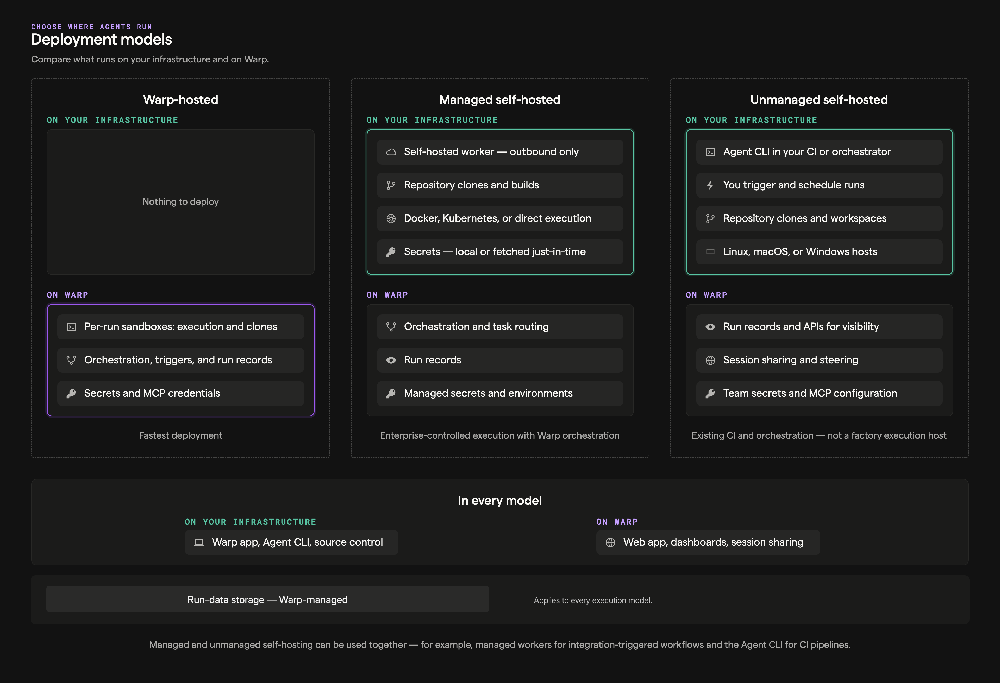
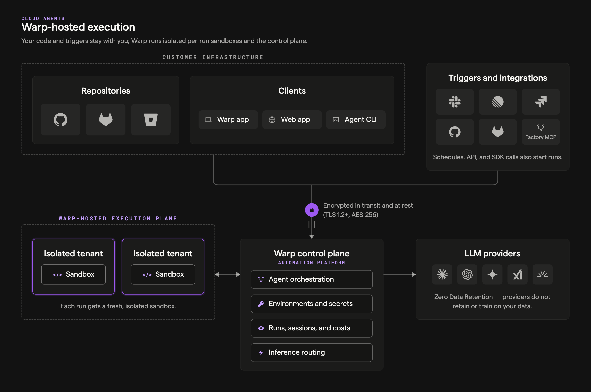

import { VARS } from '@data/vars';

Choose an execution model for your factory based on where its code must run and who operates the compute. Warp-hosted execution is the default. Managed self-hosting keeps checkout and command execution in your network while Warp coordinates the work.

The comparison below also shows unmanaged execution for standalone agents, which is not a factory execution host.

<figure style={{ maxWidth: "736px" }}>

<figcaption>Deployment models divide responsibilities between Warp and your infrastructure.</figcaption>
</figure>

## Choose an execution model

| If your factory needs to... | Choose |
| --- | --- |
| Run public repositories and services without operating workers | [Warp-hosted execution](#warp-hosted-execution) |
| Reach private repositories or services behind your network boundary | [Managed self-hosting](#managed-self-hosting) |
| Run standalone agents from CI or developer infrastructure, without a factory | [Unmanaged execution](/platform/unmanaged-execution/) |

Both factory options use the same [factory definition](/factories/factory-as-code/), [runners](/factories/runners/), and [factory dashboard](/factories/factory-dashboard/). The execution host changes the location of checkout, command execution, and the sandbox filesystem.

## Warp-hosted execution

Use this when your factory can reach its repositories and services over the public internet. The [{VARS.WARP_AUTOMATION_PLATFORM}](/platform/overview/) runs the work on Warp-managed infrastructure while your factory definition selects the agents, runner, workspace, and credentials.

<figure style={{ maxWidth: "736px" }}>

<figcaption>Warp operates the control plane and per-run sandboxes.</figcaption>
</figure>

See the [cloud agent run lifecycle](/platform/architecture/#cloud-agent-run-lifecycle) reference for a description of each component in the architecture.

### What it looks like

* **Work intake** - Automations, integrations, Factory MCP, and factory endpoints send work to the factory.
* **Execution** - Agents run in Docker-based environments hosted by the {VARS.WARP_AUTOMATION_PLATFORM}.
* **Visibility** - Teams monitor work through the factory dashboard, session sharing, and APIs.

### Send work to a factory

* Route integration events, schedules, and webhooks to factory agents with [Factory automations](/factories/automations/).
* Send work from Slack, Linear, Jira, GitHub, and GitLab through [factory integrations](/factories/connect-your-factory/).
* Find a factory and dispatch work by UID from your service using [Factory endpoints](/factories/factory-api/).
* Coding agents can hand work to a factory through [Factory MCP](/factories/factory-mcp/).

For standalone cloud-agent triggers, see [cloud agents](/platform/).

## Managed self-hosting

Use this when a factory must run checkout and execution on your infrastructure while the {VARS.WARP_AUTOMATION_PLATFORM} coordinates the work and records its results. Managed workers support Docker, Kubernetes, Direct, and external command backends. See [managed self-hosting](/factories/self-hosting/) for requirements and setup.

For standalone agents that you orchestrate directly from CI, Kubernetes, or developer infrastructure, use [unmanaged execution](/platform/unmanaged-execution/). See [execution security](/factories/self-hosting/security-and-networking/) for the data and network boundaries shared by both architectures.

## Related pages

* [Infrastructure and security](/factories/infrastructure-and-security/) - Choose execution, inference, storage, and credential boundaries for a factory.
* [Warp-hosted execution](/factories/warp-hosting/) - Review hosted execution capacity, networking, and supported environments.
* [Managed self-hosting](/factories/self-hosting/) - Install and operate a factory worker on your infrastructure.
* [Unmanaged execution](/platform/unmanaged-execution/) - Run standalone agents outside a factory.
