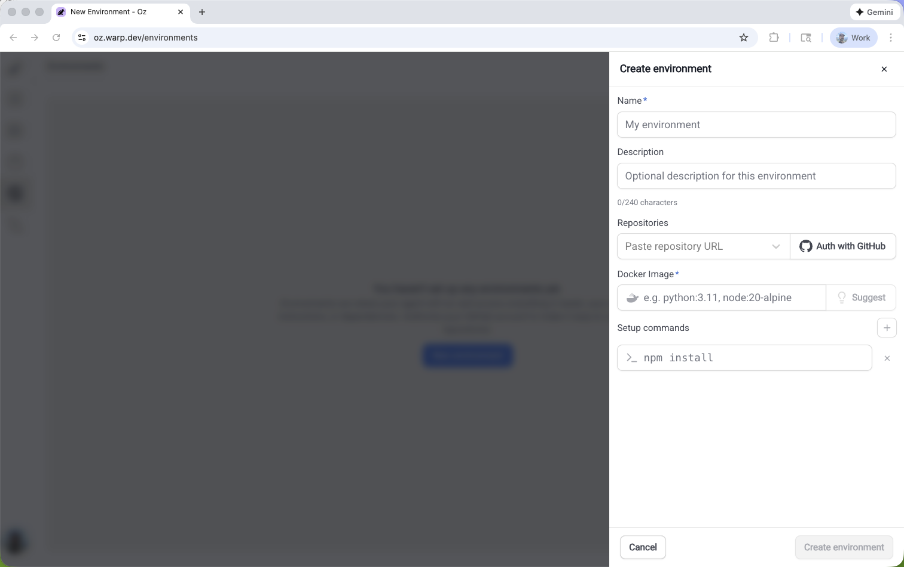

import { VARS } from '@data/vars';

Factories manage their workspace by default. Configure repositories in the [factory definition](/factories/factory-as-code/#repositories) and compute in [runners](/factories/runners/); creating a standalone environment is not a prerequisite.

Create an environment when a standalone cloud workflow needs repositories, a toolchain, and setup commands, or when factory agents need an existing environment as an override. Use the {VARS.WARP_AGENT_CLI}, guided setup in Warp, or the legacy {VARS.WEB_APP}. To select an existing environment for factory agents, set [`agentDefaults.environmentId`](/factories/factory-as-code/#agentdefaultsenvironmentid).

## Prerequisites

* **GitHub repositories** - Add one or more repositories for the agent to clone and work in.
* **GitHub authorization** - Give the run's repository identity access to the repositories. For factory runs, check the [GitHub connection](/factories/integrations/github/) and [credential strategy](/factories/factory-as-code/#credentialstrategy). Standalone automation using an agent API key follows [team GitHub authorization](/platform/team-access-billing-and-identity/#team-github-authorization).
* **Docker image** - Use a publicly accessible image that can build and run your code. Official [node](https://hub.docker.com/_/node), [python](https://hub.docker.com/_/python), and [rust](https://hub.docker.com/_/rust) images work for many projects. You can also use [Warp's prebuilt dev images](https://github.com/warpdotdev/oz-dev-environments).

Use a glibc-based image such as Debian, Ubuntu, or a default non-Alpine image from Docker Hub. If the runtime fails to start with a musl-based image such as Alpine, switch to a glibc-based image before retrying.

<span id="create-an-environment-in-the-web-app" />

## Create an environment in the legacy web app

<figure style={{ maxWidth: "563px" }}>

<figcaption>The Create environment panel in the Oz web app.</figcaption>
</figure>

1. Open the <a href={`${VARS.WEB_APP_URL}/environments`}>Environments page in the {VARS.WEB_APP}</a>, then click **New environment**.
2. Enter a name, select one or more repositories, and enter a Docker image reference. Click **Suggest** to get an image recommendation based on the selected repositories.
3. Add setup commands, cloud provider access for AWS or GCP, or a description when needed.
4. Click **Create environment**. You can now use the environment with cloud agents and integrations.

## Create an environment with guided setup

Run [`/create-environment`](warp://action/create_environment) in Warp to inspect your repositories and generate an environment configuration. The guided setup detects languages, frameworks, and tools, then recommends an image and setup commands.

Run the command from a Git repository with no argument, or pass one or more repository paths or URLs.

```text
# Local paths
/create-environment ./payments-service ./deployment-config

# GitHub repositories
/create-environment acme/payments-service acme/deployment-config

# GitHub URL
/create-environment https://github.com/acme/payments-service.git
```

Guided setup does the following:

* **Detect repositories** - Identifies the languages, frameworks, and tools the agent will use.
* **Recommend an image** - Finds an existing Dockerfile, recommends an official base image, or helps you build a custom image.
* **Suggest setup commands** - Uses your scripts and package managers to recommend workspace setup.
* **Create the environment** - Creates the environment through the CLI and returns an environment ID.

## Create an environment with the CLI

Use the {VARS.WARP_AGENT_CLI} when you know the environment configuration, need a custom Docker image, or want to automate environment creation.

```bash
oz environment create \
  --name ENVIRONMENT_NAME \
  --docker-image IMAGE_REFERENCE \
  --repo OWNER/REPO \
  --setup-command "SETUP_COMMAND" \
  --description "DESCRIPTION"
```

Replace `ENVIRONMENT_NAME` with a human-readable label, `IMAGE_REFERENCE` with a Docker Hub image, `OWNER/REPO` with a repository to clone, `SETUP_COMMAND` with a workspace command, and `DESCRIPTION` with an optional summary. Repeat `--repo` and `--setup-command` for each additional repository or command.

## Environment design and best practices

Design the image and setup commands so they produce the same workspace on every run.

* **Keep setup repeatable** - Write setup commands that are safe to rerun and produce the same toolchain and workspace state for a given repository revision.
* **Pin toolchain versions** - Pin language runtimes and core tools in a Docker image, then use lockfiles such as `package-lock.json` for dependencies.
* **Define the workspace boundary** - In a multi-repo environment, state which repositories are cloned and where setup commands run.
* **Make prerequisites explicit** - Add any required build, code generation, or system-package installation steps to the setup commands.

```bash
# Repeatable setup
mkdir -p .cache
npm ci

# Setup that can fail on rerun or drift over time
mkdir .cache
npm install
```

If factory setup commands need credentials, configure [factory secrets](/factories/secrets/). For standalone workflows, use [Agent Secrets](https://docs.warp.dev/platform/secrets/). Don't hardcode tokens in setup commands.

## Configure container users

Linux container runs use a non-root user by default. Configure your image and setup commands for the selected user.

### Understand how Warp chooses the container user

* **Image with a non-root `USER`** - Warp respects the Dockerfile `USER` directive and runs the agent as that user.
* **Image that starts as root** - Warp runs the agent as a dedicated `agent` user with passwordless `sudo`. The user has UID and GID 1000 when available.
* **Image that cannot support a non-root user** - If Warp can't install `sudo` or the workspace isn't writable by the agent user, it logs a warning and continues as root.

### Prepare images and setup commands

* **Use `sudo` for root access** - Prefix commands such as `apt-get install`, writes to `/usr/local` or `/etc`, and `chown` with `sudo`. The dedicated `agent` user's passwordless `sudo` preserves `PATH`, with sudo's environment filtering. If your image supplies its own non-root user, configure the privileges that user needs in the image.
* **Install tools outside `/root`** - A newly created `agent` user normally has its home in `/home/agent`; an existing user keeps its configured home. Install tools and configuration stored in `~/.bashrc`, `~/.cargo`, or `~/.nvm` system-wide or somewhere the selected user can access.
* **Keep directories writable** - Make workspace directories writable by the selected user's UID and GID. The dedicated `agent` user uses UID and GID 1000 when available; an image's existing non-root user can have different IDs.

:::note
To temporarily restore root behavior while you update an image or setup commands, set `WARP_AGENT_NONROOT=0` in the image, such as with a Dockerfile `ENV` directive.
:::

## Manage environments

Use the {VARS.WARP_AGENT_CLI} to inspect and update environments after you create them.

### List environments

```bash
oz environment list
```

### View an environment

Replace `<ENV_ID>` with the ID of the environment you want to view.

```bash
oz environment get <ENV_ID>
```

### Update an environment

Replace `<ENV_ID>` with the ID of the environment you want to modify.

```bash
# Add or remove a repository
oz environment update <ENV_ID> --repo OWNER/REPO
oz environment update <ENV_ID> --remove-repo OWNER/REPO

# Add or remove a setup command
oz environment update <ENV_ID> --setup-command "SETUP_COMMAND"
oz environment update <ENV_ID> --remove-setup-command "SETUP_COMMAND"

# Update the name, description, or Docker image
oz environment update <ENV_ID> --name "ENVIRONMENT_NAME"
oz environment update <ENV_ID> --description "DESCRIPTION"
oz environment update <ENV_ID> --docker-image IMAGE_REFERENCE

# Set or replace the default runner
oz environment update <ENV_ID> --default-runner RUNNER_UID
```

A [runner](/factories/runners/) is a reusable compute configuration for cloud agent runs. Run `oz runner list` to see the runners available to you and their UIDs. For a team environment, the runner must be owned by that same team.

Use `--remove-description` to clear the description. Use `--force` to skip confirmation checks for environments used by integrations.

### Delete an environment

Replace `<ENV_ID>` with the ID of the environment you want to delete.

```bash
oz environment delete <ENV_ID>
```

Add `--force` to skip confirmation checks for environments used by integrations.

## Related pages

* [Cloud agent environments](/factories/environments/) - Understand factory defaults and shared environment overrides
* [Troubleshooting cloud agent environments](/factories/environments/troubleshooting-environments/) - Resolve setup and runtime problems
* [Integration setup](/agents/cli/oz-cli/integration-setup/) - Configure end-to-end integration workflows
