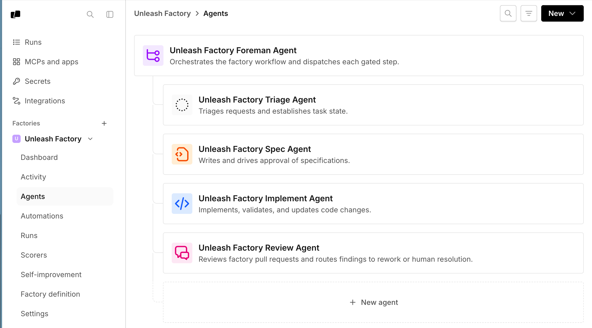
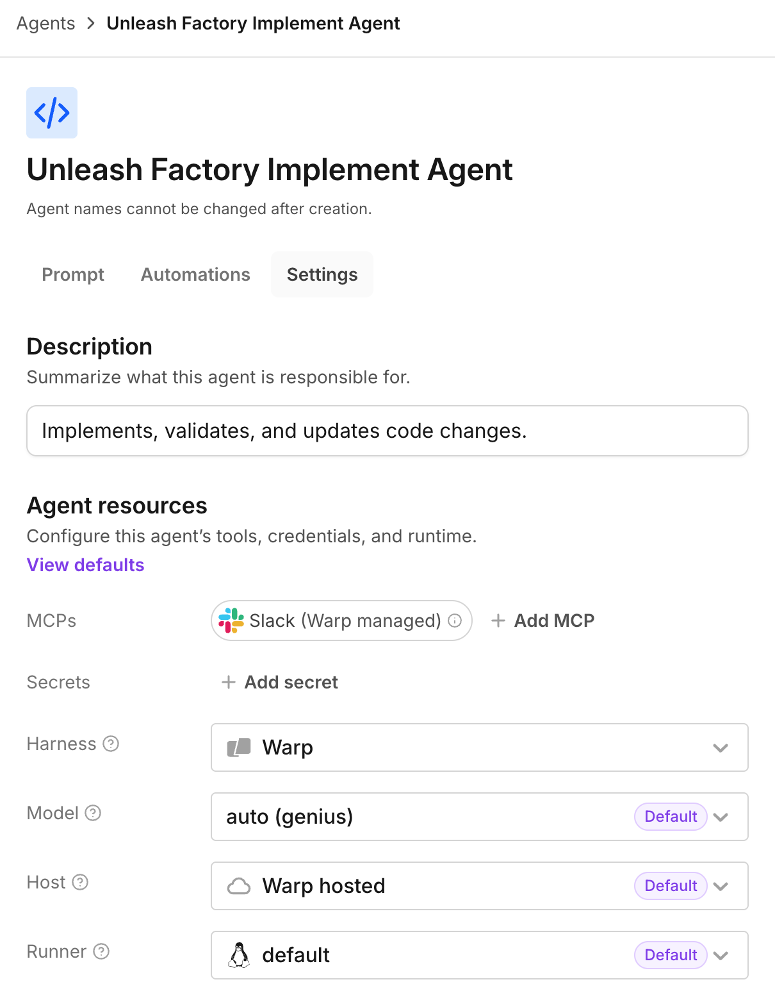
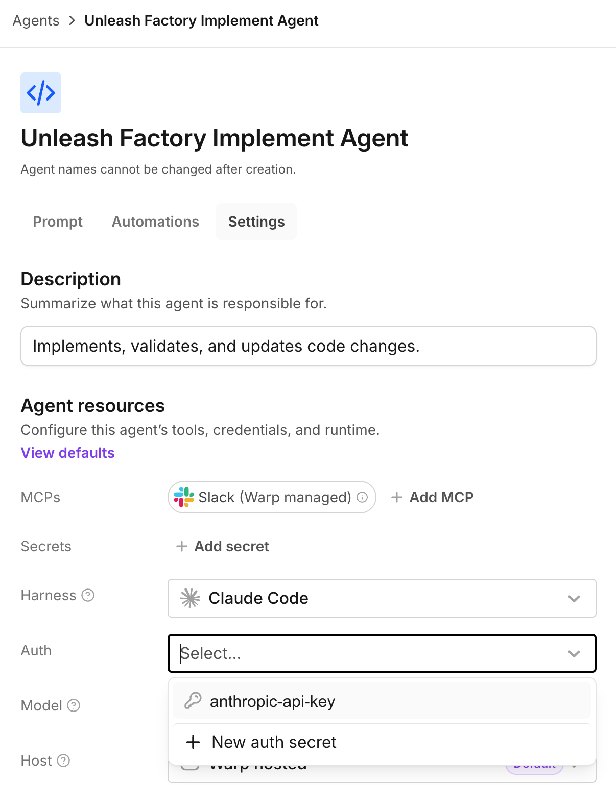

The **foreman** is the agent that coordinates a factory's work and communicates with you. It delegates work to other agents, asks for your decisions when needed, and returns results. Default agents each cover one part of the software development lifecycle: triage scopes the request, spec writes the plan, implement writes the code, and review checks it. Together, they turn a work item into a pull request ready for your team to review.

## The default agents

Every factory gets a foreman. You choose which of the four default agents to include. These defaults are a starting point, and you can [add custom agents and automations](#add-custom-agents-and-automations) for work they don't cover.

The default agents' prompts, descriptions, and models are available in [`00-warp-default-agents`](https://github.com/warpdotdev/warp-factory-examples/tree/main/examples/00-warp-default-agents) in the [warp-factory-examples](https://github.com/warpdotdev/warp-factory-examples) repository.

| Agent | What it does | What it produces |
| --- | --- | --- |
| Foreman | Coordinates the work and talks to the requester | Decisions, questions, status updates, and the final handoff |
| Triage | Investigates the request and establishes scope | Evidence, issue context, complexity, and open questions |
| Spec | Turns requirements into a concrete plan with validation criteria | Product and technical specs in a draft pull request |
| Implement | Makes and validates the code change | Code, tests, validation results, and visual evidence |
| Review | Independently checks the finished change | Findings and a recommendation |

These are responsibilities, not a fixed pipeline. A small, well-understood change can skip the Planning stage entirely. If the review agent finds problems, the foreman sends work back for another pass. By default, work that goes through Planning needs a human to approve the spec before the Building stage starts.

For the complete lifecycle, see [how Warp Factories work](/factories/how-factories-work/).

### Foreman

The **foreman agent** assigns work and is the only default agent that communicates directly with you. It relays questions and answers between you and other agents, and continues their existing conversations for revisions and follow-ups.

When finished, it returns the pull request and supporting evidence, then marks the work item complete. Complete means handed off to your team, not merged or deployed.

#### Foreman name

Use the foreman's handle to @-mention it in Slack and Linear. Factory setup defaults the handle to the factory's name. For example, a factory named `payments` gets the handle `@payments`.

In the web app sidebar, expand your factory and click **Settings**, then **Identity** to change the foreman's handle. You can also edit [`alias`](/factories/factory-as-code/#alias) in the definition. The factory name and foreman handle can differ.

### Triage

Triage researches the codebase and related issues, reproducing problems when research doesn't establish the cause. It reports scope, complexity, and open questions so the foreman can choose clarification, planning, or implementation.

### Spec

Spec defines requirements through the foreman. It writes product and technical specifications with validation criteria in a draft pull request. By default, the foreman waits for human approval before implementation starts. You can change this policy in the foreman's instructions.

### Implement

Implement builds on the spec's branch and draft pull request. It adds tests, runs repository checks, and captures visual evidence of user-facing changes when [computer use](/agents/capabilities/computer-use/) is available. It revises changes after review but never merges.

### Review

Review independently checks requirements, code conventions, tests, security, and supporting evidence. It reruns or extends validation when needed, then recommends acceptance, revisions, or a human decision. It doesn't approve or merge the pull request.

## Built-in skills

Every default agent includes GitHub skills; the foreman also includes a Slack skill. Choosing Linear or Jira during setup adds that tracker's skill and instructions. Add custom procedures with [factory skills](/factories/factory-skills/).

## Configure agent behavior

For a Warp-managed factory, edit agent settings in the web app. For a GitHub-backed factory, settings are read-only in the web app; edit the [factory definition files](/factories/factory-as-code/) instead. See [where the definition lives](/factories/factory-as-code/#where-the-definition-lives).

1. In the web app sidebar, click your factory to expand it, then click **Agents**.

   <figure style={{ maxWidth: "563px" }}>
   
   <figcaption>The Agents page lists a factory's foreman and default agents.</figcaption>
   </figure>

2. Click an agent to open its **Settings** tab.

   <figure style={{ maxWidth: "563px" }}>
   
   <figcaption>The Settings tab contains the agent's description and resources.</figcaption>
   </figure>

3. Edit the agent description, harness, model, runner, host, [MCP servers](/platform/mcp/), or [secrets](/platform/secrets/).

4. To change the agent's instructions, click **Prompt** and edit the prompt.

5. In the top-right corner, click **Save**.

## Choose models and harnesses per agent

Choose each agent's model and harness in its settings. Supported harnesses include the Warp Agent harness, Claude Code, and Codex. A foreman using Claude Code or Codex can still dispatch other factory agents, whose runs are tracked as its children.

Third-party harnesses require a paid plan. On the Free plan, agents use the Warp Agent harness. See [Warp pricing](https://www.warp.dev/pricing) for plan details.

Default model IDs change over time, so choose based on what each agent has to do well:

| Agent | What to optimize for |
| --- | --- |
| Foreman | Orchestration, instruction following, and long-running conversations |
| Triage | Research, evidence gathering, and working with connected tools |
| Spec | Synthesizing requirements, technical reasoning, and precise writing |
| Implement | Coding strength, with a harness that fits your repositories and toolchain |
| Review | A different model or harness from the implement agent, so the two don't share blind spots |

The model picker also includes custom routers from factories you can access. See [model choice for agents](/agents/inference/model-choice/), [custom model routers](/agents/inference/custom-routers/), and [harnesses for cloud agents](/platform/harnesses/) for available options.

### Configuring a third-party harness

Change an agent's harness to Claude Code or Codex to run it with that provider's own coding tool instead of the Warp Agent.

1. In the web app sidebar, click your factory to expand it, then click **Agents**.
2. Click an agent to open its **Settings** tab.
3. In the "Harness" dropdown, choose **Claude Code** or **Codex**. The "Auth" field appears for these harnesses.
4. In the "Auth" field, choose a compatible, team-owned secret from the list or click **New auth secret** to create one.

   <figure style={{ maxWidth: "563px" }}>
   
   <figcaption>The Auth dropdown appears when a third-party harness is selected.</figcaption>
   </figure>

   :::note
   * Claude Code accepts an Anthropic API key, Anthropic Bedrock API key, or Anthropic Bedrock access key.
   * Codex accepts an OpenAI API key.

   See [connecting Claude Code credentials](/platform/harnesses/authentication/#connecting-claude-code-credentials) and [connecting Codex credentials](/platform/harnesses/authentication/#connecting-codex-credentials) for how to obtain each key.
   :::

5. In the "Model" dropdown, choose a model from that harness's catalog.
6. In the top-right corner, click **Save**.

With a Warp-managed factory, you can edit harness, auth, and model from the dashboard. A GitHub-backed factory sets them through [`agentDefaults.harness` or a per-agent `harness` override](/factories/factory-as-code/#agentdefaultsharness) in the definition files. For an example, see [`03-multi-harness`](https://github.com/warpdotdev/warp-factory-examples/tree/main/examples/03-multi-harness).

## Add custom agents and automations

Add a custom agent for a role that needs separate instructions, configuration, and runs.

For a Warp-managed factory, open **Agents** in the [factory dashboard](/factories/factory-dashboard/), click **New**, then click **Custom agent**. For a GitHub-backed factory, add `agents/<name>/agent.md`. See the [`agent.md` configuration keys](/factories/factory-as-code/#agentsnameagentmd).

Custom agents have no built-in skills. Add [factory skills](/factories/factory-skills/) based on who needs them:

* **One agent** - Put the skill under `agents/<name>/skills/`.
* **Every agent** - Put the skill under `skills/`.

### Choose a configured factory agent

Use `run_agents` when the foreman should give work to one of the agents configured in your factory. The foreman receives a list of those agents, with a unique ID (UID) for each one.

Run the child remotely by setting the call's `remote` field, then copy the chosen agent's UID into `agent_run_configs[].agent_identity_uid`. Only use UIDs from the list, and select an agent for every child in the call. The `name` field only labels the child run; it doesn't choose the factory agent.

Warp uses the UID to load that agent's configured environment, runner, host, harness, and model unless the call overrides them. To start a child without factory configuration, use [multi-agent orchestration](/platform/orchestration/) from any Warp conversation.

Automations start a chosen agent on a [schedule](/factories/factory-as-code/#triggersschedule) or when an event fires. They're one more way for work to enter your factory; the foreman still coordinates whatever they start. For all the ways to route work into a factory, see [connect your factory](/factories/connect-your-factory/).

## Human decision points and permissions

| Decision | Default behavior | What enforces it |
| --- | --- | --- |
| Spec approval | The foreman asks a human to clarify ambiguity and approve every spec | Workflow policy in the foreman's instructions, which your team can change |
| Merging | Agents never merge; the foreman hands the finished pull request to a human | Your repository's permissions decide who can approve and merge |
| Runtime access | Each agent reaches only the repositories, secrets, and MCP servers in its configuration | Platform configuration and the permissions of the connected providers |

The first two rows are conventions: they live in the foreman's instructions and your repository settings, and your team can change them. Access is different. What an agent can reach comes from its configuration and the permissions of the connected providers, never from its instructions — changing what an agent is told to do doesn't change what it's able to do.

So enforce with the real controls: branch protection and repository permissions decide who merges, and each agent's configuration decides what it can reach.

Next, capture these choices in [factory definitions as code](/factories/factory-as-code/).
