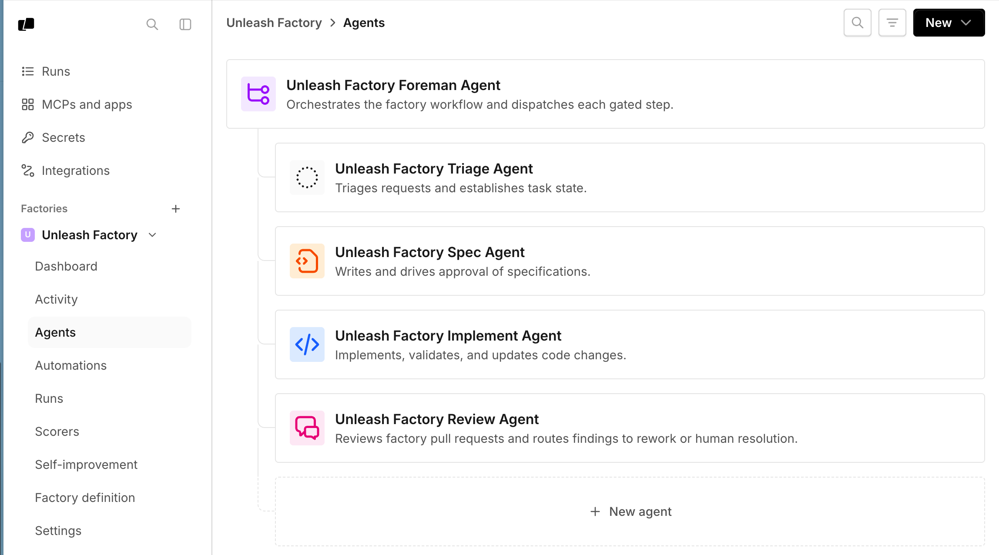
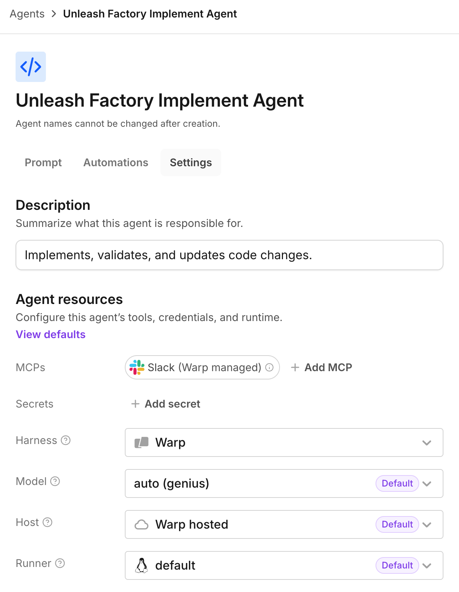
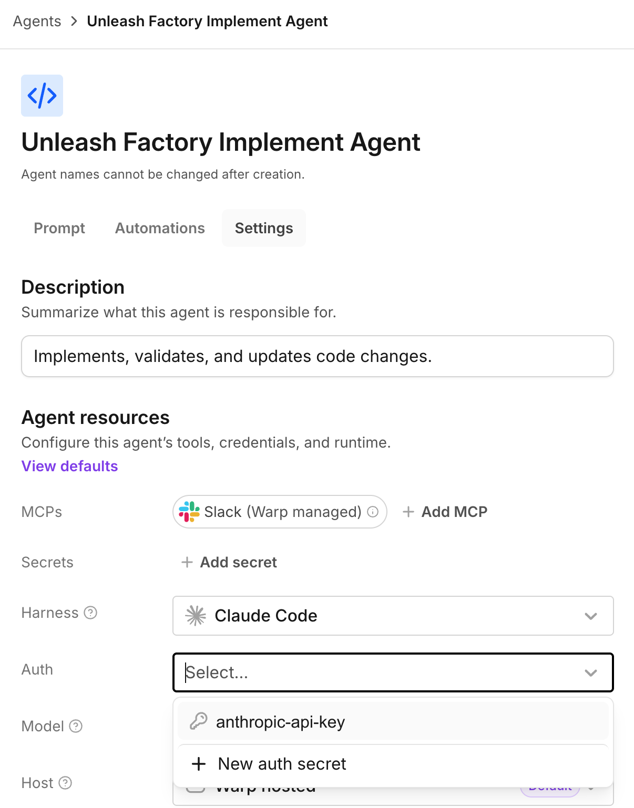

import { VARS } from '@data/vars';

Change how an existing factory agent works by editing its instructions, tools, and runtime in the <a href={VARS.FACTORY_WEB_APP_URL}>{VARS.FACTORY_WEB_APP}</a> or its definition files.

## Prerequisites

* [Editor access to this factory, or team or workspace admin access](/factories/infrastructure-and-security/#factory-roles-and-permissions).
* An existing factory agent. See [About factory agents](/factories/factory-agents/) for the default roles, or [Creating custom agents](/factories/factory-agents/creating-custom-agents/) to add a role.

## Edit agent settings and instructions

For a Warp-managed factory, edit agent settings in the web app. For a GitHub-backed factory, settings are read-only in the web app; edit the [factory definition files](/factories/factory-as-code/) instead. See [Where the definition lives](/factories/factory-as-code/#where-the-definition-lives).

1. In the web app sidebar, click your factory to expand it, then click **Agents**.

   <figure style={{ maxWidth: "563px" }}>
   
   <figcaption>The Agents page lists a factory's foreman and default agents.</figcaption>
   </figure>

2. Click an agent to open its **Settings** tab.

   <figure style={{ maxWidth: "563px" }}>
   
   <figcaption>The Settings tab contains the agent's description and resources.</figcaption>
   </figure>

3. Edit the agent description, harness, model, runner, host, [MCP servers](/factories/mcp/), or [secrets](/factories/secrets/).

4. To change the agent's instructions, click **Prompt** and edit the prompt.

5. In the top-right corner, click **Save**.

## Choose models and harnesses per agent

Choose each agent's model and harness in its settings. Supported harnesses include the Warp Agent, Claude Code, and Codex. A foreman using Claude Code or Codex can still dispatch other factory agents, whose runs are tracked as its children.

Third-party harness access depends on your team's plan and workspace settings. If a harness requires an upgrade, use the Warp Agent or review [Warp pricing](https://www.warp.dev/pricing).

Default model IDs change over time, so choose based on what each agent has to do well:

| Agent | What to optimize for |
| --- | --- |
| Foreman | Orchestration, instruction following, and long-running conversations |
| Triage | Research, evidence gathering, and working with connected tools |
| Spec | Synthesizing requirements, technical reasoning, and precise writing |
| Implement | Coding strength, with a harness that fits your repositories and toolchain |
| Review | A different model or harness from the implement agent, so the two don't share blind spots |

The model picker also includes custom routers from factories you can access. See [Agent model choice](/agents/inference/model-choice/), [Custom routers](/agents/inference/custom-routers/), and [Agent harnesses](/factories/harnesses/) for available options.

For team-managed inference in definition files, see [custom endpoint and BYOK model values](/factories/factory-as-code/#custom-inference-endpoints-and-byok), including factory defaults and per-agent overrides.

## Reviewing inference for provider ZDR

Avoid [retention-required models](/agents/inference/model-choice/#models-requiring-provider-retention) in the settings you control. Read [factory ZDR coverage and its limits](/factories/zero-data-retention/) first. Both paths work in a browser without Warp Terminal.

Ask an admin whose [provider account](/factories/infrastructure-and-security/#inference-options-for-factory-runs) serves your models. For customer-owned accounts or third-party harnesses, [verify retention with the provider](/factories/zero-data-retention/#choose-inference-covered-by-provider-zdr). Don't switch credentials or harnesses solely to follow these steps.

Choose by [where the definition is managed](/factories/factory-as-code/#where-the-definition-lives): follow the GitHub repository link in **Settings**, or use **Factory definition** for a Warp-managed definition. Ask an admin if the mode is unclear; API-managed factories have no definition files.

Defaults apply only where inherited; agent and automation overrides can select another model.

### Reviewing a dashboard-managed factory

You need [editing access](#prerequisites). Read-only controls don't identify the management mode; ask an admin to confirm your access.

1. Open the <a href={VARS.FACTORY_WEB_APP_URL}>{VARS.FACTORY_WEB_APP}</a>, expand your factory, and click **Factory definition**. Open the existing `factory.yaml`.
2. Set the Warp Agent default (`type: oz`) outside the exception list using `agentDefaults.model` or `agentDefaults.harness.model`. Keep one form; see [model syntax](/factories/factory-as-code/#agentdefaultsmodel). For third-party harnesses, verify provider retention instead. Click **Save** and resolve validation errors.
3. In **Agents**, open each agent's **Settings**. Check the "Harness" and "Model" selections, including the foreman and agents it dispatches. For agents using the Warp Agent, choose a model outside the exception list and click **Save**.
4. Complete [additional model checks](#checking-separate-model-settings), then save. Reopen changed agent settings and compare their model and harness with your intended values before [testing](#checking-new-runs). Saved files alone don't prove application.

### Reviewing a GitHub-backed factory

You need permission to propose and merge changes in the definition's GitHub repository. The dashboard editors are read-only.

1. In the <a href={VARS.FACTORY_WEB_APP_URL}>{VARS.FACTORY_WEB_APP}</a>, expand your factory and open **Settings**. Follow the definition repository link, then create a branch for the changes.
2. In `factory.yaml`, set the Warp Agent default (`type: oz`) outside the exception list using `agentDefaults.model` or `agentDefaults.harness.model`. Keep one form; see [model syntax](/factories/factory-as-code/#agentdefaultsmodel). Verify third-party harness choices with their provider.
3. In each existing `agents/<name>/agent.md`, including the foreman, replace exception models in Warp Agent `model` or `harness.model` overrides. Preserve unrelated settings and instructions.
4. Complete the applicable [additional model checks](#checking-separate-model-settings) in the definition files.
5. Pass the [factory-definition PR checks](/factories/factory-as-code/#pull-request-checks) and merge into the connected production branch. Reopen changed agents in the dashboard and compare their model and harness with the merged values before [testing](#checking-new-runs). PR checks validate proposed changes, not post-merge application.

### Checking separate model settings

Complete each check that applies to your factory rather than assuming every feature uses the foreman's model.

| If you use… | Check before starting work |
| --- | --- |
| Automations | In `automations/<name>/automation.md`, replace exception models in `model` or `harness.model`; these override the target agent. Dashboard-managed factories use **Factory definition**, not the **Automations** editor, for these settings. |
| Computer Use | Check `agentDefaults.computerUseModel` in `factory.yaml` and `computerUseModel` overrides in agent and automation files. Replace exception models. Omitted values inherit or use automatic selection; see [Computer Use inheritance](/factories/factory-as-code/#agentdefaultscomputerusemodel). |
| Scorers | In **Scorers**, change exceptions in each "Judge model" and save. For GitHub-backed definitions, edit `model` in `scorers/<name>/scorer.md`. |
| Custom routers | Inspect every target and default in the [router definition](/factories/factory-as-code/#routersnameyaml). If another factory owns it, ask its editor or admin to verify the choices, or select an inspectable concrete model. Access to this factory doesn't grant access elsewhere. |
| Benchmarks | Before launching, check each trial's harness, model, selected Scorers, and any supplied overrides. See [running a benchmark](/factories/benchmarks/#create-and-run-a-benchmark). |
| API, CLI, or agent-started runs | Check supplied model, harness, and Computer Use overrides before dispatching the run. |

Self-improvement analyzes run data with a separate model, not the foreman's model. Before using it with sensitive data, ask Warp to confirm that model and its provider coverage.

### Checking new runs

Use a test factory with non-sensitive repositories and inputs. Resolve validation errors first. If changes remain pending or fail to apply, don't send sensitive work; [contact support](/support-and-community/troubleshooting-and-support/sending-us-feedback/) with the factory link and, for GitHub, the merge commit.

1. In the web app, click **New Chat**, choose your factory, and send: “Reply with a greeting. Don't read repository files or call tools.” This is a basic run check, not a test of every agent or feature.
2. In **Runs**, open the new run and inspect its model and harness. If it dispatches child runs, check those separately. If a selection differs from your configuration, check agent, automation, and run overrides before sending sensitive work.

Exercise changed paths separately:

* Agents and automations: request a greeting from each changed agent or send a matching test event; inspect the receiving agent and child runs.
* Computer Use: request the page title from `https://example.com`; check for Computer Use in the session.
* Scorers: score a non-sensitive completed run; inspect the judge configuration and result.
* Routers: test representative routing rules or complexity levels; inspect resolved models, not only the router name.
* Benchmarks and caller overrides: run a non-sensitive trial or request with the reviewed choices; inspect resulting runs.

Record settings inspected and paths exercised separately. These checks don't prove provider contracts or every background request. Existing runs keep their model; recheck new runs after configuration changes.

## Configuring a third-party harness

Change an agent's harness to Claude Code or Codex to run it with that provider's own coding tool.

1. In the web app sidebar, click your factory to expand it, then click **Agents**.
2. Click an agent to open its **Settings** tab.
3. In the "Harness" dropdown, choose **Claude Code** or **Codex**. The "Auth" field appears for these harnesses.
4. In the "Auth" field, choose a compatible, team-owned secret. To create one, click **New auth secret** for Claude Code or **New OpenAI API Key** for Codex.

   <figure style={{ maxWidth: "563px" }}>
   
   <figcaption>The Auth dropdown appears when a third-party harness is selected.</figcaption>
   </figure>

   :::note
   * Claude Code accepts an Anthropic API key, Anthropic Bedrock API key, or Anthropic Bedrock access key.
   * Codex accepts an OpenAI API key.

   See [connecting Claude Code credentials](/factories/harnesses/authentication/#connecting-claude-code-credentials) and [connecting Codex credentials](/factories/harnesses/authentication/#connecting-codex-credentials) for how to obtain each key.
   :::

5. In the "Model" dropdown, choose a model from that harness's catalog.
6. In the top-right corner, click **Save**.

With a Warp-managed factory, you can edit harness, auth, and model from the dashboard. A GitHub-backed factory sets them through [`agentDefaults.harness` or a per-agent `harness` override](/factories/factory-as-code/#agentdefaultsharness) in the definition files. For an example, see [`03-multi-harness`](https://github.com/warpdotdev/warp-factory-examples/tree/main/examples/03-multi-harness).

## Related pages

* [About factory agents](/factories/factory-agents/) - Understand responsibilities and human decision points
* [Creating custom agents](/factories/factory-agents/creating-custom-agents/)
* [Factory skills](/factories/factory-skills/)
* [Definitions as code](/factories/factory-as-code/)
