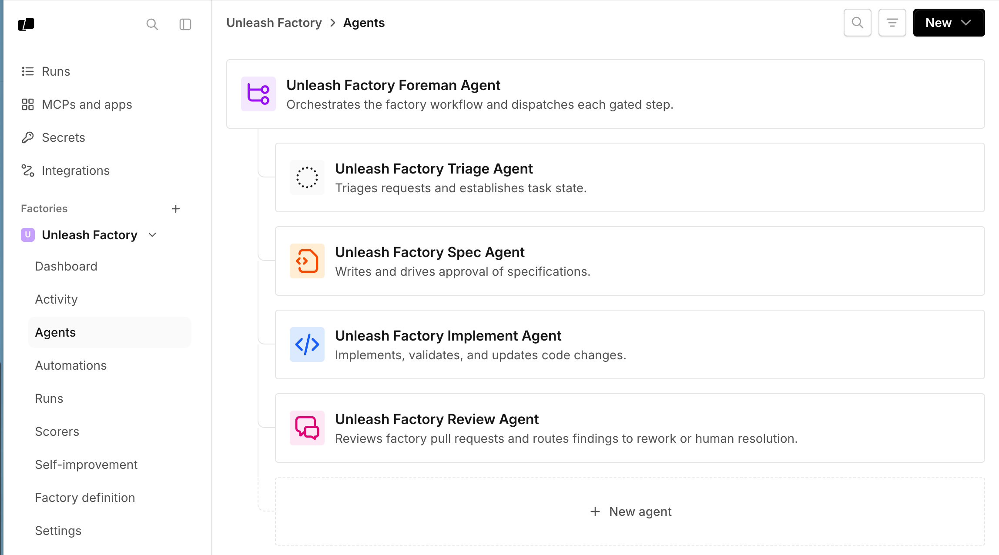
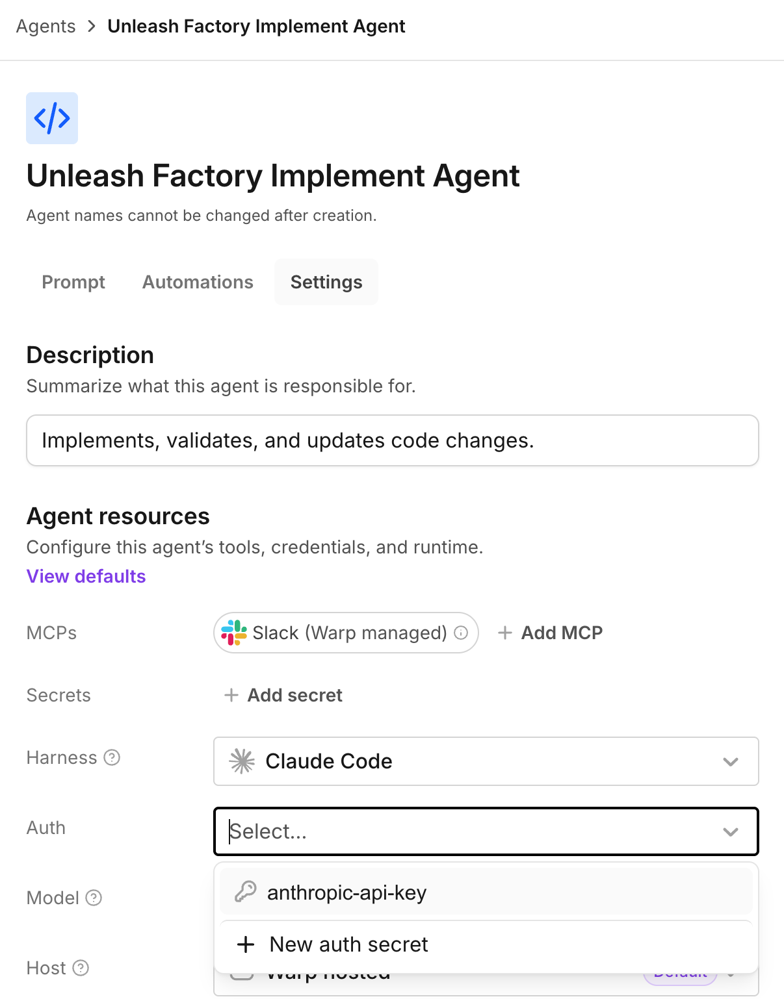

import { VARS } from '@data/vars';

Change how an existing factory agent works by editing its instructions, tools, and runtime in the <a href={VARS.FACTORY_WEB_APP_URL}>{VARS.FACTORY_WEB_APP}</a> or its definition files.

## Prerequisites

* [Editor access to this factory, or team or workspace admin access](/factories/infrastructure-and-security/#factory-roles-and-permissions).
* An existing factory agent. See [About factory agents](/factories/factory-agents/) for the default roles, or [Creating custom agents](/factories/factory-agents/creating-custom-agents/) to add a role.

## Edit agent settings and instructions

For a Warp-managed factory, edit agent settings in the web app. For a GitHub-backed factory, settings are read-only in the web app; edit the [factory definition files](/factories/factory-as-code/) instead. See [Where the definition lives](/factories/factory-as-code/#where-the-definition-lives).

1. In the web app sidebar, click your factory to expand it, then click **Agents**.

   <figure style={{ maxWidth: "563px" }}>
   
   <figcaption>The Agents page lists a factory's foreman and default agents.</figcaption>
   </figure>

2. Click an agent to open its **Settings** tab.

   <figure style={{ maxWidth: "563px" }}>
   
   <figcaption>The Settings tab contains the agent's description and resources.</figcaption>
   </figure>

3. Edit the agent description, harness, model, runner, host, [MCP servers](/factories/mcp/), or [secrets](/factories/secrets/).

4. To change the agent's instructions, click **Prompt** and edit the prompt.

5. In the top-right corner, click **Save**.

## Choose models and harnesses per agent

Choose each agent's model and harness in its settings. Supported harnesses include the Warp Agent, Claude Code, and Codex. A foreman using Claude Code or Codex can still dispatch other factory agents, whose runs are tracked as its children.

Third-party harness access depends on your team's plan and workspace settings. If a harness requires an upgrade, use the Warp Agent or review [Warp pricing](https://www.warp.dev/pricing).

Default model IDs change over time, so choose based on what each agent has to do well:

| Agent | What to optimize for |
| --- | --- |
| Foreman | Orchestration, instruction following, and long-running conversations |
| Triage | Research, evidence gathering, and working with connected tools |
| Spec | Synthesizing requirements, technical reasoning, and precise writing |
| Implement | Coding strength, with a harness that fits your repositories and toolchain |
| Review | A different model or harness from the implement agent, so the two don't share blind spots |

The model picker also includes custom routers from factories you can access. See [Agent model choice](/agents/inference/model-choice/), [Custom routers](/agents/inference/custom-routers/), and [Agent harnesses](/factories/harnesses/) for available options.

For team-managed inference in definition files, see [custom endpoint and BYOK model values](/factories/factory-as-code/#custom-inference-endpoints-and-byok), including factory defaults and per-agent overrides.

## Reviewing inference for provider ZDR

Before choosing a path, complete these checks. Both paths work in a browser without Warp Terminal.

1. Read [factory ZDR coverage and limits](/factories/zero-data-retention/). For Warp-managed inference, avoid [models that require retention](/agents/inference/model-choice/#models-requiring-provider-retention).
2. Confirm with an admin whose [provider account](/factories/infrastructure-and-security/#inference-options-for-factory-runs) serves inference. For customer-owned accounts or third-party harnesses, [verify ZDR with the provider](/factories/zero-data-retention/#choose-inference-covered-by-provider-zdr). Don't switch credentials or harnesses just to follow these steps.
3. Identify [where the definition is managed](/factories/factory-as-code/#where-the-definition-lives). In the factory web app, use **Settings** for the GitHub repository link or **Factory definition** for a Warp-managed definition. Ask an admin if unclear. API-managed factories have no definition files.

Agent and automation overrides can replace factory defaults.

### Reviewing a dashboard-managed factory

Review defaults and overrides in the web app with [editing access](#prerequisites). If controls are read-only, ask an admin to confirm access and management mode.

1. Open the <a href={VARS.FACTORY_WEB_APP_URL}>{VARS.FACTORY_WEB_APP}</a>, expand your factory, and click **Factory definition**. Open the existing `factory.yaml`.
2. In `factory.yaml`, review [`agentDefaults.model` or `agentDefaults.harness.model`](/factories/factory-as-code/#agentdefaultsmodel). For Warp-managed inference, select a model that doesn't require retention. Keep one form, preserving the harness and credentials.
3. Click **Save**. Resolve validation errors before continuing.
4. In **Agents**, open **Settings** for each agent, including the foreman. Review the "Harness" and "Model" selections. For Warp-managed inference, replace models requiring retention and click **Save**.
5. Complete every applicable [separate model check](#checking-separate-model-settings) and save those changes.
6. Reopen changed agents and confirm their model and harness match your intended values before [testing](#checking-new-runs). Saved files alone don't prove settings were applied.

### Reviewing a GitHub-backed factory

Review the definition in GitHub. You need permission to propose and merge changes. Dashboard editors are read-only.

1. In the <a href={VARS.FACTORY_WEB_APP_URL}>{VARS.FACTORY_WEB_APP}</a>, expand your factory, open **Settings**, and follow the definition repository link.
2. In GitHub, create a branch for the changes.
3. In `factory.yaml`, review [`agentDefaults.model` or `agentDefaults.harness.model`](/factories/factory-as-code/#agentdefaultsmodel). For Warp-managed inference, select a model that doesn't require retention. Keep one form, preserving the harness and credentials.
4. In each existing `agents/<name>/agent.md`, including the foreman, review `model` or `harness.model` overrides. For Warp-managed inference, replace models requiring retention. Preserve unrelated settings and instructions.
5. Complete every applicable [separate model check](#checking-separate-model-settings) in the definition files.
6. Open a pull request and confirm the [factory-definition PR checks](/factories/factory-as-code/#pull-request-checks) pass.
7. Merge the pull request into the connected production branch.
8. In the dashboard, reopen changed agents and confirm their model and harness match the merged values before [testing](#checking-new-runs). Passing checks doesn't prove settings were applied.

### Checking separate model settings

Complete every applicable check for features with separate models. For Warp-managed inference, replace models requiring retention. For customer-owned accounts, verify provider ZDR.

| If you use… | Check before starting work |
| --- | --- |
| Automations | Review `model` or `harness.model` in each existing `automations/<name>/automation.md`. These override the target agent. For dashboard-managed definitions, use **Factory definition**, not the **Automations** editor. |
| Computer Use | Review `agentDefaults.computerUseModel` in `factory.yaml` and `computerUseModel` overrides in agent and automation files. Omitted values inherit or use automatic selection. See [Computer Use inheritance](/factories/factory-as-code/#agentdefaultscomputerusemodel). |
| Scorers | For dashboard-managed definitions, review each "Judge model" in **Scorers** and save changes. For GitHub-backed definitions, edit `model` in `scorers/<name>/scorer.md`. |
| Custom routers | Inspect every target and default in the [router definition](/factories/factory-as-code/#routersnameyaml). If another factory owns it, ask its editor or admin to verify the choices, or select an inspectable concrete model. Access to this factory doesn't grant access elsewhere. |
| Benchmarks | Before launching, check each trial's harness, model, selected Scorers, and any supplied overrides. See [running a benchmark](/factories/benchmarks/#create-and-run-a-benchmark). |
| API, CLI, or agent-started runs | Check supplied model, harness, and Computer Use overrides before dispatching the run. |

Self-improvement uses a separate model, not the foreman's. Before sensitive use, ask Warp to confirm its model and provider coverage.

### Checking new runs

Test the reviewed configuration in a test factory with non-sensitive repositories and inputs. If changes fail validation or remain unapplied, stop and [contact support](/support-and-community/troubleshooting-and-support/sending-us-feedback/) with the factory link and, for GitHub, the merge commit. Don't send sensitive work.

1. In the factory web app sidebar, click **New Chat**.
2. In the dropdown below the prompt input, choose the test factory.
3. Send: “Reply with a greeting. Don't read repository files or call tools.” This checks a basic run, not every feature.
4. In **Runs**, open the new run and inspect its model and harness. Inspect child runs separately. If a selection differs, review agent, automation, and run overrides before sending sensitive work.

Next, test each changed feature that applies:

* Agents and automations: request a greeting or send a matching test event. Inspect the receiving agent and child runs.
* Computer Use: request the page title from `https://example.com`. Check for Computer Use in the session.
* Scorers: score a non-sensitive completed run. Inspect the judge configuration and result.
* Routers: test representative rules or complexity levels. Inspect resolved models, not only the router name.
* Benchmarks and caller overrides: run a non-sensitive trial or request with the reviewed choices. Inspect resulting runs.

Record settings inspected and features exercised separately. These checks don't prove provider contracts or every background request. Existing runs keep their model. Recheck new runs after configuration changes.

## Configuring a third-party harness

Change an agent's harness to Claude Code or Codex to run it with that provider's own coding tool.

1. In the web app sidebar, click your factory to expand it, then click **Agents**.
2. Click an agent to open its **Settings** tab.
3. In the "Harness" dropdown, choose **Claude Code** or **Codex**. The "Auth" field appears for these harnesses.
4. In the "Auth" field, choose a compatible, team-owned secret. To create one, click **New auth secret** for Claude Code or **New OpenAI API Key** for Codex.

   <figure style={{ maxWidth: "563px" }}>
   
   <figcaption>The Auth dropdown appears when a third-party harness is selected.</figcaption>
   </figure>

   :::note
   * Claude Code accepts an Anthropic API key, Anthropic Bedrock API key, or Anthropic Bedrock access key.
   * Codex accepts an OpenAI API key.

   See [connecting Claude Code credentials](/factories/harnesses/authentication/#connecting-claude-code-credentials) and [connecting Codex credentials](/factories/harnesses/authentication/#connecting-codex-credentials) for how to obtain each key.
   :::

5. In the "Model" dropdown, choose a model from that harness's catalog.
6. In the top-right corner, click **Save**.

With a Warp-managed factory, you can edit harness, auth, and model from the dashboard. A GitHub-backed factory sets them through [`agentDefaults.harness` or a per-agent `harness` override](/factories/factory-as-code/#agentdefaultsharness) in the definition files. For an example, see [`03-multi-harness`](https://github.com/warpdotdev/warp-factory-examples/tree/main/examples/03-multi-harness).

## Related pages

* [About factory agents](/factories/factory-agents/) - Understand responsibilities and human decision points
* [Creating custom agents](/factories/factory-agents/creating-custom-agents/)
* [Factory skills](/factories/factory-skills/)
* [Definitions as code](/factories/factory-as-code/)
