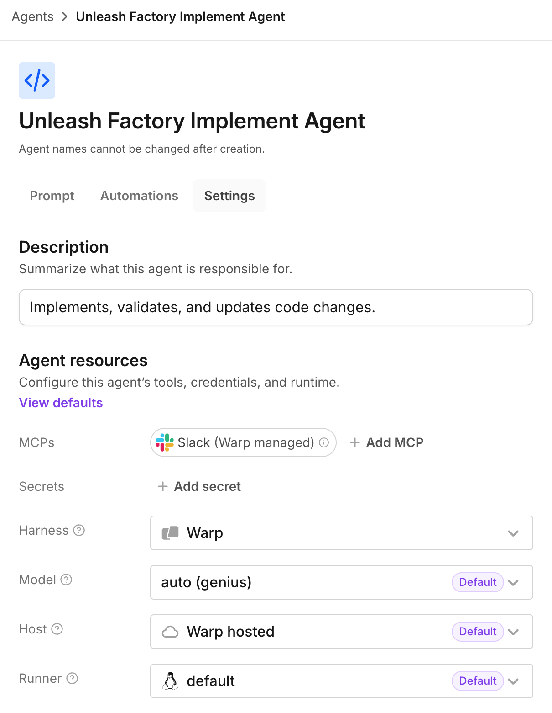

import { VARS } from '@data/vars';

Change how an existing factory agent works by editing its instructions, tools, and runtime in the <a href={VARS.FACTORY_WEB_APP_URL}>{VARS.FACTORY_WEB_APP}</a> or its definition files.

## Prerequisites

* [Editor access to this factory, or team or workspace admin access](/factories/infrastructure-and-security/#factory-roles-and-permissions).
* An existing factory agent. See [About factory agents](/factories/factory-agents/) for the default roles, or [Creating custom agents](/factories/factory-agents/creating-custom-agents/) to add a role.

## Edit agent settings and instructions

For a Warp-managed factory, edit agent settings in the web app. For a GitHub-backed factory, settings are read-only in the web app; edit the [factory definition files](/factories/factory-as-code/) instead. See [Where the definition lives](/factories/factory-as-code/#where-the-definition-lives).

1. In the web app sidebar, click your factory to expand it, then click **Agents**.

   <figure style={{ maxWidth: "563px" }}>
   
   <figcaption>The Agents page lists a factory's foreman and default agents.</figcaption>
   </figure>

2. Click an agent to open its **Settings** tab.

   <figure style={{ maxWidth: "563px" }}>
   
   <figcaption>The Settings tab contains the agent's description and resources.</figcaption>
   </figure>

3. Edit the agent description, harness, model, runner, host, [MCP servers](/factories/mcp/), or [secrets](/factories/secrets/).

4. To change the agent's instructions, click **Prompt** and edit the prompt.

5. In the top-right corner, click **Save**.

## Choose models and harnesses per agent

Choose each agent's model and harness in its settings. Supported harnesses include the Warp Agent, Claude Code, and Codex. A foreman using Claude Code or Codex can still dispatch other factory agents, whose runs are tracked as its children.

Third-party harness access depends on your team's plan and workspace settings. If a harness requires an upgrade, use the Warp Agent or review [Warp pricing](https://www.warp.dev/pricing).

Default model IDs change over time, so choose based on what each agent has to do well:

| Agent | What to optimize for |
| --- | --- |
| Foreman | Orchestration, instruction following, and long-running conversations |
| Triage | Research, evidence gathering, and working with connected tools |
| Spec | Synthesizing requirements, technical reasoning, and precise writing |
| Implement | Coding strength, with a harness that fits your repositories and toolchain |
| Review | A different model or harness from the implement agent, so the two don't share blind spots |

The model picker also includes custom routers from factories you can access. See [Agent model choice](/agents/inference/model-choice/), [Custom routers](/agents/inference/custom-routers/), and [Agent harnesses](/factories/harnesses/) for available options.

For team-managed inference in definition files, see [custom endpoint and BYOK model values](/factories/factory-as-code/#custom-inference-endpoints-and-byok), including factory defaults and per-agent overrides.

## Reviewing inference for provider ZDR

Use [factory ZDR guidance](/factories/zero-data-retention/) to check coverage for your model and provider account before changing settings. For Warp-managed inference, choose models outside the [provider-retention exception list](/agents/inference/model-choice/#models-requiring-provider-retention).

Review factory defaults, agent and automation overrides, and separate feature models such as Computer Use and Scorers. The [factory definition reference](/factories/factory-as-code/) lists these settings. Team-wide model restrictions and shared credentials belong in the [Admin Panel's Models settings](/enterprise/team-management/admin-panel/#models-settings).

Choose the path matching [where your factory definition is hosted](/factories/factory-as-code/#where-the-definition-lives).

### Factory definition hosted by Warp

With [editing access](#prerequisites):

1. In the <a href={VARS.FACTORY_WEB_APP_URL}>{VARS.FACTORY_WEB_APP}</a>, expand your factory and click **Factory definition**. Review model defaults and overrides in the existing definition files.
2. In **Agents**, open each agent's **Settings**, including the foreman's, and review the "Harness" and "Model" selections.
3. Save any changes, resolve validation errors, and reopen the settings to confirm the intended values before [checking a new run](#checking-new-runs).

### Factory definition hosted by GitHub

You need permission to propose and merge definition changes. The factory web app shows these files read-only.

1. In the <a href={VARS.FACTORY_WEB_APP_URL}>{VARS.FACTORY_WEB_APP}</a>, expand your factory, open **Settings**, and follow the definition repository link.
2. In GitHub, propose model changes in the existing definition files. Check factory defaults, agents including the foreman, and any automation or feature overrides.
3. Confirm the [factory-definition PR checks](/factories/factory-as-code/#pull-request-checks) pass, then merge into the connected production branch. Reopen the changed settings in the factory web app to confirm the values before [checking a new run](#checking-new-runs).

### Checking new runs

Use a test factory with non-sensitive repositories and inputs:

1. In the factory web app, click **New Chat** and choose the test factory below the prompt input.
2. Send: “Reply with a greeting. Don't read repository files or call tools.”
3. In **Runs**, open the new run and compare its model and harness with your selections. Check child runs and any features you changed separately.

If settings don't match, review overrides or [contact support](/support-and-community/troubleshooting-and-support/sending-us-feedback/) before sending sensitive work. A greeting checks the selected model, not [coverage for every AI request](/factories/zero-data-retention/#provider-zdr-coverage).

## Configuring a third-party harness

Change an agent's harness to Claude Code or Codex to run it with that provider's own coding tool.

1. In the web app sidebar, click your factory to expand it, then click **Agents**.
2. Click an agent to open its **Settings** tab.
3. In the "Harness" dropdown, choose **Claude Code** or **Codex**. The "Auth" field appears for these harnesses.
4. In the "Auth" field, choose a compatible, team-owned secret. To create one, click **New auth secret** for Claude Code or **New OpenAI API Key** for Codex.

   <figure style={{ maxWidth: "563px" }}>
   
   <figcaption>The Auth dropdown appears when a third-party harness is selected.</figcaption>
   </figure>

   :::note
   * Claude Code accepts an Anthropic API key, Anthropic Bedrock API key, or Anthropic Bedrock access key.
   * Codex accepts an OpenAI API key.

   See [connecting Claude Code credentials](/factories/harnesses/authentication/#connecting-claude-code-credentials) and [connecting Codex credentials](/factories/harnesses/authentication/#connecting-codex-credentials) for how to obtain each key.
   :::

5. In the "Model" dropdown, choose a model from that harness's catalog.
6. In the top-right corner, click **Save**.

With a Warp-managed factory, you can edit harness, auth, and model from the dashboard. A GitHub-backed factory sets them through [`agentDefaults.harness` or a per-agent `harness` override](/factories/factory-as-code/#agentdefaultsharness) in the definition files. For an example, see [`03-multi-harness`](https://github.com/warpdotdev/warp-factory-examples/tree/main/examples/03-multi-harness).

## Related pages

* [About factory agents](/factories/factory-agents/) - Understand responsibilities and human decision points
* [Creating custom agents](/factories/factory-agents/creating-custom-agents/)
* [Factory skills](/factories/factory-skills/)
* [Definitions as code](/factories/factory-as-code/)
