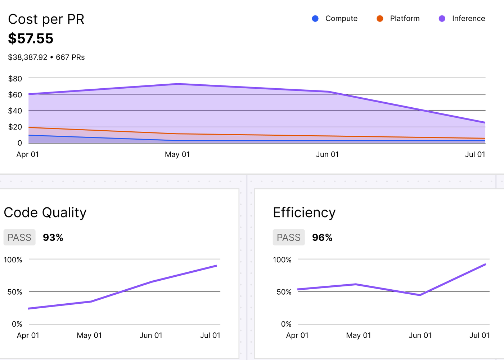

import { VARS } from '@data/vars';

The factory dashboard is the web app for operating a single factory. Open the <a href={VARS.FACTORY_WEB_APP_URL}>{VARS.FACTORY_WEB_APP}</a>, then select a factory to track its work, inspect its runs and pull requests, and manage its workers, automations, and settings.

:::note
"Factory dashboard" names the whole surface. **Dashboard**, in bold, is one page inside it: the metrics page you land on when you open a factory.
:::

## Getting oriented

Select a factory in the sidebar to open its pages. **Runs**, **MCPs and apps**, **Secrets**, and **Integrations** sit above the factory list and cover your whole team, not a single factory. **Home** sits there too, but it's a personal page that brings together your factory runs and items waiting on you across the factories you have access to.

To send work to a factory's foreman, click **New Chat** in the sidebar. In the dropdown below the prompt input, choose your factory, enter a request, then click the send arrow.

A factory opens on its **Dashboard** page, covered next. Use **Factory definition** to edit a definition hosted by Warp; edit a definition hosted by GitHub in its repository instead. See [where the definition lives](/factories/factory-as-code/#where-the-definition-lives).

To create credentials or grant workers access, see [managing secrets for factory workers](/factories/secrets/).

## Read metrics on the Dashboard page

**Dashboard** is the factory's landing page. It summarizes the factory over a date range you choose:

* **Autonomy** - The share of the factory's merged PRs that needed no human code push before merging. Opening the PR counts as a push, so a human-authored PR that a factory run later revised doesn't count as autonomous; comments, reviews, requested changes, and the merge itself don't count as a push.
* **PR cycle time** - The median time the factory's merged PRs took from run kickoff through PR, first review, and merge, with an independent median for each stage - the stage medians don't sum to the headline.
* **Cost per PR** - The median cost of PRs opened in the range. A run's cost includes its child runs and splits evenly across the PRs it produces. This is an estimate, not an invoice total. See [factory cost metrics](/factories/measure-and-improve/#read-metrics-on-the-dashboard-page) for limitations.

The page also charts opened versus merged PRs and a breakdown of runs, and the **Cost per PR** card expands to list the most expensive PRs in the range. When Scorers are set up, Scorer cards summarize recent classification results.

<figure style={{ maxWidth: "563px" }}>

<figcaption>Cost per PR and example Scorer cards on the Dashboard page.</figcaption>
</figure>

<span id="find-what-needs-you-in-inbox" />
<span id="find-what-needs-you-on-home" />

## See what needs your attention on Home

**Home** defaults to the **Waiting on you** status filter, showing questions, spec approvals, pull request reviews, and other items that need your attention. See [Reviewing items on Home](/factories/factory-home/) for the item kinds and how to resolve them.

## Inspect runs

A run is a single agent execution. In a factory, the configured agent is called a worker. A request can span several runs as different workers pick it up, and related runs group under their parent in the list. In the sidebar, click **Runs** to see the runs you have access to across your team.

Open a run to see its timeline, cost, and child runs. From there you can view the worker's full session, stop or score the run, or turn it into a benchmark task.

:::note
Run pages don't include a chat input. **View worker** opens the worker's [shared agent session](/platform/viewing-cloud-agent-runs/), the conversation where you can inspect commands, outputs, and follow-up messages. You can send instructions while the sandbox is active; after it shuts down, the link opens the transcript.
:::

## View and edit a Blueprint

{/* VERIFY: Confirm live Blueprint navigation, stage and transition inspection, and diagram editing before publication; no product UI capture is available yet. */}

Select **Blueprint** in the factory dashboard's sidebar to view the workflow diagram. Select a stage to inspect its worker and instructions, or select a transition to read its condition.

Edit the diagram to change the Blueprint, or edit it in the [definition files](#edit-definitions-in-the-factory-definition-tab). Definitions hosted by GitHub are read-only in the app; propose those changes in the repository instead. To change a worker's model, harness, or tools, edit its [worker configuration](/factories/factory-agents/configuration/).

A Blueprint graph describes the workflow; inspect the run conversation, PR diff, and check results to verify what actually happened. Existing work keeps the Blueprint selected when its run started.

<span id="manage-agents-and-automations" />

## Manage workers and automations

**Workers** lists the factory's workers. [Create custom workers](/factories/factory-agents/creating-custom-agents/) or [configure existing workers](/factories/factory-agents/configuration/) to change their instructions, models, harnesses, and tools. **Automations** defines the triggers that start runs: a schedule (including custom cron expressions), a GitHub, Linear, Slack, or Jira event, or a delivery to a custom webhook. **Webhooks** is a tab within **Automations** that lists the factory's [custom webhooks](/factories/webhooks/), where you create them, copy their URLs, rotate secrets, and read the delivery log.

The automation editor doesn't change execution settings. Worker-targeted automations can use [execution overrides in the definition files](/factories/factory-as-code/#execution-overrides); stage-targeted automations use the stage worker's settings instead. When the factory's definition lives in an external repository, Workers, Automations, and Scorers are read-only; make changes there through pull requests.

## Edit definitions in the Factory definition tab

**Factory definition** is the factory dashboard's view of the definition files that [definitions as code](/factories/factory-as-code/) describes in full. Where the definition lives decides what you get:

* **Hosted by Warp** - Browse and edit the definition files, or clone the repository to work locally. Saving in the editor commits changes to the selected branch.
* **Hosted by GitHub** - Edit the definition through pull requests in your repository; **Settings** links back to it.
* **Live-managed** - The factory is managed through the API, so there are no definition files to browse.

When a worker proposes a change to a definition hosted by Warp, a spec review for the branch appears on [Home](/factories/factory-home/) when the **Waiting on you** filter is selected. Open the spec review to comment on the diff, select **Request changes** to send feedback to the worker, or select **Approve & merge** to merge the change.

### Clone a Warp-hosted definition

You need Git and a Warp account with factory access.

1. In **Factory definition**, open the actions menu beside **Save**, then click **Clone repository** to open the clone dialog.
2. Install the [{VARS.WARP_CLI}](/agents/cli/quickstart/#1-install-the-warp-agent-cli). Run `warp` and sign in through the browser, not with a Warp API key.
3. Run the authentication setup from the **Clone repository** dialog in bash or zsh once per machine. It replaces credential helpers for that host with a helper that obtains short-lived credentials from the signed-in CLI.
4. Run the dialog's clone command. Enter the new directory.

### Push and review a branch

Git pushes can't update the protected production branch. Other branches don't deploy changes. Merge through the dashboard to update the factory.

1. Locally, create a branch:

   ```bash
   git switch -c update-review-instructions
   ```

2. Edit the definition files. Check the diff, then commit and push:

   ```bash
   git diff
   git add PATH_TO_CHANGED_FILE
   git commit -m "Update review instructions"
   git push -u origin update-review-instructions
   ```

   Replace `PATH_TO_CHANGED_FILE` with each file you edited.

3. In **Factory definition**, open the branch selector. Search for your feature branch name (`update-review-instructions` in this example), then choose that branch. **Save** commits further edits to that branch. The production branch is marked "Production".
4. In the actions menu, click **Create PR** to open a review against production.
5. Inspect the diff and merge checks. If authorized, click **Approve & merge**, then confirm.

## Score and benchmark

**Scorers** is where you create Scorers and read their results. **Self-improvement** lists the pull requests the self-improvement flow opens after analyzing runs your Scorers mark as failing, and **Benchmarks** compares model and runner configurations against a fixed set of tasks. See [Configuring Scorers](/factories/measure-and-improve/scorers/), [Configuring and reviewing Self-improvement](/factories/measure-and-improve/self-improvement/), and [benchmarking factory worker configurations](/factories/benchmarks/) for what each one is and how to use it.

## Change factory settings

**Settings** holds the configuration the factory owns:

* **Identity** - The factory's name, avatar, and ["Foreman name"](/factories/factory-as-code/#alias), the handle your team @-mentions.
* **Repositories** - The repos the factory works in.
* **Pull request authorship** - Whether pull requests are authored by the worker or the run creator (the definition's [`credentialStrategy`](/factories/factory-as-code/#credentialstrategy)).
* **Analysis model** - The model [Self-improvement](/factories/measure-and-improve/self-improvement/) uses to analyze failed runs.
* **Runners** - The compute the factory's runs execute on. See [factory runners](/factories/runners/) to choose runner configuration or [managed self-hosting](/factories/self-hosting/) to run factory work on your infrastructure.
* **Integrations** - The integrations this factory can access.
* **Deletion** - Deletes the factory. This cannot be undone.

For a file-managed factory, `runners/*.yaml` in the repository is the source of truth. Anything managed in an external repository is read-only in Settings.

## Related pages

* [Reviewing items on Home](/factories/factory-home/) - See and resolve the questions, spec approvals, and PR reviews waiting on you
* [How Warp Factories work](/factories/how-factories-work/) - The stages work moves through and where humans stay in the loop
* [Definitions as code](/factories/factory-as-code/) - Define workers, automations, runners, and source ownership in code
* [Factory workers](/factories/factory-agents/) - Understand default worker roles
* [Configuring factory workers](/factories/factory-agents/configuration/) - Edit worker instructions and runtime settings
* [Measure and improve a factory](/factories/measure-and-improve/) - Configure Scorers and use them in an improvement loop
* [Factory benchmarks](/factories/benchmarks/) - Create a benchmark suite and compare configurations on fixed tasks
* [Troubleshooting Warp Factories](/factories/troubleshooting/) - Fixes for setup problems, work that doesn't start, and stuck runs
