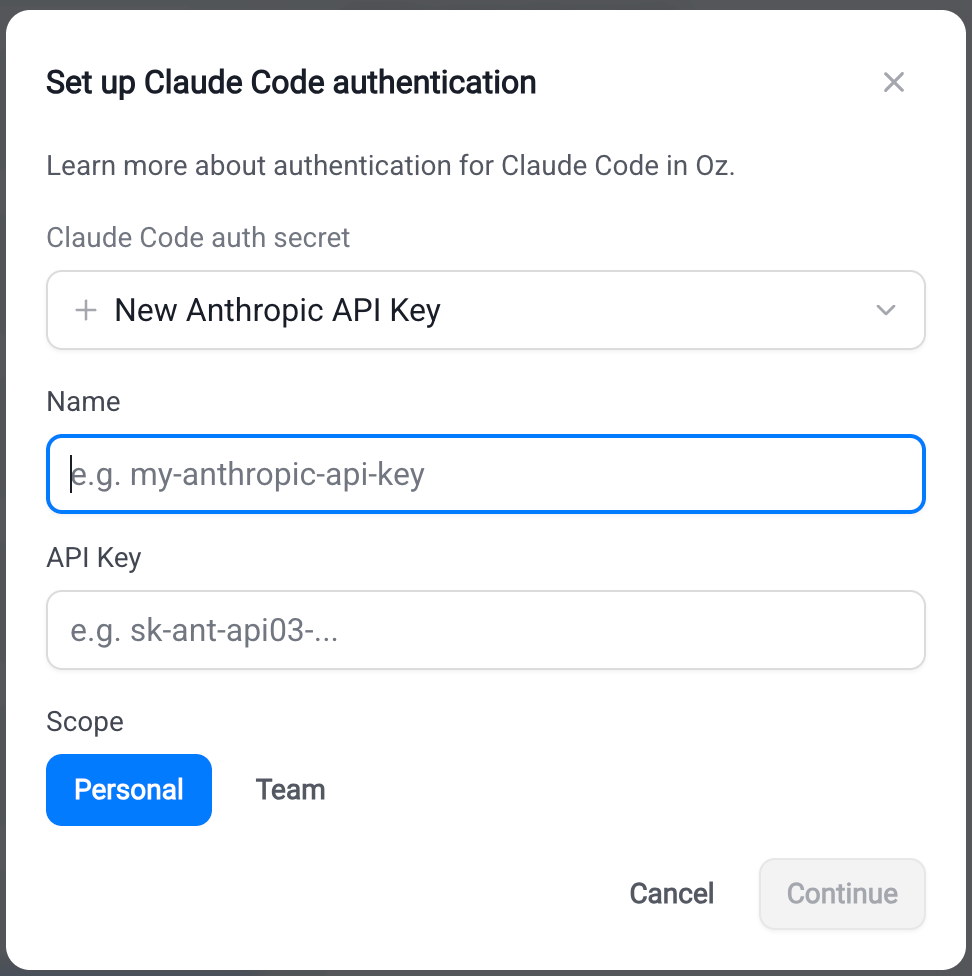

import { VARS } from '@data/vars';

Authenticate [Claude Code](#connecting-claude-code-credentials) or [Codex](#connecting-codex-credentials) with a provider credential stored as a Warp-managed secret. For a factory agent, select a compatible team-owned auth secret in [Configuring factory agents](/factories/factory-agents/configuration/#configuring-a-third-party-harness). The Warp Agent does not need a third-party harness auth secret.

Auth secrets can be scoped to a **team** or to your **personal** account. A factory agent can only select team-scoped secrets. Personal secrets remain available for your own ad hoc cloud runs; creating a factory is not required for those runs.

The procedures below configure managed-secret authentication, not local CLI sign-in or a personal device key for the Warp Agent. See [Bring Your Own Key (BYOK)](/agents/inference/bring-your-own-api-key/) for that separate inference configuration. For credentials supplied by a self-hosted worker instead of a selected secret, follow the [self-hosting configuration](/factories/self-hosting/).

## Factory authentication

Create the provider credential using the sections below, then select the team-owned secret in the factory agent's "Auth" field. Follow [Configuring factory agents](/factories/factory-agents/configuration/#configuring-a-third-party-harness) for dashboard and definition-file setup. See [Managing factory secrets](/factories/secrets/) for shared-secret ownership and access.

The Warp app, legacy web app, and CLI procedures below also support standalone cloud runs. Select personal scope only when the run acts as you rather than as a factory agent.

## Connecting Claude Code credentials

Claude Code is Anthropic's agentic coding tool. For more on Claude Code authentication, see [Anthropic's Claude Code auth docs](https://code.claude.com/docs/en/authentication).

### Create an Anthropic API key

1. Sign in to the [Anthropic Console](https://platform.claude.com/login?returnTo=/?).
2. Confirm the API account has funding for the run. Direct API usage is billed to that account.
3. Create an API key in the console's API keys section. Store it securely for the next step.

If your team consumes Anthropic models through Amazon Bedrock, use an **Anthropic Bedrock API key** or **Anthropic Bedrock access key** credential instead. Bedrock credentials route inference through AWS rather than directly to Anthropic.

### Store the API key

#### Warp desktop app

In the Warp desktop app, start a standalone cloud run. In the "Agent harness" dropdown, choose **Claude Code**, then add or select your Anthropic credential in the harness auth secret field.

#### Web app

In the {VARS.WEB_APP}, start a <a href={`${VARS.WEB_APP_URL}/runs/new`}>new run</a>. In the "Harness" dropdown, choose **Claude Code**, then add a key in the Claude Code auth secret dialog.

<figure style={{ maxWidth: "563px" }}>

<figcaption>The Claude Code auth secret dialog.</figcaption>
</figure>

#### CLI

In the {VARS.WARP_AGENT_CLI}, create a typed Anthropic secret. Replace `KEY_NAME` with a name for the stored credential; the command prompts for its value.

```bash
oz secret create claude api-key --team KEY_NAME
```

For Bedrock credentials, use the matching typed command and enter the requested AWS credential and region:

```bash
oz secret create claude bedrock-api-key --team KEY_NAME
oz secret create claude bedrock-access-key --team KEY_NAME
```

Add `--description "..."` to record rotation notes or owner info. Replace `--team` with `--personal` to make the secret available only to your own runs.

**Expected outcome.** `oz secret list` shows the new secret with the matching Anthropic credential type. The value is never displayed.

## Connecting Codex credentials

Codex is OpenAI's coding agent. For more on Codex authentication, see [OpenAI's Codex auth docs](https://developers.openai.com/codex/auth).

For this cloud managed-secret setup, use an OpenAI API key with funded API access. A ChatGPT subscription sign-in used by local Codex is a different authentication path.

### Create an OpenAI API key

1. Sign in to the [OpenAI Platform](https://platform.openai.com/).
2. Confirm the API account has funding. Runs with this credential are billed to the API account, not a ChatGPT subscription.
3. In the API keys section, create a key with the project and permissions needed by the run. Store it securely for the next step.

### Store the API key

#### Warp desktop app

In the Warp desktop app, start a standalone cloud run. In the "Agent harness" dropdown, choose **Codex**, then add or select your OpenAI credential in the harness auth secret field.

#### Web app

In the {VARS.WEB_APP}, start a <a href={`${VARS.WEB_APP_URL}/runs/new`}>new run</a>. In the "Harness" dropdown, choose **Codex**, then add a key in the Codex auth secret dialog.

#### CLI

In the {VARS.WARP_AGENT_CLI}, create a typed OpenAI secret. Replace `KEY_NAME` with a name for the stored credential; the command prompts for its value.

```bash
oz secret create codex api-key --team KEY_NAME
```

Add `--description "..."` to record rotation notes or owner info. Replace `--team` with `--personal` to make the secret available only to your own runs.

**Expected outcome.** `oz secret list` shows the new secret with the matching OpenAI credential type. The value is never displayed.

## Managing harness auth secrets

Auth secrets follow the Warp-managed secret lifecycle. See [Managing factory secrets](/factories/secrets/) for shared-secret ownership or [Cloud agent secrets](/platform/secrets/) for the CLI lifecycle commands. In the {VARS.WARP_AGENT_CLI}, use the secret's name, not its value, in these commands:

```bash
# List secrets you can see
oz secret list

# Rotate a secret value (prompts for the new value)
oz secret update --team --value ANTHROPIC_API_KEY

# Update the description
oz secret update --team --description "Rotated 2026-05-12; owned by platform team" ANTHROPIC_API_KEY

# Delete a secret (irreversible)
oz secret delete --team ANTHROPIC_API_KEY
```

:::caution
Before deleting an auth secret, update every factory agent, schedule, or integration that references it. Runs using the deleted credential can no longer authenticate.
:::

## Troubleshooting

**Claude Code or Codex run fails with an authentication error.**\
For managed-secret authentication, confirm the run was started with the correct auth secret selected. For a factory agent, inspect the "Auth" selection in its settings. For a standalone run, inspect the selected harness auth secret in the {VARS.WEB_APP}. Re-launch with the correct secret, or create a compatible credential if none exists.

**The harness auth secret dropdown is empty.**\
The dropdown only lists secrets whose type matches the selected harness: Anthropic types for Claude Code, OpenAI for Codex. Factory agents also require team scope. If you stored the credential as a raw value or in personal scope for a factory, create a compatible team-scoped secret using the typed flow above.

**The selected harness is disabled.**\
Your team admin has disabled the harness for your workspace. Contact your admin or pick a different harness for the run.

## Related pages

* [Choosing agent harnesses](/factories/harnesses/)
* [Configuring factory agents](/factories/factory-agents/configuration/)
* [Managing factory secrets](/factories/secrets/)
* [Claude Code in Warp](/agents/cli-agents/claude-code/) - Run Claude Code locally
* [Codex CLI in Warp](/agents/cli-agents/codex/) - Run Codex locally
* [Cloud agent secrets](/platform/secrets/) - Manage standalone cloud credentials
