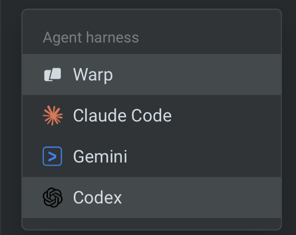

import { VARS } from '@data/vars';
import VideoEmbed from '@components/VideoEmbed.astro';

A harness is the agent runtime that works on a task. Choose the [Warp Agent](/factories/harnesses/warp-agent/), [Claude Code](/factories/harnesses/claude-code/), or [Codex](/factories/harnesses/codex/) for each factory agent. For example, use Claude Code for an implement agent and the Warp Agent for a review agent.

Set the harness, model, and team-owned authentication in [Configuring factory agents](/factories/factory-agents/configuration/#configuring-a-third-party-harness). For file-based configuration, set a default or per-agent override in the [factory definition](/factories/factory-as-code/#agentdefaultsharness).

You can also select a harness for a standalone cloud run without creating a factory. The walkthrough shows these standalone cloud-agent surfaces.

<VideoEmbed url="https://www.youtube.com/watch?v=ZUYyuA5i1VU" title={`Run any agent in the cloud with the ${VARS.WARP_AUTOMATION_PLATFORM} - Claude Code, Codex, or Warp Agent`} />

## Shared cloud-run capabilities

* **Triggers** - Select a harness for agents launched by [factory automations](/factories/automations/) or standalone [triggers](/platform/triggers/).
* **Environments and secrets** - Configure the run's [environment](/factories/environments/) and credentials. Factory agents use [factory secrets](/factories/secrets/); standalone runs have their own [secret configuration](/platform/secrets/).
* **Instructions** - Use [skills](/agents/capabilities/skills/) for reusable work and [Rules](/agents/capabilities/rules/) for project guidance. Harnesses have their own tool and context behavior; selecting a harness does not make every local feature available in a cloud run.
* **Observability** - Inspect factory runs in the factory dashboard, or standalone runs in the [{VARS.DASHBOARD}](/platform/managing-cloud-agents/).

## Plan requirements

Third-party harness access depends on your plan and workspace settings. If a harness requires an upgrade, use the Warp Agent or review [Warp pricing](https://www.warp.dev/pricing). A team admin can also disable a harness for the workspace.

## Billing

With the [provider credentials described here](/factories/harnesses/authentication/), your inference provider bills your account. Warp charges for [Warp-hosted compute](/support-and-community/plans-and-billing/credits/#compute-usage) and [platform usage](/support-and-community/plans-and-billing/platform-credits/) according to your plan or contract. External inference bills are not fully represented in Warp's [cost summaries](/support-and-community/plans-and-billing/credits/#charges-and-estimates).

## How to switch harnesses

For a factory agent, follow [Configuring factory agents](/factories/factory-agents/configuration/). The following alternatives select a harness for a standalone run.

### Warp app

In the Warp app's Cloud Mode, choose a harness from the "Agent harness" dropdown above the input.

<figure style={{ maxWidth: "375px" }}>

<figcaption>The Agent harness selector.</figcaption>
</figure>

:::note
You can enter Cloud Mode by creating a new **Cloud Agent** tab or by using the `/cloud-agent` slash command.
:::

### Web app

In the {VARS.WEB_APP}, open the new run or new schedule pane. In the "Harness" dropdown, choose the harness.

### API and SDK

Set the agent config's `harness.type` to one of the [harness identifiers](#harness-identifiers). The API takes a harness object, not a bare harness string. See the [API reference](/factories/api-and-sdk/) for the schema and authentication fields.

## Harness identifiers

Use `oz` for the Warp Agent, `claude` for Claude Code, and `codex` for Codex in stored configuration:

* **API and SDK** - The agent config's `harness.type` accepts `oz`, `claude`, or `codex`.
* **CLI** - In the {VARS.WARP_AGENT_CLI}, `oz agent run-cloud --harness` accepts these identifiers, plus `claude-code` as an alias for `claude`.
* **Factory definition files** - Use `oz`, `claude`, or `codex` in [`harness.type`](/factories/factory-as-code/#agentdefaultsharness). `claude-code` is also accepted as a Claude Code alias.

Agent orchestration tools can use `claude-code` as their Claude Code label. Follow the schema for the surface you're using rather than copying a tool-call label into an API request.

## Related pages

* [Configuring factory agents](/factories/factory-agents/configuration/) - Select a harness and its team-owned auth secret
* [Warp Agent](/factories/harnesses/warp-agent/)
* [Claude Code](/factories/harnesses/claude-code/)
* [Codex](/factories/harnesses/codex/)
* [Configuring harness authentication](/factories/harnesses/authentication/)
* [Multi-agent orchestration](/platform/orchestration/) - Coordinate ad hoc parent and child agents
* [Third-party CLI agents overview](/agents/cli-agents/overview/) - Run CLI agents locally in Warp
