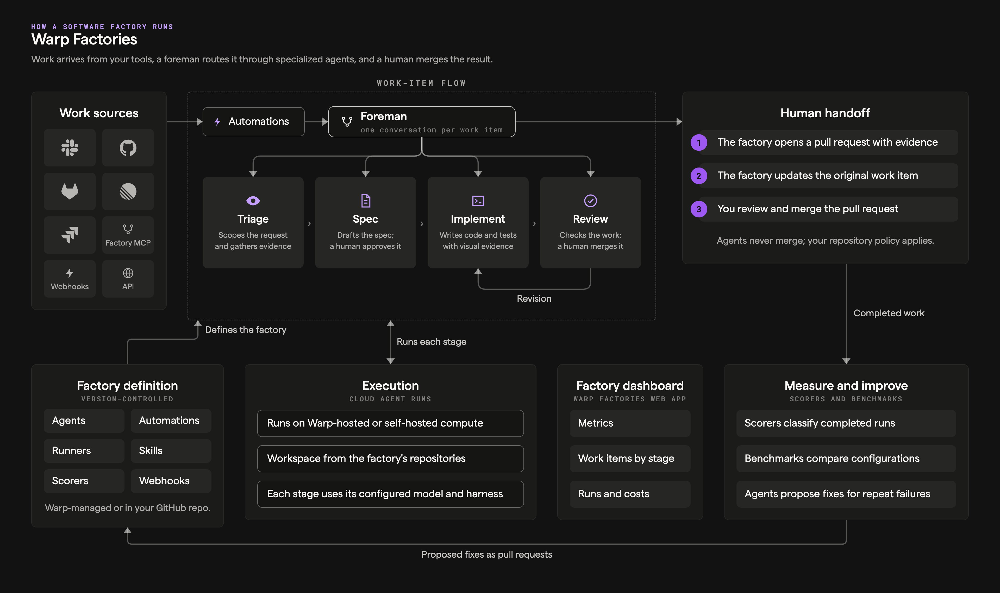
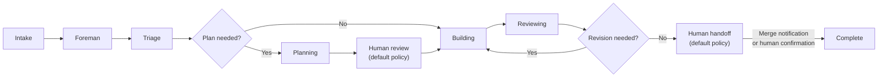

Warp Factories provides the infrastructure for development workflows you define and configure. Your [definition files](/factories/factory-as-code/) connect repositories, agents, and automations. Use Scorers to check runs against criteria you define, and benchmarks to compare configurations on the same tasks. See [Measure and improve](/factories/measure-and-improve/).

The foreman agent drives the workflow and communicates through the tool where work started, such as Slack or Linear. A [Blueprint](./blueprints/) defines its stages, worker assignments, procedures, routes, and human gates. Those workflow instructions take precedence over stage lists in agent prompts. Definitions without a Blueprint keep routing in the foreman's instructions.

A work item is a single request the factory acts on, such as an issue, support request, pull request, or Factory MCP task. It keeps its identity from intake to handoff, however many agents contribute to it along the way.

## How a work item moves through the factory

The foreman gathers each stage's declared inputs from the request and earlier results. It runs stages assigned to itself in its conversation and delegates other stages to their workers, continuing existing conversations when work returns for revisions.

Not every work item needs every stage. With a Blueprint, the foreman takes the first route whose prose condition matches the request or the preceding stage's outputs. Configure those routes to skip work that is already defined or send changes back for revision. A delegated worker returns its stage's outputs; the foreman selects what happens next.

### Stages

The diagram below shows a typical issue-to-PR workflow. Your Blueprint chooses which stages run and when work returns for revision.

* **Intake** - A work item enters from a [connected integration](/factories/connect-your-factory/), an automation, a direct run, or the [Factory MCP](/factories/factory-mcp/). [Automations](/factories/automations/) filter events and schedules and select an agent or Blueprint entry stage. Direct requests go to the foreman. The work item keeps its source context as it moves through later stages.
* **Triage** - The triage agent researches the request, reproduces the problem when needed, and defines the scope and complexity of the change. The foreman skips this stage when the request already explains the problem and what needs to change.
* **Planning** - The spec agent defines product behavior, technical constraints, and validation criteria. The foreman skips this stage for small, well-understood changes.
* **Building** - The implement agent makes the code change on a branch and opens a pull request with test and visual evidence.
* **Reviewing** - The review agent checks the change against the requirements, tests, and security expectations, then sends findings back for another pass. Its verdict is advisory.
* **Human handoff** - The factory presents the result, its evidence, and any findings, and updates the original work item. A person decides what happens next.
* **Complete or Cancelled** - By default, the foreman completes the work item after a merge notification or confirmation that the pull request landed. Handoff alone doesn't complete it. A cancellation stops the work early.

Stages and agents are named separately, so the spec agent works the planning stage, the implement agent works the building stage, and the review agent works the reviewing stage. See [About factory agents](/factories/factory-agents/) for each agent's responsibilities.

These lifecycle names describe the default workflow, not a required sequence or a list of Blueprint stage identifiers. A Blueprint's stage names come from its definition. Existing work retains the Blueprint selected when its run started, even after you apply a definition change.

Each agent's run is a [cloud agent run](/platform/) on Warp-hosted or [managed self-hosted](/factories/self-hosting/) compute, using the factory's repositories and the agent's configured model and [harness](/factories/harnesses/). Watch and steer runs from the factory's [Runs page](/factories/factory-dashboard/#inspect-runs). Work that needs your input appears in the **Waiting on you** status filter on [Home](/factories/factory-home/).

## Where your team stays in charge

A factory pauses when a person needs to decide. By default, that's three places:

* **Approving the spec** - When work needs a spec, implementation waits until a person signs off on the plan.
* **Answering questions** - When requirements are unclear or a review finding is ambiguous, the foreman asks instead of guessing.
* **Merging** - The factory opens the pull request and hands it off. Whether and when it merges is your team's call.

In a Blueprint, [add gates](./blueprints/gates/) for the first two decisions. A gate pauses the stage until you answer; its outgoing routes distinguish approval from requested changes. In a definition without a Blueprint, those checkpoints remain in the foreman's instructions. Use branch protection and repository permissions to enforce human-only merges.

## How the factory improves itself

[Scorers](/factories/measure-and-improve/scorers/) classify completed runs against criteria you write, and [Self-improvement](/factories/measure-and-improve/self-improvement/) groups the failures they flag into follow-up runs that propose fixes to the application code or to the factory's own definition. Every proposal arrives as a pull request for your review; nothing is adopted on its own.

Use [benchmarks](/factories/benchmarks/) to compare configurations on the same tasks.

A factory's agents, automations, runners, scorers, skills, and webhooks are configured in [definition files](/factories/factory-as-code/), either managed by Warp or stored in a GitHub repository your team owns. Anyone on the team, or an agent, can propose changes to the definition, including its instructions, skills, and models. Definitions stored in GitHub go through pull request review and [configuration checks](/factories/factory-as-code/#pull-request-checks) before a change reaches the production branch.

## Related pages

* [About Blueprints](./blueprints/) - Choose stages, routes, and human gates
* [Sizing a factory](/factories/#sizing-a-factory) - Which repositories belong in one factory.
* [About factory agents](/factories/factory-agents/) - What each default agent does and how to configure it.
* [Connect your factory](/factories/connect-your-factory/) - Every way work can enter a factory.
* [Measure and improve](/factories/measure-and-improve/) - Scorers, benchmarks, and Self-improvement.
* [Build a self-improving agent](/guides/agent-workflows/build-a-self-improving-agent/) - Apply the same loop to a standalone agent.
