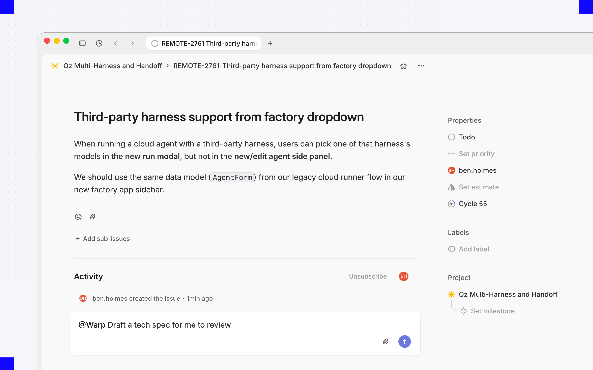

Connect Linear to your factory so your team can send issues without leaving Linear. Assign an issue to the factory or tag it in a comment, and the factory picks it up with the issue's full context, then keeps the issue updated as the work moves through [its stages](/factories/how-factories-work/).

When the factory needs an answer, reply in Linear, or open the live run to steer the agent directly.

## Prerequisites

* A factory with the agents and repositories needed for Linear work. See the [Warp Factories quickstart](/factories/quickstart/).
* A Linear account that can authorize the Warp app for the workspace.
* A Warp account linked to your Linear user to start agent sessions.
* Repository access through the factory's [GitHub connection](/platform/integrations/github/) for code changes and pull requests.

For workspace-level installation, reconnection, and removal steps, see the [Linear integration setup guide](/platform/integrations/linear/).

## Permissions

Linear app authorization is separate from linking a teammate's Warp account. In Linear's `actor=app` authorization model, a workspace admin installs the app, and updates are attributed to the app rather than the installer.

**Production scope inventory pending verification.** The table lists the scopes in Warp's development provider configuration, not a confirmed export of the production registration or consent screen. Engineering must compare the deployed request with this list, including any additional grants.

{/* VERIFY: Confirm the complete production Linear OAuth scope list and actor=app setting against the app registration and authorization request; the six scopes below come from development provider configuration only. */}

| Scope to confirm | Granted access | Function in Warp | Boundary |
| --- | --- | --- | --- |
| `app:assignable` | Let the app be delegated issues and made a project member | Delegate work to the factory | Doesn't grant repository access |
| `app:mentionable` | Let the app be mentioned in issues, documents, and other editor surfaces | Start an agent session with a mention | Not itself a grant to edit those resources |
| `comments:create` | Create issue comments | Acknowledge requests and post results | Narrower than the separately listed `write` scope |
| `issues:create` | Create and update issues, and create their attachments | Create or update tracked work | Despite its name, this scope isn't create-only |
| `read` | Read data available to the app | Retrieve issue context and workspace metadata | Subject to the app's team access in Linear |
| `write` | Broad write access available to the app | Update issues, workflow state, and delegation | Broader than comment creation; trigger filters don't narrow this grant |

These scope meanings follow [Linear's OAuth reference](https://linear.app/developers/oauth-2-0-authentication) and [app authentication model](https://linear.app/developers/agents#actor-and-scopes). A workspace admin can change or revoke the app's team access in Linear. Selecting teams for a factory's automations controls routing, not the underlying OAuth grant.

## Connect Linear

You connect Linear either while creating a factory, at the **Connect your issue trackers** step, or afterward from the factory's **Settings**. Either way you do the same two things:

1. **Authorize Warp for your Linear workspace.** This is Linear's own OAuth flow, and it's only needed once per workspace.
2. **Choose which Linear teams trigger this factory.**

Warp then adds a default automation that routes new [agent sessions](#route-agent-sessions) from those teams to your factory. Issue and comment activity doesn't start work until you [add triggers](#configure-linear-triggers) for it.

## Route agent sessions

If Warp can't identify the session creator, Linear shows an authentication prompt instead of starting work.

When someone mentions, assigns, or delegates the Warp app on an issue, Linear starts an agent session. The default automation created when you connected Linear routes new sessions from your selected teams to the factory, so assigning an issue or tagging the factory in a comment is enough to start work. If a session doesn't match any automation, the [Linear integration](/platform/integrations/linear/) handles it with its default behavior.

<figure style={{ maxWidth: "563px" }}>

<figcaption>Mentioning the Warp app in an issue comment starts an agent session.</figcaption>
</figure>

Replies in an existing session continue that run rather than starting a new one. To narrow which sessions reach the factory, such as by creator or keyword, edit the `agent_session_created` trigger in the factory's [definition files](/factories/factory-as-code/); session routing isn't editable from the automation editor.

## Configure Linear triggers

Agent sessions cover explicit requests. To start work automatically from issue and comment activity too, add an automation with a **Linear** trigger for one of these events: **Issue created**, **Issue labeled**, **Issue state changed**, **Issue assigned**, or **Comment created**. To learn how to edit those filters, see [Automations](/factories/automations/#edit-filters-on-an-automation).

Every Linear trigger filters on teams and labels, and **More filters** adds project, workflow state, assignee, mentioned user, and, for comment events, a specific issue. For example, a trigger can require that an issue belongs to one team, enters a chosen workflow state, and carries a release label.

For the exact `event` value each of these triggers uses in a definition file, see [triggers](/factories/factory-as-code/#triggers).

## Supported events and outputs

Each event determines the context the agent receives and the updates the factory sends back.

| Linear event | What the agent receives | What the factory sends back |
| --- | --- | --- |
| Issue created, labeled, state changed, or assigned | The issue's title, description, team, project, labels, workflow state, and assignee | Work item progress, issue state or delegate changes, and links to results |
| Comment created | The new comment and its issue's context | An acknowledgment, progress updates, and responses |
| Agent session created | The request that mentioned, assigned, or delegated the Warp app | Live progress in the session, plus links to the run and any pull request |
| Reply in an agent session | The new message and the session history | Continued work in the same session, not a separate work item |

## Follow-up events on the same issue

Once a Linear issue is linked to a factory work item, later matching events on that issue continue the same work item instead of creating a new one.

:::caution
One comment can match two routes: a comment that creates an agent session can also match a **Comment created** trigger. If both point at your factory, a single action starts two runs. Scope your automations so one path owns each kind of request.
:::

## What the factory can do in Linear

In an agent session, the factory posts its plan, actions, and results as it works. It can also attach a GitHub pull request to the issue, update the issue's workflow state or delegate, link back to the run, and acknowledge comments it acts on. Its own Linear activity never triggers automations, so a factory can't set itself off in a loop.

Only agent sessions require a linked Warp account. Issue and comment events from unlinked users still start work, but Warp may not record who requested it.

Connecting Linear doesn't grant repository access. Branches and pull requests use the factory's code-host credentials, and the pull request still waits for a person to review and merge.

## Troubleshooting

* **An agent session shows an authentication prompt** - Complete the prompt to link your Linear user to your Warp account, then retry the request.
* **Teams or filters don't load** - Reconnect Linear by following the [Linear integration setup guide](/platform/integrations/linear/), then confirm the connection can access the workspace and team you expect.
* **An event doesn't start work** - Confirm the automation is enabled, the event type matches, and every filter matches the issue's current values or the state change.
* **One action starts multiple runs** - Look for overlapping agent-session and comment triggers, then narrow or remove one.
* **No pull request appears** - Check the factory's code-host credentials and repository access. Linear authorization alone doesn't allow code changes.

## Related pages

* [Permissions for factory integrations](/factories/integrations/permissions/) - Compare grants and review status across providers
* [Linear integration](/platform/integrations/linear/) - Install or remove the workspace app
