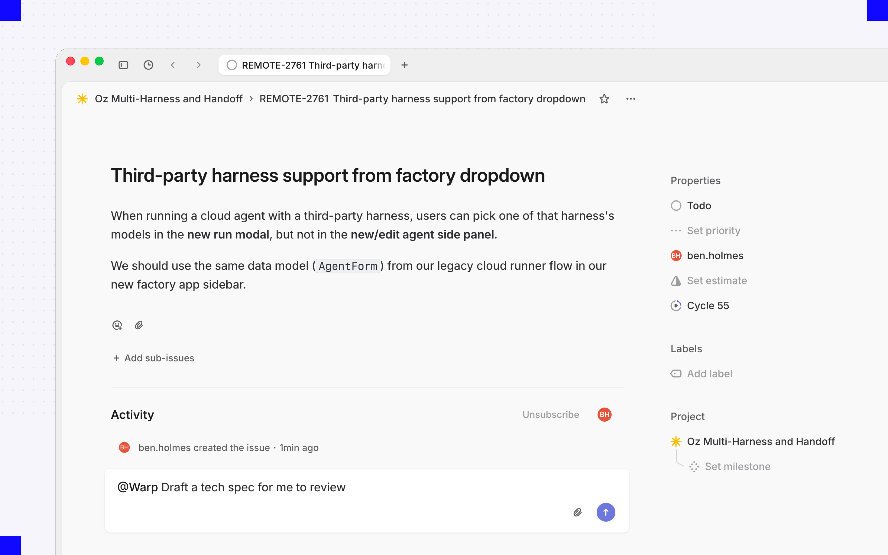

Connect Linear to send issues to your factory and track progress through [its stages](/factories/how-factories-work/).

[Answer in the Linear agent session or send a run follow-up](#replying-to-a-waiting-run). Plain issue comments don't always resume runs.

## Prerequisites

* A factory with the agents and repositories needed for Linear work. See the [Warp Factories quickstart](/factories/quickstart/).
* A Linear account that can authorize the Warp app for the workspace.
* A Warp account linked to your Linear user to start agent sessions.
* Repository access through the factory's [GitHub connection](/platform/integrations/github/) for code changes and pull requests.

For workspace-level installation, reconnection, and removal steps, see the [Linear integration setup guide](/platform/integrations/linear/).

## Permissions

Linear app authorization is separate from linking a teammate's Warp account. With Linear's `actor=app` authorization model, a workspace admin installs the app, and updates are attributed to the app rather than the installer.

The table lists the scopes in Warp's staging configuration recorded on 2026-10-29, which uses `actor=app`. It describes that configuration, not production authorization or existing workspace grants. Review Linear's consent screen before approving workspace access.

| Configured scope | Granted access | Function in Warp | Boundary |
| --- | --- | --- | --- |
| `app:assignable` | Let the app be delegated issues and made a project member | Delegate work to the factory | Doesn't grant repository access |
| `app:mentionable` | Let the app be mentioned in issues, documents, and other editor surfaces | Start an agent session with a mention | Not itself a grant to edit those resources |
| `comments:create` | Create issue comments | Acknowledge requests and post results | Narrower than the separately listed `write` scope |
| `issues:create` | Create and update issues, and create their attachments | Create or update tracked work | Despite its name, this scope isn't create-only |
| `read` | Read data available to the app | Retrieve issue context and workspace metadata | Subject to the app's team access in Linear |
| `write` | Broad write access available to the app | Update issues, workflow state, and delegation | Broader than comment creation; trigger filters don't narrow this grant |

These scope meanings follow [Linear's OAuth reference](https://linear.app/developers/oauth-2-0-authentication) and [app authentication model](https://linear.app/developers/agents#actor-and-scopes). A workspace admin can change or revoke the app's team access in Linear. Selecting teams for a factory's automations controls routing, not the underlying OAuth grant.

## Connect Linear

You connect Linear either while creating a factory, at the **Connect your issue trackers** step, or afterward from the factory's **Settings**. Either way you do the same two things:

1. **Authorize Warp for your Linear workspace.** This is Linear's own OAuth flow, and it's only needed once per workspace.
2. **Choose which Linear teams trigger this factory.**

Warp adds an `agent_session_created` automation for those teams, not `comment_created` or `issue_labeled`. For other issue activity, [add triggers](#configure-linear-triggers).

## Route agent sessions

If Warp can't identify the session creator, Linear shows an authentication prompt instead of starting work.

Mention, assign, or delegate the Warp app on an issue to start a Linear agent session. The default automation routes sessions from your selected teams to the factory.

<figure style={{ maxWidth: "563px" }}>

<figcaption>Mentioning the Warp app in an issue comment starts an agent session.</figcaption>
</figure>

To filter sessions by creator or keyword, edit `agent_session_created` in the [definition files](/factories/factory-as-code/); session routing isn't editable from the automation editor.

## Configure Linear triggers

To start work from issue activity, [add an automation](/factories/automations/#edit-filters-on-an-automation) with a **Linear** trigger: **Issue created**, **Issue labeled**, **Issue state changed**, **Issue assigned**, or **Comment created**.

Filters depend on the event. Issue events support assignees; comments support specific issues but not assignees. Agent sessions accept only team, project, label, creator, and keyword filters.

Use the [Linear trigger reference](/factories/automation-triggers/#linear) for exact event names, keys, types, and examples. `labels` takes label names, not IDs.

## Supported events and outputs

| Linear event | What the agent receives | What the factory sends back |
| --- | --- | --- |
| Issue created, labeled, state changed, or assigned | Issue content and metadata | Progress, issue updates, and result links |
| Comment created | New comment and issue context | Acknowledgment and responses |
| Agent session created | The request to the Warp app | Live progress and run and pull request links |
| Reply in an agent session | New message and session history | Continued work in that session |

## Replying to a waiting run

Reply delivery depends on how the run started:

| How the run started | How to answer |
| --- | --- |
| A Linear agent session routed to this factory | Reply in that session. No `comment_created` trigger is required. |
| A label or another issue-data trigger | Use the [follow-up API](#resume-a-run-that-missed-a-reply) or live conversation to address the waiting run. |
| An issue associated with an active run through a routed agent session | A matching `comment_created` automation sends the comment to that factory's associated run, subject to access checks. |

A label-started run doesn't establish the issue association used by comment routing. Adding `comment_created` without that association can start separate work. A work item link or a question on the issue isn't sufficient.

If the factory restricts follow-ups to the starter, a different teammate's comment doesn't bypass that restriction.

### Start from a factory-ready label

Add this to a [factory definition](/factories/factory-as-code/) with a `foreman` agent and Linear connection:

```markdown title="automations/linear-ready/automation.md"
---
agent: foreman
triggers:
  - provider: linear
    event: issue_labeled
    filter:
      teams: [Engineering]
      labels: [factory-ready]
---
Read the issue. If requirements are missing, post the question on the
issue with a link to this run, then wait for an answer. Continue when
the answer arrives as a follow-up.
```

Replace `Engineering` with your team name. `factory-ready` is a Linear label name.

1. Apply `factory-ready` to an issue. Open the resulting run in the factory dashboard.
2. When the run asks a question and waits, have a teammate answer on the issue.
3. Forward the answer to that run using the procedure below. Reapplying the label or mentioning the app can start other work.

For automatic replies, start future work through the [agent-session path](#route-agent-sessions) and reply in that session. Avoid overlapping comment and session triggers: one comment can emit both events.

### Resume a run that missed a reply

Use `POST /agent/runs/{id}/followups` with a [Warp API key](/agents/cli/oz-cli/api-keys/) authorized to follow up on the waiting run.

1. Open the waiting conversation from the factory dashboard or issue's run link. Copy its run ID, not the issue, session, or work item ID.
2. Set `RUN_ID` to that ID. With `WARP_API_KEY` exported, inspect the destination:

   ```bash
   RUN_ID=WAITING_RUN_ID
   curl --fail-with-body \
     "https://app.warp.dev/api/v1/agent/runs/${RUN_ID}" \
     --header "Authorization: Bearer ${WARP_API_KEY}"
   ```

   Replace `WAITING_RUN_ID` with the copied run ID. Confirm the destination conversation.

3. Send the answer in `message`, including the issue identifier and comment link:

   ```bash
   curl --fail-with-body --request POST \
     "https://app.warp.dev/api/v1/agent/runs/${RUN_ID}/followups" \
     --header "Authorization: Bearer ${WARP_API_KEY}" \
     --header "Content-Type: application/json" \
     --data '{"message":"Answer for ENG-42: use the existing API, not a new endpoint. Source: https://linear.app/YOUR_WORKSPACE/issue/ENG-42#COMMENT_ID. Continue from the question you asked."}'
   ```

   Replace the message and placeholder comment URL. The URL's run ID selects the destination, not `ENG-42` in the message.

4. Reopen the same conversation and confirm the answer appears and work continues. HTTP `200` means accepted, not acted on. The response's `outcome` describes delivery, such as `live_session` or `queued_prompt`. Warp resumes in a new sandbox when needed.

If denied, check the key's run access and factory follow-up restrictions. See the [API reference](/api) for request and response fields.

## What the factory can do in Linear

In an agent session, the factory posts its plan, actions, and results as it works. It can also attach a GitHub pull request to the issue, update the issue's workflow state or delegate, link back to the run, and acknowledge comments it acts on. Its own Linear activity never triggers automations, so a factory can't set itself off in a loop.

Only agent sessions require a linked Warp account. Issue and comment events from unlinked users still start work, but Warp may not record who requested it.

Connecting Linear doesn't grant repository access. Branches and pull requests use the factory's code-host credentials, and the pull request still waits for a person to review and merge.

## Troubleshooting

* **An agent session shows an authentication prompt** - Complete the prompt to link your Linear user to your Warp account, then retry the request.
* **Teams or filters don't load** - Reconnect Linear by following the [Linear integration setup guide](/platform/integrations/linear/), then confirm the connection can access the workspace and team you expect.
* **An event doesn't start work** - Confirm the automation is enabled, the event type matches, and every filter matches the issue's current values or the state change.
* **One action starts multiple runs** - Look for overlapping agent-session and comment triggers, then narrow or remove one.
* **A reply doesn't resume a waiting run** - Check how the run started, then [send a follow-up to its run ID](#resume-a-run-that-missed-a-reply). A comment trigger doesn't associate a label-started run with the issue.
* **No pull request appears** - Check the factory's code-host credentials and repository access. Linear authorization alone doesn't allow code changes.

## Related pages

* [Permissions for factory integrations](/factories/integrations/permissions/) - Compare grants and review status across providers
* [Linear integration](/platform/integrations/linear/) - Install or remove the workspace app
* [Automation triggers](/factories/automation-triggers/) - Look up exact event and filter syntax
