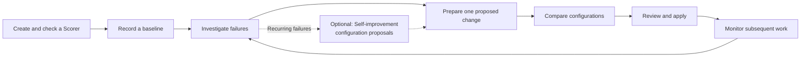

Use Warp Factories to assess coding agent effectiveness by comparing output quality, cost, and cycle time across configurations. Record results for the current configuration, test a proposed change on the same tasks, and compare the results before deciding what to keep. To assess return on investment (ROI), also consider the time people spend reviewing and correcting the output.

For example, suppose a verification run fails because its startup instructions omit a required build command. Revising those instructions changes how the factory verifies work, rather than changing the application. Compare the existing and revised instructions on the same tasks to check whether the revision resolves the startup failure without preventing the worker from completing the requested task. See [improving a skill from observed failures](/factories/factory-skills/#improve-a-skill-from-observed-failures).

## Read metrics on the Dashboard page

Use the **Dashboard** page to identify changes in activity, cost, and cycle time that need investigation. Review the underlying runs before attributing a change to a particular configuration.

:::caution
**PRs merged**, **Autonomy**, **PR cycle time**, and the detail in **Most expensive PRs** require a connected code host - the GitHub App, or the GitLab webhook Warp installs when you [connect GitLab](/factories/integrations/gitlab/) - and only cover activity from after you connect it. A PR's cost, creator, source, and requested model come from the run itself, so those still show without that connection.
:::

| Metric | What it shows |
| --- | --- |
| **Total runs** | All agent runs, with breakdowns by agent type, status, source, model, and more. |
| **PRs opened** | Pull requests created from factory work, counted once, in the period they were first observed. |
| **PRs merged** | Pull requests opened in the selected period that later merged. Because opened and merged counts come from different data sources, the reported merged count can occasionally exceed the opened count for that period. |
| **Autonomy** | The share of the factory's merged PRs that needed no human code push before merging. Opening the PR counts as a push, so a human-authored PR that a factory run later revised doesn't count as autonomous. |
| **PR cycle time** | The median time the factory's merged PRs took from run kickoff through PR, first review, and merge, with a median for each stage. |
| **Cost per PR** | The median cost of pull requests opened in the selected period. Each run's cost includes its child runs and is divided evenly across its PRs. View breakdowns by cost component or PR size (S/M/L/XL, split at 100/500/1,000 changed lines). |
| **Most expensive PRs** | The highest-cost pull requests. |
| **Scorer cards** | Results from your Scorers. |
| **Self-improvement PRs** | The three newest Self-improvement pull requests, regardless of the selected date range. |

**Cost per PR** is a comparison metric, not a billing figure. Historical estimates and incomplete coverage of external inference can affect it. Inspect a run's [usage details](/factories/factory-dashboard/#inspect-runs) when investigating a cost.

**Total runs** includes evaluation, benchmark, and Self-improvement runs, so a higher run count with a flat PR count could mean harder tasks, retries, or measurement activity.

## Evaluate runs with Scorers

A **Scorer** uses an LLM judge to classify completed runs against criteria you write — for example, "did the agent run the tests before opening a PR?" See [Configuring Scorers](/factories/measure-and-improve/scorers/) for its fields and how automatic and on-demand scoring work.

## Compare configurations with benchmarks

A benchmark compares configurations for an agent or Blueprint stage on the same fixed tasks. Test model, harness, runner, or definition-branch changes before applying them to production. See [benchmarking factory configurations](/factories/benchmarks/) for the workflow.

## Propose fixes with Self-improvement

When enabled for a Scorer, **Self-improvement** investigates recurring failures and proposes changes to application code or the factory's own definition in pull requests. Review and test those proposals before applying them. See [Configuring and reviewing Self-improvement](/factories/measure-and-improve/self-improvement/) for setup and review instructions.

## Run a practical improvement loop

Test one configuration change at a time:

1. **Create and check a Scorer.** Choose a worker and an observable requirement, such as building a required package before starting the app. [Create a Scorer](/factories/measure-and-improve/scorers/) for that requirement and score a few completed runs on demand. Inspect those runs yourself and compare your assessment with the Scorer's classifications and reasoning.
2. **Record a baseline.** Collect results from the current configuration across the task types the worker normally handles. Record the configuration, Scorer settings, task sample, date range, and costs so you can compare later results with the same starting point.
3. **Investigate failures.** Inspect runs the Scorer classified as failures. Confirm whether the cause is missing context, incorrect instructions, unavailable tools or access, or an unsuitable evaluation criterion before deciding what to change. If the Scorer's criteria are incorrect, revise and recheck the Scorer before using its results to compare configurations.
4. **Prepare one proposed change.** Change the setting or instruction responsible for the confirmed problem. For the startup example, add the missing build command to the skill. Keep unrelated settings unchanged. Do not apply the change to the shared workflow yet.
5. **Compare configurations.** Use a [benchmark](/factories/benchmarks/) to compare the current and proposed configurations on the same tasks with the same evaluation criteria. Repeat trials to check whether the difference persists. Check task completion and quality as well as cost.
6. **Review and apply the change.** Review the proposed configuration and benchmark results, including cost. If the revised startup instructions resolve the failure and the worker still completes the requested tasks, [apply the accepted change](/factories/benchmarks/#apply-a-benchmark-result) through the relevant worker settings or factory definition.
7. **Monitor subsequent work.** Keep the Scorer active and compare later runs on similar tasks with the baseline. If the Scorer's criteria no longer reflect your requirements, revise them or set its sample rate to 0.

Self-improvement can provide the proposed change in step 4 when failures recur. Compare its factory-configuration proposals using the same process before applying them. Review and test application-code fixes through your normal code-review process.

## Related pages

* [Configuring Scorers](/factories/measure-and-improve/scorers/) - What a Scorer is, its fields, and how it runs
* [Configuring and reviewing Self-improvement](/factories/measure-and-improve/self-improvement/) - Turn on Self-improvement and review its pull requests
* [Factory benchmarks](/factories/benchmarks/) - Compare candidate configurations on the same tasks
* [Factory definition as code](/factories/factory-as-code/) - Record an adopted change so your team can review the factory configuration
