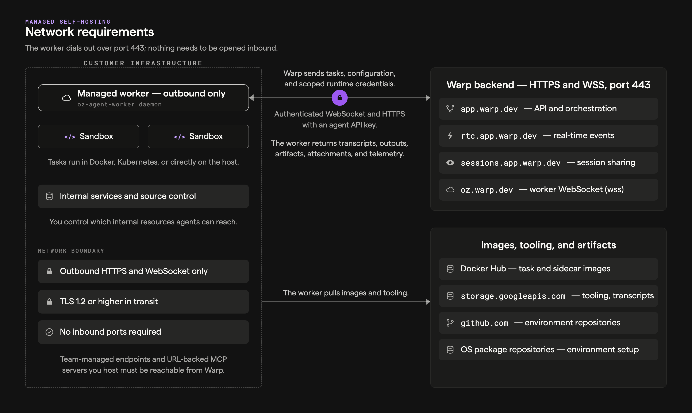

Self-hosted factory workers run repository checkouts and agent workloads on your infrastructure. Warp coordinates runs and receives their results. These requirements apply to [managed factory workers](/factories/self-hosting/#managed-architecture) and [standalone unmanaged agents](/platform/unmanaged-execution/).

## Data boundaries

**Execution resources on your infrastructure:**

* Repository clones and source files.
* Build artifacts and compiled outputs.
* Runtime secrets and environment variables.
* Container, host, or external-runtime workspace state.

**Data sent to Warp:**

* Orchestration metadata (task status, lifecycle events).
* Session transcripts, which include agent-generated summaries of code context, file contents the agent reads, and command output.
* Run attachments and artifacts.
* The Warp Agent's LLM inference requests and responses, which include code context from the agent's interactions.

Code content can appear in transcripts, artifacts, and LLM prompts even though repository checkouts stay on your infrastructure. Run data is stored separately from the execution workspace; see [Self-hosted agent data storage](/factories/self-hosting/data-storage/). For retention and provider boundaries, see [Security overview](/enterprise/security-and-compliance/security-overview/) and [LLM inference and BYOLLM](#llm-inference-and-byollm).

---

## Network requirements

Self-hosted workers connect outbound to Warp; task assignment does not require an inbound firewall port. Allow the required destinations from both the worker and the task runtime. A connected worker does not confirm that a task container or Pod has the same access.

<figure style={{ maxWidth: "736px" }}>

<figcaption>Self-hosted workers connect outbound to Warp and runtime dependencies.</figcaption>
</figure>

### Warp services

These are domain-based destinations, not a fixed-IP allowlist. Allow HTTPS and secure WebSocket connections on port `443`.

| Destination | Purpose | Applies to |
| --- | --- | --- |
| `app.warp.dev` | Warp API requests | Managed and unmanaged execution |
| `rtc.app.warp.dev` | Real-time updates over secure WebSockets | Managed and unmanaged execution |
| `sessions.app.warp.dev` | Session sharing over secure WebSockets | Managed and unmanaged execution |
| `oz.warp.dev` | Worker task-assignment connection over secure WebSockets | Managed workers |
| `storage.googleapis.com` | Uploading run transcripts for later resume and transferring agent attachments | Managed and unmanaged execution using Warp-managed storage |

### Images, repositories, and task dependencies

Docker and Kubernetes deployments need access to the registries that serve their worker, task, sidecar, and preflight images. Default images come from Docker Hub. For restricted networks, see [Pulling self-hosted images from a private registry](/factories/self-hosting/private-container-registry/).

Depending on the selected harness and tools, task images include:

* [`warpdotdev/warp-agent:latest`](https://hub.docker.com/r/warpdotdev/warp-agent)
* [`warpdotdev/warp-xvfb-sidecar:latest`](https://hub.docker.com/r/warpdotdev/warp-xvfb-sidecar) (only if [computer use](/agents/capabilities/computer-use/) is enabled)
* [`warpdotdev/warp-claude-cli-sidecar:latest`](https://hub.docker.com/r/warpdotdev/warp-claude-cli-sidecar) (only if using Claude Code)
* [`warpdotdev/warp-codex-cli-sidecar:latest`](https://hub.docker.com/r/warpdotdev/warp-codex-cli-sidecar) (only if using Codex)
* The base image specified by your [environment](/factories/environments/)

The selected environment and setup commands determine additional access:

* **Source control** - Allow `github.com` when the managed environment checks out configured GitHub repositories. Other repository hosts need their own network access.
* **Package repositories** - Allow the repositories used by your base image and setup commands, including installation of Git when it is absent from the base image.
* **Model providers** - Claude Code and Codex call their providers directly from the execution environment. Allow the provider destinations required by your [harness](/factories/harnesses/).
* **Application services and tools** - Allow the APIs, command-based MCP servers, and internal services the task uses.

Warp services above use port `443`; your registries, repositories, and internal services can require other ports. Optional metrics collection has separate connectivity requirements; see [Monitoring](/factories/self-hosting/monitoring/).

### Services reached from Warp

[Team-managed inference endpoints](/enterprise/enterprise-features/team-managed-keys-and-endpoints/) and URL-backed MCP servers used through [Warp's proxy](/factories/mcp/#connect-directly-by-url) must be reachable from Warp's servers, not only from your worker. For private inference gateways, see [Private networking](/enterprise/enterprise-features/private-networking/).

---

## Backend-specific security considerations

### Docker backend

* **Docker socket access** - The worker requires access to the Docker daemon to create task containers. For a rootful Linux daemon, mount `/var/run/docker.sock` and pass its numeric group ID to the worker container. Treat Docker socket access as elevated host access and restrict it to the worker. See the [Docker installation example](/factories/self-hosting/managed-docker/#option-1-docker-recommended).
* **Volume mounts** - If using `-v` / `--volumes`, restrict the host paths you expose to task containers.
* **Task isolation** - Each task runs in its own container. Containers are removed after execution by default (disable with `--no-cleanup` for debugging).

### Kubernetes backend

* **Worker permissions** - The worker uses namespace-scoped RBAC permissions to manage Jobs and read Pods, logs, and events. The task namespace must allow a root init container unless native image volumes are enabled.
* **Kubernetes service accounts** - The worker Deployment ServiceAccount is separate from the task Job `serviceAccountName` in `pod_template`. Scope each to its workload.
* **API key management** - Store `WARP_API_KEY` in a Kubernetes Secret and inject it only into the worker. Add task credentials through `pod_template` or an external secrets operator.
* **Task isolation** - Each task runs as a Kubernetes Job and Pod. Successful Jobs are removed. With cleanup enabled, failed or orphaned Jobs remain for 24 hours by default; `--no-cleanup` keeps them without a TTL.

### Direct backend

* **Shared host kernel** - The Direct backend does not provide container-level isolation. Each task runs in a separate workspace directory but shares the host OS and kernel. Setting `target_dir` disables per-task workspace separation.
* **Minimal task environment** - Tasks inherit only `HOME`, `TMPDIR`, and `PATH` from the host, plus task credentials and explicitly configured variables. The worker's own `WARP_API_KEY` is not inherited by the agent process. Setup and teardown scripts inherit the worker environment, so restrict access to those scripts.
* **Workspace cleanup** - Workspaces under `workspace_root` are removed after execution by default (disable with `--no-cleanup` for debugging). A shared `target_dir` is not removed.

### Command backend

* **Task payloads** - The dispatch command receives task credentials and runtime configuration on standard input. Keep payloads out of logs.
* **Runtime isolation** - The external runtime owns task isolation, credentials, network policy, and cleanup.

### Unmanaged

* **Host inheritance** - Agents use the network access, tools, and credentials available to their process. Review VPN and internal-service access before running them.
* **Kubernetes pod isolation** - Whether Kubernetes pods provide sufficient sandboxing for agents depends on your cluster configuration and risk profile. Evaluate your pod security policies, network policies, and RBAC settings based on your organization's security requirements.

---

## VPN and on-premises access

Self-hosted agents can reach VPN services, private source control, and databases when their execution environment has access. Apply network policies to the task runtime as well as the worker.

See [GitLab](/platform/integrations/gitlab/) and [Bitbucket](/platform/integrations/bitbucket/) setup guides for SCM integration details.

---

## LLM inference and BYOLLM

The Warp Agent sends inference requests through Warp. With Warp-managed inference, requests go to contracted providers covered by [ZDR](/enterprise/security-and-compliance/security-overview/#zero-data-retention-zdr) agreements. With customer-supplied inference, provider-side retention follows your team's agreement with that provider.

Teams that want inference routed and billed through their own accounts can use [team-managed model keys and endpoints](/enterprise/enterprise-features/team-managed-keys-and-endpoints/) or [Bring Your Own LLM (BYOLLM)](/enterprise/enterprise-features/bring-your-own-llm/). Plan requirements and cloud agent support vary by option; see [inference options for factory runs](/factories/infrastructure-and-security/#inference-options-for-factory-runs).

Claude Code and Codex send inference requests directly to their providers under your provider agreement. Their [authentication](/factories/harnesses/authentication/) and network access are separate from the Warp Agent's inference configuration.

---

## Related pages

* [Self-hosting overview](/factories/self-hosting/) - Choose managed or unmanaged execution
* [About factory infrastructure and security](/factories/infrastructure-and-security/) - Choose execution, inference, and credential boundaries
* [Data security and boundaries](/platform/architecture/#data-security-and-boundaries) - Review where each class of data lives and travels
* [Security overview](/enterprise/security-and-compliance/security-overview/) - Review Warp's security model and ZDR
* [Bring Your Own LLM](/enterprise/enterprise-features/bring-your-own-llm/) - Route inference through your own cloud provider accounts
* [Self-hosted worker reference](/factories/self-hosting/reference/) - Look up worker flags and configuration
