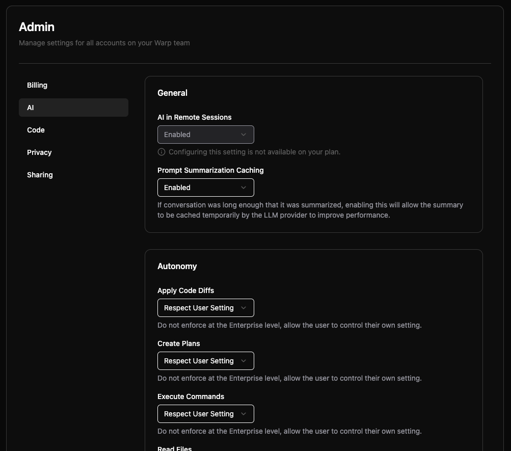

import { VARS } from '@data/vars';

Use the Warp Admin Panel to configure team policies for {VARS.WARP_TERMINAL}, including agent approvals, personal conversation sync, Codebase Context, and Warp Drive sharing.

Your [role](/knowledge-and-collaboration/roles-and-permissions/) determines administrative access. Your plan and workspace policies determine which settings you can change. For policies across an Enterprise workspace, use the [Enterprise Admin Panel guidance](/enterprise/team-management/admin-panel/).

## Accessing the Admin Panel

### For team admins

1. Open the [Admin Panel](https://app.warp.dev/admin/) and sign in.
2. For a self-serve team, confirm the selected team. In an Enterprise workspace, under "Team admin" in the sidebar, click the team name.
3. Open the section for the setting you want to change. Confirm the team name before making a change.

To change team admins or ownership, follow [Managing admins](/knowledge-and-collaboration/roles-and-permissions/#managing-admins) or [Transferring team ownership](/knowledge-and-collaboration/roles-and-permissions/#transferring-team-ownership).

<figure style={{ maxWidth: "563px" }}>

<figcaption>The Admin Panel groups shared configuration by topic.</figcaption>
</figure>

### For team members

Team members see enforced settings in their personal Warp Settings. A disabled control can show "Your organization has configured this setting." Ask the appropriate team or workspace admin to review it.

## How settings enforcement works

An editable team setting applies to members of the selected team. Some controls let you enforce a value or select **Respect User Setting** so members can choose their own preference.

### Setting enforcement levels

| Setting state | What it means |
| --- | --- |
| Team enforced | Members cannot override the configured value |
| Respect User Setting | Individual members control their own preference |
| Tier restricted | The plan does not permit changing the control |

In Enterprise, a workspace policy can also lock a team control. Ask a workspace admin to [enforce or delegate the workspace policy](/enterprise/team-management/admin-panel/#enforcing-or-delegating-workspace-policies). Team admins cannot override that policy.

Test a changed policy with an affected member before applying it to other teams.

## Plan limitations

A plan-locked setting shows "Configuring this setting is not available on your plan." Review [Warp Agent plans](/support-and-community/plans-and-billing/plans-pricing-refunds/#warp-agent-plans) for plan requirements.

See [Managing admins](/knowledge-and-collaboration/roles-and-permissions/#managing-admins) for multiple-admin availability by product and plan.

For factory-plan data controls and usage visibility, use [Warp Factories team administration](/factories/teams-and-admin-controls/#shared-settings-and-usage).

## AI settings

Under **AI**, configure supported Warp Agent behavior for the selected team. Autonomy controls do not apply to sandboxed agents. Do not assume they govern every harness.

* **AI in remote sessions** - Controls availability during SSH sessions and other remote connections.
* **Prompt summarization caching** - Controls provider caching used for long conversations. Provider retention follows the selected model and inference configuration. See [model retention policies](/agents/inference/model-choice/#zero-data-retention-policies).

### Autonomy settings

To set approval behavior for applying code diffs, creating plans, executing commands, or reading files:

1. In the team's Admin Panel, click **AI** and find "Autonomy".
2. Click the "Apply Code Diffs", "Create Plans", "Execute Commands", or "Read Files" dropdown for the action you want to control.
3. Select **Agent Decides**, **Always Ask**, **Always Allow**, or **Respect User Setting**.
4. Wait for the update to complete. Reload the page and confirm the value persists.

See [Agent Profiles and permissions](/agents/capabilities/agent-profiles-permissions/) for the action permissions and personal configuration.

### Directory and command control

Directory allowlists identify approved paths, such as `~/git/internal-tooling` or `/home/user/repos/public-*`. Command allowlists and denylists use regular expressions.

:::caution
Under "Autonomy", command denylist rules take precedence over command allowlists and autonomy settings. A matching command requires explicit approval. The separate "Sandboxed Agents" denylist blocks matching commands instead.
:::

To change an Autonomy list:

1. In the team's Admin Panel, click **AI** and find "Autonomy".
2. Under "Directory Allowlist", enter a directory path and press `Enter`. For command rules, enter a regular expression under "Command Allowlist" or "Command Denylist" and press `Enter`.
3. Confirm the entry appears in the list. Reload the page and confirm it persists.

To remove a team entry, click its remove control and confirm the entry disappears. Entries marked "Added by your workspace" are managed by a workspace admin.

## Privacy settings

### Content collection for service improvement

The "UGC Data Collection" dropdown controls collection of team content for service improvement. Telemetry, [provider retention](/agents/inference/model-choice/#models-requiring-provider-retention), and [product storage](/support-and-community/privacy-and-security/privacy/#product-storage) are separate controls and requirements.

To change team content collection:

1. Open the [Admin Panel](https://app.warp.dev/admin/) for the team and go to **Privacy**.
2. If "UGC Data Collection" is editable, click the dropdown and select **Disabled** to stop team content collection, or **Respect User Setting**, if available, to defer to individual preferences.
3. After changing the value, reload the page and confirm it persists.

Plans that lock collection off keep it **Disabled**. Admins cannot enable it or delegate to individual preferences. Ask a workspace admin about workspace-enforced values. For personal controls, see [browser privacy preferences](/support-and-community/privacy-and-security/privacy/#how-to-disable-telemetry-and-crash-reporting).

### Cloud conversation storage

The "Cloud Conversation Storage" control applies to cloud sync of personal Terminal conversations. Disabling it does not disable factory or other cloud agent run storage.

1. In the team's Admin Panel, click **Privacy**.
2. Click the "Cloud Conversation Storage" dropdown. Select **Enabled** to sync personal conversations, **Disabled** to keep them local, or **Respect User Setting** to let members decide.
3. Wait for the update to complete. Reload the page and confirm the value persists.

Review [product storage](/support-and-community/privacy-and-security/privacy/#product-storage) before changing this setting.

### Enterprise secret redaction

For enforced redaction across Enterprise teams, use [Enterprise privacy policies](/enterprise/team-management/admin-panel/#enterprise-secret-redaction) and the [Secret redaction](/support-and-community/privacy-and-security/secret-redaction/) configuration guidance.

## Code settings

In the team's Admin Panel, click **Code**. Where the control is editable, click the "Codebase Indexing" dropdown and select **Disabled**, **Enabled**, or **Respect User Setting**. Reload the page and confirm the value persists.

See [Codebase Context](/agents/capabilities/codebase-context/) for indexing behavior and plan limits.

## Model settings

Under **Models**, configure [team-managed API keys and endpoints](/enterprise/enterprise-features/team-managed-keys-and-endpoints/) on plans that include that control. Sharing credentials does not restrict which models members can select.

Self-serve plans do not include team-wide model blocking. Enterprise admins use [Enterprise model settings](/enterprise/team-management/admin-panel/#models-settings) for restrictions, BYOLLM routing, and team-synced routers.

Some models require provider retention even when content collection is disabled. Follow [Reviewing inference and privacy in Terminal](/agents/inference/model-choice/#reviewing-inference-and-privacy-in-terminal) before selecting a model or override.

## Billing settings

On **Billing**, review usage and the controls available for your plan. Use [self-serve spend limits and auto-reload](/support-and-community/plans-and-billing/add-on-credits/) for limits on additional purchases, or [Enterprise billing](/enterprise/support-and-resources/billing/) for workspace pools and usage caps.

## Sharing settings

Configure direct-link and public-link access for Warp Drive resources:

* **Direct Link Sharing** - Controls whether Warp Drive resources can be shared through direct links.
* **Anyone with Link Sharing** - Controls whether anyone with a link can access a shared resource, including people outside the team.

Review [Warp Drive sharing](/knowledge-and-collaboration/warp-drive/) before changing access to existing resources.

These steps apply to self-serve teams. Enterprise workspace admins configure [sharing across teams](/enterprise/team-management/admin-panel/#sharing-settings). Enterprise team Sharing controls are read-only.

1. In the team's Admin Panel, click **Sharing**.
2. Click the "Direct Link Sharing" or "Anyone with Link Sharing" dropdown and select **Enabled** or **Disabled**.
3. Wait for the update to complete. Reload the page and confirm the value persists.

{/* VERIFY: Test team Autonomy dropdowns and lists, conversation storage, Codebase Indexing, and sharing controls in the production Admin Panel, including saved values and policy locks. Labels and save behavior were source-checked; no live-account test was performed. */}

## Platform settings

For shared cloud-agent controls, including **Enabled GitHub Orgs** and **Agent artifact attachments**, use [shared controls for standalone agents](/platform/teams-and-admin-controls/#configuring-shared-controls). For factory access, data controls, and usage, use [Warp Factories team administration](/factories/teams-and-admin-controls/).

## Troubleshooting

### Users can't see new settings

Confirm that you changed the intended team and that the setting isn't delegated to the user. Check the affected user's membership and reload Settings before testing again.

### Setting is grayed out in Admin Panel

Check whether the control is restricted by the plan or locked by a workspace policy. Ask a workspace admin about an enforced value. Use [plans and pricing](/support-and-community/plans-and-billing/plans-pricing-refunds/) for plan requirements.

### Command allowlist not working

Check the regex, autonomy setting, and command denylist together. Under "Autonomy", a matching denylist rule still requires approval. See [Agent Profiles and permissions](/agents/capabilities/agent-profiles-permissions/).

## Support

For access problems, contact [support@warp.dev](mailto:support@warp.dev).

## Related pages

* [Managing teams in Warp Terminal](/knowledge-and-collaboration/teams/)
* [Roles and permissions](/knowledge-and-collaboration/roles-and-permissions/)
* [Workspaces for Enterprise teams](/enterprise/team-management/workspaces/)
* [Admin Panel for Enterprise workspaces](/enterprise/team-management/admin-panel/)
* [Getting started for admins](/enterprise/getting-started/getting-started-enterprise/) - Configure Enterprise SSO, membership, and policies
