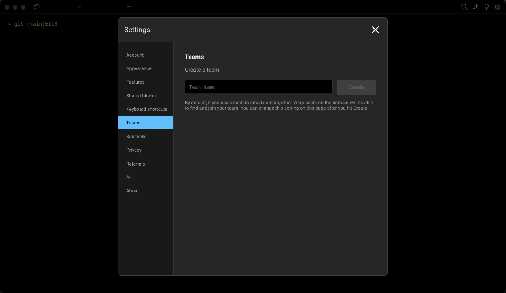

import { VARS } from '@data/vars';

A Warp team is a group of people who share resources, including factories, cloud agent environments, secrets, and [Warp Drive resources](/knowledge-and-collaboration/warp-drive/). Teams are available on self-serve plans as well as Enterprise.

For example, teammates can submit work to a shared factory instead of each creating their own. Membership, administrative roles, and factory access are separate controls. See [Roles and permissions](/knowledge-and-collaboration/roles-and-permissions/).

## Teams and workspaces

On self-serve plans, your team is the group you manage. It has one owner and, on supported plans, additional team admins. Some billing or shared-setting screens use "workspace" for that team's administrative scope; you do not manage a separate set of workspace roles.

Enterprise workspaces can contain multiple teams. Workspace admins manage company-wide settings and team organization, while team admins manage their own teams within those policies. An Enterprise workspace with one team can still use this independent administration model.

See [Workspaces for Enterprise teams](/enterprise/team-management/workspaces/) for workspace membership, roles, and team visibility.

## Creating a team

To create a self-serve team in the Warp app:

1. Open **Settings** > **Teams**, or open **Warp Drive** and click **+ Create a team**.
2. Enter a name that colleagues will recognize and complete the creation flow.
3. Confirm the new team appears in **Settings** > **Teams**.

The creator becomes the team owner. Adding an admin later does not transfer ownership.

<figure style={{ maxWidth: "375px" }}>

<figcaption>Teams settings contains the team creation form.</figcaption>
</figure>

In an Enterprise workspace, a workspace admin creates teams from the Admin Panel. See [Teams inside a workspace](/enterprise/team-management/workspaces/#teams-inside-a-workspace).

To rename a self-serve team, open **Settings** > **Teams** in the Warp app. Click the team name, enter the new name, and press `Enter`.

## Inviting team members

Check the [member billing rules](/support-and-community/plans-and-billing/pricing-faqs/#what-counts-as-a-team-member-and-how-does-billing-work-for-members) before sharing an invitation:

* **Warp Terminal and local agents** - Paid per-seat subscriptions include all active team members. Adding a member adds a prorated seat charge.
* **Warp Factories** - The Scale plan uses one team subscription rather than per-member subscription fees. Factory runs use shared funding, not a member's included personal allowance.
* **Enterprise** - Membership charges and usage funding follow your contract.

In the Warp app, open **Settings** > **Teams**. Copy the team's invite link and share it with your colleagues through a secure channel.

For Enterprise invitations, including adding people to Hidden teams, follow [Joining a workspace or team](/enterprise/team-management/workspaces/#joining-a-workspace-or-team).

### Restricting team invites by domain

Team owners and admins can restrict self-serve invitations to approved email domains:

1. In the Warp app, open **Settings** > **Teams**.
2. Toggle **Restrict by domain** on.
3. Add the allowed email domains.

Someone joining with an address outside the allowed domains must verify access to an address on an allowed domain.

## Joining a team

Open the invitation link and sign up or sign in to Warp. If the team restricts invitations by domain, complete the email verification requested during joining.

Workspace membership does not automatically make you a member of every Enterprise team. For team discovery and workspace invitations, see [Workspaces for Enterprise teams](/enterprise/team-management/workspaces/).

## Team discoverability

For eligible self-serve teams, an owner or admin can let colleagues with the same email domain find and join the team without a direct invitation.

In the Warp app, open **Settings** > **Teams** and toggle **Make team discoverable** on. People who join this way follow the same [member billing rules](/support-and-community/plans-and-billing/pricing-faqs/#what-counts-as-a-team-member-and-how-does-billing-work-for-members) as invited members.

## Team roles and permissions

Team owners and admins manage membership and the settings available on their plan. Members use shared resources within the applicable policies.

See [Roles and permissions](/knowledge-and-collaboration/roles-and-permissions/) for role definitions, multiple-admin availability, and changing a role. To configure shared settings, open the [Admin Panel](/knowledge-and-collaboration/admin-panel/).

### Transferring team ownership

Only the current self-serve team owner can transfer ownership to another member. Follow [Transferring team ownership](/knowledge-and-collaboration/roles-and-permissions/#transferring-team-ownership). The previous owner becomes a Member.

Independent Enterprise workspace ownership is a different operation. Follow [Changing workspace roles](/enterprise/team-management/workspaces/#changing-workspace-roles).

## Leaving and deleting teams

In a self-serve team, members and admins can leave from **Settings** > **Teams** in the Warp app. An owner must transfer ownership before leaving or [deleting their Warp account](/support-and-community/privacy-and-security/privacy/#delete-your-account-and-data).

To delete a self-serve team, the owner must first remove the other members.

:::caution
A team cannot be deleted while it has unused purchased usage. Contact [support@warp.dev](mailto:support@warp.dev) for help removing that balance.
:::

Enterprise workspace membership is managed separately from team membership. Ask a workspace admin to remove you from an Enterprise workspace.

### Purchased usage when membership changes

Purchased usage stays tied to the team that bought it. Leaving or being removed ends your access to that balance; rejoining restores access to unused, unexpired usage. Rejoining a per-seat subscription also adds a prorated seat charge.

See [usage when team membership changes](/support-and-community/plans-and-billing/add-on-credits/#when-team-membership-changes). Enterprise pools follow your [billing agreement](/enterprise/support-and-resources/billing/).

## Managing a team without Warp Terminal

Factory admins can open the [Admin Panel](https://app.warp.dev/admin/) in a browser. In the {VARS.FACTORY_WEB_APP}, the account menu also provides **Admin panel**.

See [Managing factory plans and billing](/factories/managing-plans-and-billing/#opening-the-admin-panel) for selecting the team and opening its billing settings.

## Related pages

* [Roles and permissions](/knowledge-and-collaboration/roles-and-permissions/) - Identify the role needed for an administrative task
* [Admin Panel](/knowledge-and-collaboration/admin-panel/) - Configure shared settings
* [Workspaces for Enterprise teams](/enterprise/team-management/workspaces/)
* [Managing factory plans and billing](/factories/managing-plans-and-billing/)
