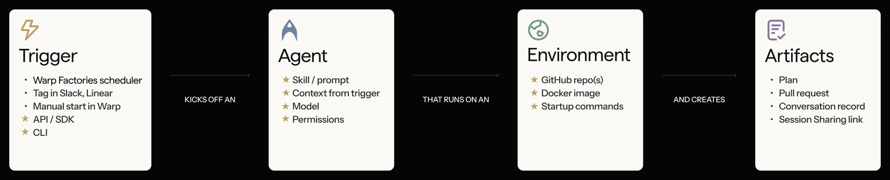

import { VARS } from '@data/vars';

[Warp Factories](/factories/) and [standalone cloud agents](/platform/) run on the {VARS.WARP_AUTOMATION_PLATFORM}. It provides the execution, configuration, and APIs they share.

## Start with a factory

For a team workflow with planning, implementation, and review, start with the [Warp Factories quickstart](/factories/quickstart/). Then configure its [agents](/factories/factory-agents/configuration/), [automations](/factories/automations/), and [tools](/factories/mcp/).

Already using the {VARS.WEB_APP}, {VARS.WARP_AGENT_CLI}, or SDKs? Use [transitioning from Oz](/platform/transitioning-from-oz/) to assess that workflow. The [cloud agents overview](/platform/) retains standalone setup and management entry points.

## How a run works

A trigger starts work: a schedule, a message in a connected tool, or a request from the app, CLI, or API. Its context tells the agent what to investigate or change, such as an issue description, pull request diff, or failed-build logs.

The agent executes on its configured host using the available repositories, tools, and credentials. A run records its progress and produces results such as a pull request, report, or transcript. For example, send failed-build logs with a request for the agent to investigate and propose a fix for review. See [how Warp Factories work](/factories/how-factories-work/) for the factory task lifecycle and human review points.

<figure style={{ maxWidth: "736px" }}>

<figcaption>An environment-backed run produces reviewable artifacts.</figcaption>
</figure>

The diagram illustrates an environment-backed run. Factories manage workspace setup by default; selecting a separate existing environment is optional.

## Integrations and triggers

Integrations supply work and context from tools your team already uses. For example, a message or issue can become a task for an agent. [Factory automations](/factories/automations/) route those events from [connected tools](/factories/connect-your-factory/) to factory agents, or start recurring work on a schedule. For custom intake, use [webhooks](/factories/webhooks/) and [factory endpoints](/factories/factory-api/).

Standalone workflows have separate [integrations](/platform/integrations/) and [scheduled runs](/platform/triggers/scheduled-agents/). The [CLI integration setup guide](/agents/cli/oz-cli/integration-setup/) covers their configuration.

## Inspecting results

Run records let you see what the agent attempted, inspect its transcript and outputs, and decide whether the result needs more work. Inspect factory tasks from the [factory dashboard](/factories/factory-dashboard/). For standalone management, sharing, and steering, use the [cloud-agent inspection paths](/platform/#monitor-inspect-and-share-cloud-agent-runs).

## Environments

An environment groups a container image, repositories, and setup commands, such as installing the dependencies an agent needs to run tests. Reusing that setup gives recurring tasks a configured toolchain rather than requiring each task to recreate it.

Factories manage their workspace by default, so selecting an existing environment is optional. See [Environments for factory agents](/factories/environments/) for that option and standalone setup, and [runners](/factories/runners/) for compute configuration.

## Hosts

A host is where the agent executes commands and accesses its workspace. Warp-hosted execution uses compute provisioned by Warp. Managed self-hosting uses a worker on your infrastructure, where your team manages capacity and network access.

For factory hosting choices and requirements, compare [Warp-hosted execution](/factories/warp-hosting/) with [managed self-hosting](/factories/self-hosting/). [Unmanaged execution](/platform/unmanaged-execution/) covers standalone CLI workflows in an existing checkout or CI runner you operate.

## The CLI

The CLI lets you work from a terminal or incorporate agents into scripts and CI without requiring the Warp desktop app. Use the [{VARS.WARP_AGENT_CLI}](/agents/cli/oz-cli/) for existing `oz` workflows and the [{VARS.WARP_CLI}](/agents/cli/) for `warp` commands. Check the owning reference before changing a script.

## API and SDKs

The API and SDKs let an internal service submit work and inspect results programmatically. Use [factory endpoints](/factories/factory-api/) to send work to a factory, and [agent and run endpoints](/factories/api-and-sdk/) for standalone runs and run inspection. [Developer tools](/factories/developer-tools/) links to the SDKs and full API reference.

## Secrets

Secrets give agents credentials for resources such as package registries, APIs, or databases. Grant only the access needed for the task. Use [factory secrets](/factories/secrets/) for credentials granted to factory agents and [harness authentication](/factories/harnesses/authentication/) for third-party provider credentials. The [legacy secrets reference](/platform/secrets/) preserves standalone CLI and personal-secret workflows.

## Shared configuration

Configuration determines which agent runs, which tools it can use, and what setup its work needs. A harness runs the coding agent; MCP servers connect it to external tools and data. Factory-wide and per-agent settings live in the [factory definition](/factories/factory-as-code/). The shared [harness](/factories/harnesses/), [environment](/factories/environments/), and [MCP-server](/factories/mcp/) references explain factory and standalone configuration separately.

For instructions and reusable context, see [factory skills](/factories/factory-skills/), [Rules](/agents/capabilities/rules/), [saved prompts](/knowledge-and-collaboration/warp-drive/prompts/), and [environment variables](/knowledge-and-collaboration/warp-drive/environment-variables/). These have different scopes; follow the relevant reference.

## Measuring factory work

Use [Scorers](/factories/measure-and-improve/scorers/), [Benchmarks](/factories/benchmarks/), and [Self-improvement](/factories/measure-and-improve/self-improvement/) to evaluate factory work and propose changes to its configuration. See [measure and improve](/factories/measure-and-improve/) for metric definitions and limitations.

## Related pages

* [Warp Factories quickstart](/factories/quickstart/) - Create a factory and send its first work item
* [Cloud agents overview](/platform/) - Find supported standalone entry points
* [Architecture](/platform/architecture/) - Review the run lifecycle and data boundaries
* [Multi-agent orchestration](/platform/orchestration/) - Coordinate parent and child agents
