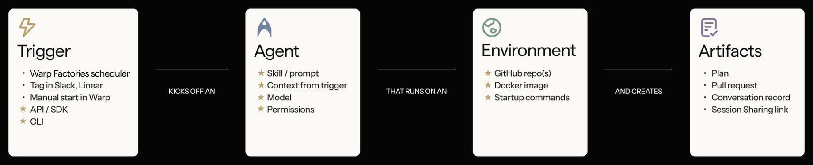

import { VARS } from '@data/vars';

[Warp Factories](/factories/) and [standalone cloud agents](/platform/) run on the {VARS.WARP_AUTOMATION_PLATFORM}. It provides the execution, configuration, and APIs they share.

## Start with a factory

For a team workflow with planning, implementation, and review, start with the [Warp Factories quickstart](/factories/quickstart/). Then configure its [agents](/factories/factory-agents/configuration/), [automations](/factories/automations/), and [tools](/factories/mcp/).

Already using the {VARS.WEB_APP}, {VARS.WARP_AGENT_CLI}, or SDKs? Use [transitioning from Oz](/platform/transitioning-from-oz/) to assess that workflow. The [cloud agents overview](/platform/) retains standalone setup and management entry points.

## How a run works

A request or event supplies the task and its context. The agent executes on its configured host and produces results such as a pull request, report, or transcript. For the factory task lifecycle and review points, see [how Warp Factories work](/factories/how-factories-work/).

<figure style={{ maxWidth: "736px" }}>

<figcaption>A trigger starts a run that produces reviewable artifacts.</figcaption>
</figure>

## Integrations and triggers

[Factory automations](/factories/automations/) route events from [connected tools](/factories/connect-your-factory/) to factory agents. They also start runs on a schedule. For custom intake, use [webhooks](/factories/webhooks/) and [factory endpoints](/factories/factory-api/).

Standalone workflows have separate [integrations](/platform/integrations/) and [scheduled runs](/platform/triggers/scheduled-agents/). The [CLI integration setup guide](/agents/cli/oz-cli/integration-setup/) covers their configuration.

## Inspecting results

Inspect factory work from the [factory dashboard](/factories/factory-dashboard/). For standalone management, sharing, and steering, use the [cloud-agent inspection paths](/platform/#monitor-inspect-and-share-cloud-agent-runs).

## Environments

Factories manage their workspace by default. [Environments for factory agents](/factories/environments/) cover the optional existing-environment path and standalone setup; [runners](/factories/runners/) cover compute configuration.

## Hosts

For factory hosting choices and requirements, compare [Warp-hosted execution](/factories/warp-hosting/) with [managed self-hosting](/factories/self-hosting/). [Unmanaged execution](/platform/unmanaged-execution/) covers standalone CLI workflows on infrastructure you operate.

## The CLI

Use the [{VARS.WARP_AGENT_CLI}](/agents/cli/oz-cli/) for existing `oz` workflows and the [{VARS.WARP_CLI}](/agents/cli/) for `warp` commands. Check the owning reference before changing a script.

## API and SDKs

Use [factory endpoints](/factories/factory-api/) to send work to a factory, and [agent and run endpoints](/factories/api-and-sdk/) for standalone runs and run inspection. [Developer tools](/factories/developer-tools/) links to the SDKs and full API reference.

## Secrets

Use [factory secrets](/factories/secrets/) for credentials granted to factory agents and [harness authentication](/factories/harnesses/authentication/) for third-party provider credentials. The [legacy secrets reference](/platform/secrets/) preserves standalone CLI and personal-secret workflows.

## Shared configuration

Factory-wide and per-agent settings live in the [factory definition](/factories/factory-as-code/). The shared [harness](/factories/harnesses/), [environment](/factories/environments/), and [MCP-server](/factories/mcp/) references explain factory and standalone configuration separately.

For instructions and reusable context, see [factory skills](/factories/factory-skills/), [Rules](/agents/capabilities/rules/), [saved prompts](/knowledge-and-collaboration/warp-drive/prompts/), and [environment variables](/knowledge-and-collaboration/warp-drive/environment-variables/). These have different scopes; follow the relevant reference.

## Measuring factory work

Use [Scorers](/factories/measure-and-improve/scorers/), [Benchmarks](/factories/benchmarks/), and [Self-improvement](/factories/measure-and-improve/self-improvement/) to evaluate factory work and propose changes to its configuration. See [measure and improve](/factories/measure-and-improve/) for metric definitions and limitations.

## Related pages

* [Warp Factories quickstart](/factories/quickstart/) - Create a factory and send its first work item
* [Cloud agents overview](/platform/) - Find supported standalone entry points
* [Architecture](/platform/architecture/) - Review the run lifecycle and data boundaries
* [Multi-agent orchestration](/platform/orchestration/) - Coordinate parent and child agents
