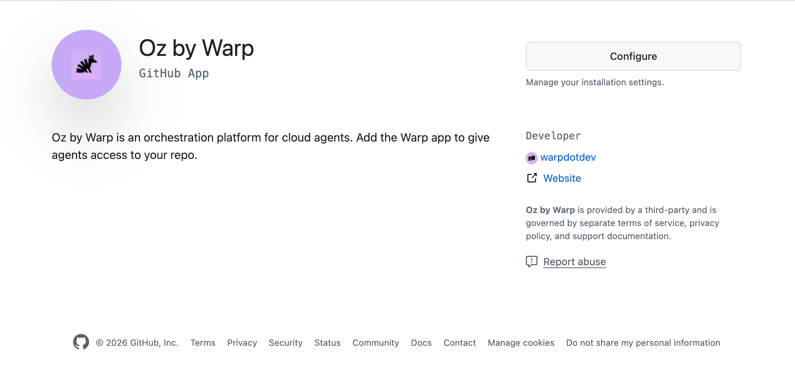
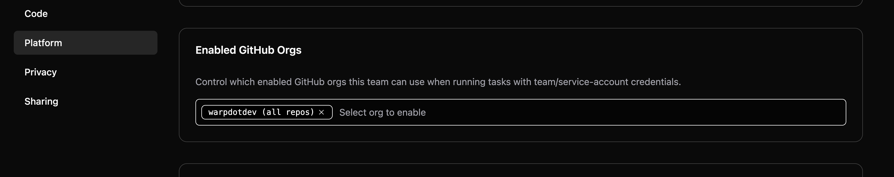

import { VARS } from '@data/vars';

Cloud agent access depends on your plan and team membership. Billing follows the user or team responsible for the run.

For membership, human roles, and shared settings, use [Teams and admin controls](/platform/teams-and-admin-controls/). The requirements below apply to standalone cloud-agent workflows. Factory access and funding have separate guidance.

---

## Overview: individual vs team access

Cloud agents can be used in two ways:

**Individual users** (without a team):
* Can run cloud agents via CLI or API
* Use available [usage balances](/support-and-community/plans-and-billing/credits/) for inference, hosted compute, and platform charges
* Agents run on Warp-hosted infrastructure
* Cannot use integrations (Slack, Linear, Jira, GitHub) or self-hosted agents

**Teams** (users who are part of a [Warp team](/platform/teams-and-admin-controls/)):
* All individual capabilities, plus:
* Can use integrations (Slack, Linear, Jira, and the [GitHub integration](/platform/integrations/github/)) to trigger agents
* Can self-host agents on their own infrastructure (Enterprise only)
* Share team-level configuration (environments, secrets, integrations)
* Teams on Build, Max, or Business need available usage for cloud agents and integrations

---

## Usage requirements

Cloud runs on Warp-hosted compute need eligible usage for compute and, when using Warp-provided models, inference.

* **Self-serve plans** - Use remaining included usage or an eligible purchased balance.
* **Enterprise** - Usage requirements follow your service agreement.

Check the balance for the [user or agent billed for the run](#billing-for-cloud-agent-runs). Spending limits and billing restrictions can block a run even when a balance remains.

## Individual access

Individual users can run cloud agents via the CLI or API without being part of a team.

**How it works:**

* Run agents using `oz agent run-cloud` or the {VARS.WARP_PLATFORM_API}
* Applicable charges draw from your available usage
* Agents execute on Warp-hosted infrastructure

**What you can do:**

* Run cloud agents from CI/CD pipelines
* Trigger agents programmatically via API
* Use personal secrets for authentication

**What requires a team:**

* Integrations (Slack, Linear, Jira, and the [GitHub integration](/platform/integrations/github/))
* Self-hosted agent execution
* Team secrets and shared configuration

---

## Team access

A [Warp team](/platform/teams-and-admin-controls/) groups people and resources so you can manage membership, access, and settings. Teams are available on self-serve plans, including Free, and Enterprise plans.

**What teams enable:**

* **Integrations** - Create Slack, Linear, and Jira integrations that all team members can use, and enable the [GitHub integration](/platform/integrations/github/) so teammates can start agents with an `@warp-agent` mention
* **Shared configuration** - Team-level environments, secrets, and settings
* **Self-hosting** - Run agents on your own infrastructure (Enterprise only)
* **Team visibility** - Shared observability into agent runs and history

Integrations are created at the team level, not per-user. Installing Slack or Linear makes the integration available to the connected Warp team, but does not link every teammate's personal account. Each teammate completes any requested account linking before starting work. For the GitHub integration, a teammate connects their GitHub account before starting a run with **@warp-agent**.

When someone triggers a cloud agent for the first time, Warp may prompt them to grant GitHub authorization so the agent can open pull requests or push branches under their identity. This allows each run to use the correct permissions without requiring additional setup from an admin.

#### Requirements for integrations

Integrations start [cloud runs](/platform/). [Platform usage](/support-and-community/plans-and-billing/platform-credits/) applies to billable agent time; Warp-hosted compute and Warp-provided inference add their respective charges. Enterprise terms follow your contract.

Your team must meet the following requirements to run integrations:

* You must be on a **Build, Max, or Business** plan with [usage purchases](/support-and-community/plans-and-billing/add-on-credits/) enabled, or an eligible **Enterprise** plan.
* The billed user or team must meet the [usage requirements](#usage-requirements).

See [billing for cloud agent runs](#billing-for-cloud-agent-runs) for run attribution and what happens when usage runs out.

:::note
If you're on an Enterprise plan, please reach out to [contact sales](https://www.warp.dev/contact-sales) with any billing questions related to integrations.
:::

### Identity mapping

Warp needs a reliable way to know which person a cloud agent run is acting for, across Warp, Slack, Linear, and GitHub.

* **Slack** - Follow the first-use link to connect your Slack account to your Warp account, then mention the bot again with your request. See [Slack identity and team access](/platform/integrations/slack/#identity-mapping-and-team-access).
* **Linear** - Link your Linear account to the intended Warp account through the first-use prompt. Matching email addresses is not a substitute for this link. Follow [Linking your Linear account](#linking-your-linear-account) below.
* The [GitHub integration](/platform/integrations/github/) maps the GitHub account that mentioned `@warp-agent` to the Warp account that connected it, rather than by email. Until a teammate connects their GitHub account, Warp replies in the thread with a link to connect instead of starting a run. That binding sets run attribution, team ownership, and billing; the run's GitHub access comes from the app installation instead.
* **GitHub authorization for runs acting as you** - Complete any authorization Warp requests before the agent writes pull requests or pushes branches on your behalf. Another teammate's installation does not connect your GitHub account.

Account linking identifies the requester. Repository access also depends on the run's execution identity. Runs acting as a user use that user's GitHub authorization. Agent API key runs with [team GitHub authorization](#team-github-authorization) and GitHub integration runs use GitHub App installation access instead.

#### Linking your Linear account

For the standalone Linear integration:

1. If Warp responds to your first request with an account-linking prompt, open that link and sign in to the intended Warp account.
2. Confirm that account belongs to the Warp team connected to the Linear integration.
3. Return to the original Linear session and reply to Warp to start the run. Linking alone does not resume the initial request.

Complete any additional authorization requested for the run's execution identity.

{/* VERIFY: Test standalone Linear account linking, team validation, and the reply required after linking in production. The standalone handler and account-binding flow were source-checked; factory-specific email resolution was not used as evidence. No live-account test was performed. */}

---

## Team GitHub authorization

By default, cloud agents authenticate with GitHub using the personal token of the user who triggered the run. Team GitHub authorization gives you an alternative: authenticate with the **Warp Factories** GitHub App instead, so agents can clone repositories and open pull requests without relying on any individual's token.

This is useful for fully automated workflows that use an [agent API key](/agents/cli/oz-cli/api-keys/), like CI/CD pipelines, [scheduled agents](/platform/triggers/scheduled-agents/), and SDK-triggered runs, where you want code changes attributed to the GitHub App rather than a specific person.

### How it works

When an agent task is initiated with an agent API key, there is no individual user to authenticate on behalf of. Instead, Warp uses tokens issued by the **Warp Factories** GitHub App installation to authenticate directly with GitHub.

The GitHub App token gives the agent access to the repositories included in the app installation — it can clone repos, create branches, push commits, and open pull requests. During installation, you choose whether the app can access **all repositories** or only **selected repositories** in your GitHub organization, and this controls what agent API key runs can access.

### Setting up team GitHub authorization

1. **Install the Warp Factories GitHub App.** A user with admin permissions on the GitHub organization installs the [Warp Factories](https://github.com/apps/warp-factories) GitHub App. During installation, grant the app access to **all repositories** or **selected repositories** in your org.

   :::note
There are two places you may encounter this installation flow:
   * During the first-time experience for the {VARS.WARP_AUTOMATION_PLATFORM}, when you connect your GitHub account.
   * When you click **Configure access on GitHub** in the repository selector while creating an environment.

   Each installation is scoped to a single GitHub organization or personal account — you can install the app to multiple orgs separately.
:::

   <figure>
   
   <figcaption>Installing the Warp Factories GitHub App.</figcaption>
   </figure>

2. **Enable the GitHub org for your Warp team.** A team admin opens the [Admin Panel](https://app.warp.dev/admin/), confirms the team, and clicks **Platform**. Under **Enabled GitHub Orgs**, add the GitHub organization. This associates the GitHub App installation with your Warp team.

   <figure>
   
   <figcaption>Enabled GitHub Orgs setting in the Admin Panel.</figcaption>
   </figure>

3. **Use an agent API key.** Tasks initiated with an agent API key on the team now use tokens from the GitHub App installation to clone repos and push changes. No individual GitHub authorization is needed. On GitHub, commits and pull requests are opened by the Warp Factories GitHub App rather than any individual user; in the {VARS.DASHBOARD}, the run is attributed to the bound [cloud agent](/platform/agents/).

### How this relates to environments

An [environment](/factories/environments/) is a template for a cloud agent's sandbox — it defines the Docker image, repos, and setup commands, but it does not carry its own GitHub permissions. The same environment can be used by different users or by agent API key runs, and each will authenticate to GitHub independently.

The environment configuration and the **Enabled GitHub Orgs** setting in the Admin Panel serve different purposes:

* **Environment repo list** - "This agent needs repos A, B, and C."
* **Enabled GitHub Orgs** - "This team can use the Warp Factories GitHub App to access repos in this GitHub organization."

### Personal tokens vs. GitHub App tokens

Team GitHub authorization is complementary to the existing personal token flow:

* **Runs acting as a user** - The agent authenticates using that user's personal token. PRs and commits are attributed to that user. Check the configured execution identity for Slack or Linear rather than assuming every trigger acts as its requester.
* **Agent API key runs with GitHub App authorization** - The agent authenticates as the GitHub App installation. On GitHub, PRs and commits are attributed to the Warp Factories GitHub App rather than any individual user. In the {VARS.DASHBOARD}, the run is attributed to the bound [cloud agent](/platform/agents/), which controls run filtering and audit attribution on the Warp side.
* **[GitHub integration](/platform/integrations/github/) runs** (an `@warp-agent` mention on an issue or pull request) - The agent authenticates as the installation that delivered the event, so its repository access and its GitHub attribution match the agent API key flow. In the {VARS.DASHBOARD} the run is still attributed to the teammate who wrote the mention, and their team is billed.

These flows can coexist on the same team. A trigger's requester, execution identity, and repository authorization are related but distinct choices.

:::caution
GitHub App installation tokens are scoped to a single GitHub organization at a time. If your team works across repos in multiple GitHub organizations, the agent can only use the installation token for the organization enabled in the Admin Panel. Repos in other organizations require user-triggered runs with a personal API key.
:::

:::note
To change which repositories the GitHub App can access, edit the app installation in your [GitHub settings](https://github.com/settings/installations).
:::

---

## Data and permissions

#### Slack / Linear

Installing the {VARS.WARP_AUTOMATION_PLATFORM} app gives Warp access to the Slack channels or Linear teams where the app is installed.

**When a run is triggered, Warp receives:**

* The content of the tagged thread or issue
* Relevant surrounding context used to build the agent prompt

Warp stores only the content required for the agent to complete its task. You can message @warp directly, mention it in channels, or tag it on specific issues depending on the integration.

#### GitHub

GitHub access follows the run's configured execution identity:

* **Runs acting as a user** - Use that user's GitHub authorization and repository permissions.
* **GitHub App runs** - Use the repositories selected for the app installation, rather than the requester's personal token.

An environment's repository list specifies what to check out. It does not grant GitHub permissions. See [Personal tokens vs. GitHub App tokens](#personal-tokens-vs-github-app-tokens) before choosing credentials for a workflow.

Runs triggered by an `@warp-agent` mention through the [GitHub integration](/platform/integrations/github/) use installation access. Warp receives the content of the issue, pull request, or review thread that carried the mention, including the recent comments and the diff of a commented file, and the run authenticates with the GitHub App installation that delivered the event. Cloning, commits, branches, pull requests, and status comments all use that installation's access rather than the mentioning user's. The repository that triggered the mention is cloned alongside any repositories in the configured environment, and only the repositories that installation covers are available to the agent.

---

## Billing for cloud agent runs

Cloud agent runs consume usage dollars or credits, depending on your plan. They also incur [platform usage](/support-and-community/plans-and-billing/platform-credits/) for billable agent time, plus charges for Warp-hosted compute and Warp-provided inference.

For factory runs, use the [shared funding requirements](/support-and-community/plans-and-billing/plans-pricing-refunds/#funding-factory-runs). On self-serve team plans, standalone cloud-run billing follows the trigger:

* **Runs acting as you** - Use your eligible included and purchased usage on the team. See [team purchase balances](/support-and-community/plans-and-billing/add-on-credits/#tracking-purchases-and-team-usage) for shared and member-specific balances.
* **Agent API key runs** - Use eligible shared team usage, not the team owner's personal included allowance. Cloud agents don't receive a separate per-seat allowance.
* **User-created schedules** - Use the creator's eligible usage by default. If configured to run as a cloud agent, the schedule uses shared team usage instead.

Enterprise availability and billing follow your contract. Dedicated cloud allowances can be used before general-purpose balances. If no usable balance remains, a run can fail with an [insufficient credits](/factories/api-and-sdk/troubleshooting/errors/insufficient-credits/) error. Repeated unattended runs can trigger purchases subject to the team's [spend controls](/support-and-community/plans-and-billing/add-on-credits/#configuring-a-monthly-spend-limit). Contact your account manager with questions about your team's cloud run billing.

For automated workflows that write to repositories, configure [team GitHub authorization](#team-github-authorization), or use a [personal API key](/agents/cli/oz-cli/api-keys/) to act as an individual user.

#### Who configures triggers and workflows

All triggers and instructions used by cloud agents are defined and controlled by your team’s authorized users.

* Admins or other authorized users decide which triggers exist, when they fire, and what the agent should do in response.
* Trigger behavior and the agent’s instructions (system prompts, workflow steps, repo access, etc.) are fully managed by your admins or other designated users.

#### Staying aware of usage

Review your triggers and available balance before relying on unattended runs. In the Warp app, open **Settings** > **Billing and usage** for usage and purchase controls.

---

## Troubleshooting

If a cloud agent or integration run fails with an error code, use the error reference to narrow the fix:

* **Missing GitHub or external authorization** - See [`external_authentication_required`](/factories/api-and-sdk/troubleshooting/errors/external-authentication-required/) when a user needs to authorize GitHub, Slack, or Linear before a run can continue.
* **Insufficient repo permissions** - See [`not_authorized`](/factories/api-and-sdk/troubleshooting/errors/not-authorized/) when the triggering user or GitHub App lacks access to the repo the agent needs.
* **Usage or spend caps block a run** - See [`insufficient_credits`](/factories/api-and-sdk/troubleshooting/errors/insufficient-credits/) or [`budget_exceeded`](/factories/api-and-sdk/troubleshooting/errors/budget-exceeded/) when the billed account has no usable balance or reached a configured limit.

---

## Related pages

* [Purchasing additional usage](/support-and-community/plans-and-billing/add-on-credits/) - Shared balances, auto-reload, and purchase limits
* [Platform usage](/support-and-community/plans-and-billing/platform-credits/) - Agent-hour billing for cloud runs
* [Usage and billing](/support-and-community/plans-and-billing/credits/) - Charge components and billing units
